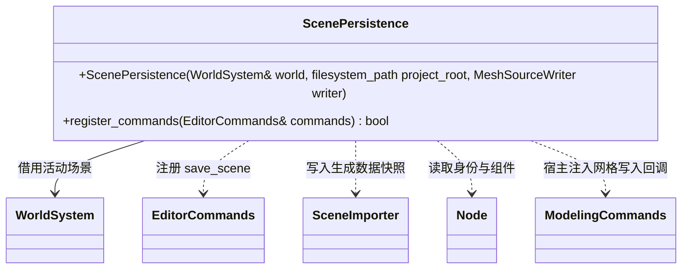

# 活动场景保存

[类图索引](../../class-diagrams/index.md)

`MeshSourceWriter = std::function<bool(const Node&, const std::filesystem::path&, std::string&)>`。
保存由编辑器驱动：以 FlatBuffers 原生数据快照记录层级、组件、启用状态及活动相机，
把当前 Mesh 与所有材质槽覆盖值写入场景相邻资源目录；邻接 meta 复用资源管线身份规则。
保存不改变运行场景、不导入、不修改运行目录；完成后由调用方停止、同步资源并重启项目。
失败恢复已覆盖的源文件与 meta；回滚失败保留 cache 暂存备份并返回其位置；成功才发布场景描述。`save_scene` 为非撤销文件命令。
运行时只读取已有 Scene/Node/Component 和资源接口，MCP 只传递命令及回执。
建模插件通过回调保存可编辑源；加载项目场景时依据 mesh 路径恢复可编辑源和编辑器身份。
