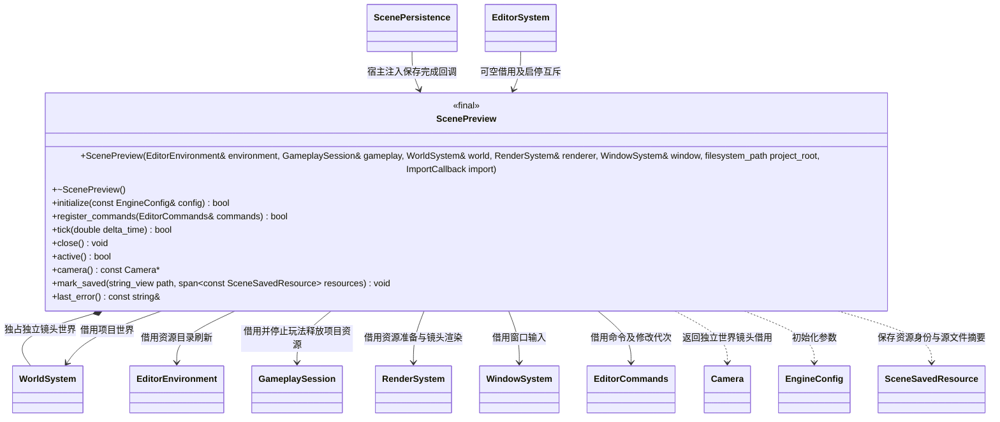

# 场景预览

[类图索引](../../class-diagrams/index.md) · [编辑器命令](editor-commands.md)

预览是编辑器调用方流程。项目场景仍由运行宿主的 WorldSystem 保存，独立镜头位于编辑器拥有的第二个 WorldSystem；镜头不会进入项目节点查询、保存或资源依赖。预览帧只处理窗口、编辑命令、源文件增量导入和渲染，不启动 Gameplay，不推进物理、动画或角色控制器。

- `ImportCallback = std::function<bool(std::string&)>`，由宿主注入已登记导入器的管线增量构建；预览不引用具体插件。所有借用与回调依赖必须覆盖预览生命周期；命令服务必须先于预览销毁。
- `initialize` 初始化仅含通用场景组件的镜头世界，并监听项目 assets 与 settings。efsw 回调只记录变化，编辑器主线程在最后一次变更 500 ms 后执行增量导入；目录版本每 250 ms 检查一次。导入失败保留现有画面，等待后续修改或显式刷新。
- 注册 `open_scene_preview(path, camera?)`、`close_scene_preview()`、`get_scene_preview()`、`set_preview_camera(position?, rotation?, speed?)`、`refresh_scene_preview(discardChanges?)`。镜头初始姿态取场景相机世界姿态，无场景相机则使用 `(0,2,5)`；不改项目的 active_camera。
- 独立镜头持续借用给 RenderSystem 的单次 prepare/render 调用，核心不保存编辑器状态。按住右键时 WASD 前后左右、Q/E 升降，Shift 加速；MCP 可直接设置世界坐标、角度及速度。
- `EditorCommands::mutation_revision()` 在影响场景的修改、批量、撤销及重做成功后递增；曝光、环境光等组件参数也属于场景编辑。预览保存自己的检查点，存在未保存编辑时外部资源变更只置 `reloadPending`，保留当前节点；`refresh_scene_preview(discardChanges=true)` 才丢弃修改。
- 成功保存当前预览路径后，`mark_saved` 记录当时的修改代次及本批实际发布资源的 GUID、源文件与 meta 摘要。下一次增量导入成功，确认目录仅含这些资源的新增或修改，且源文件及 meta 内容仍匹配，再提交新目录；保留当前场景、隐藏镜头和撤销/重做历史，不重新加载场景。多个连续保存合并最新摘要，无内容变更的保存不制造新目录。导入完成不会再次更新保存代次，因此保存后的编辑或撤销仍保持未保存状态。
- 自保存识别不暂停文件监听、不跳过任意下一次更新。其他资源改动、资源删除、同一源文件或 meta 的并行修改均按外部更新处理；未保存编辑继续受到保护。打开、显式刷新或关闭预览仍清理旧场景历史。
- 关闭预览或启动项目会释放项目 GPU/CPU 资源、独立镜头节点和撤销历史；返回空白后才进入后续玩法流程。监听线程在预览对象析构前停止。清理支持重复调用，错误通过返回值和 last_error 表达。
