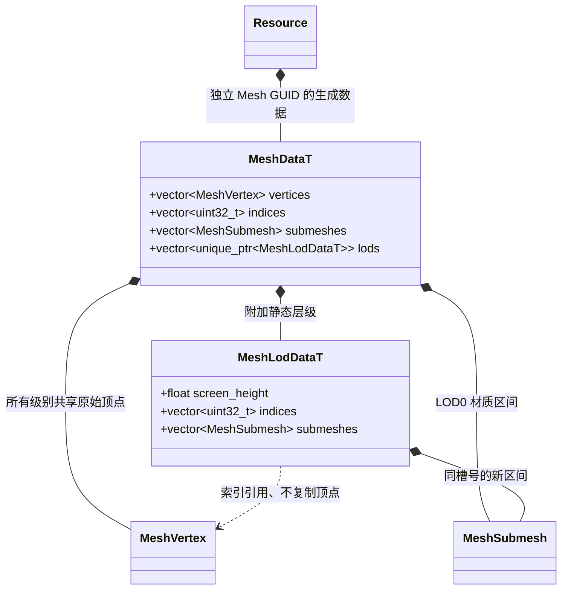
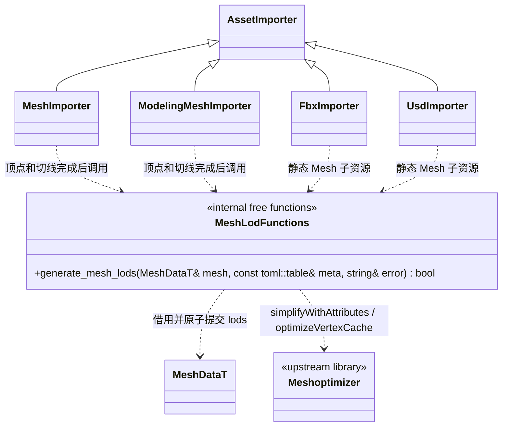
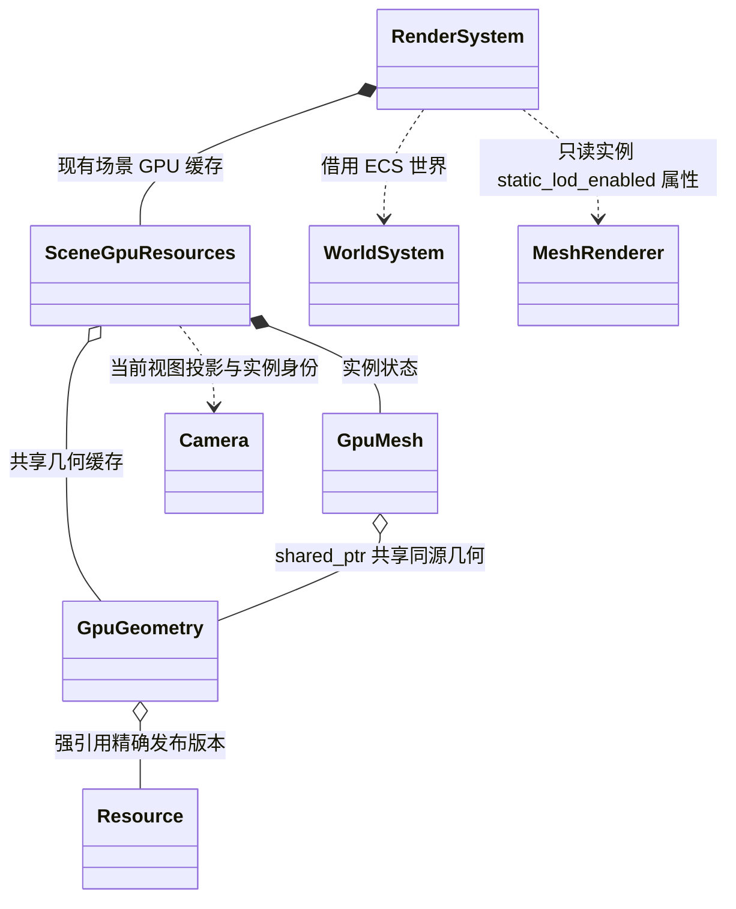

# 静态模型 LOD：评审契约

状态：最小契约已评审，正在实现与集成验证。

[详细计划](../static-model-lod-plan.md) · [现有模型资源](../../runtime/class-diagrams/model-resources.md)

本次不新增系统或 Manager。运行时持久数据由 Mesh Schema 生成；
生成只在编辑器离线阶段调用现有 meshoptimizer。MeshRenderer、Model 与资源图的公开方法不变。

## 同一 Mesh 内的渲染拓扑



`indices/submeshes` 现有字段仍为 LOD0。没有 `lods` 的资源保持原语义。
`MeshLodDataT` 是 Schema 表生成的数据，不是拥有行为的新包装类。
表只保存同一 Mesh 的拓扑选择，不为每级创建同源资源加载依赖。

## 离线生成



`MeshLodFunctions` 仅为图中标识自由函数集合，不对应 C++ class。
声明和实现属于 `src/engine/editor/mesh/mesh_lods.{hpp,cpp}`，不进入公开头。
现有 AssetPipelineSystem 继续调度导入任务、分配身份和原子发布，无新 LOD 作业框架。
函数失败时不改变传入 mesh 的既有 LOD，错误由返回值与 error 表达。

## GPU 所有权与每视图选择



`MeshRenderer::static_lod_enabled()` / `set_static_lod_enabled(bool)` 及生成字段见
[组件类图](../../runtime/class-diagrams/component.md)。开关保存在场景/预制体的 MeshRendererData，
不建立独立的 Render 全局配置；诊断叠加仅通过 MCP 临时控制。
新增内部状态：

- GpuGeometry 拥有一份原始顶点缓冲、LOD0 索引缓冲及各附加级索引缓冲；
  各级材质区间以生成资源为源，GPU 释放仍由已有析构/释放流程执行。
- SceneGpuResources 的私有缓存以场景代次、观察者身份、反射面身份（适用时）、
  MeshRenderer 实例身份和资源修订为键，保存前一级与本帧选层数字；无 ECS 指针借用跨帧。
- 选择函数留在渲染实现内；主视图 depth/surface/opaque 同层，反射独立，
  阴影与光照烘焙首期固定 LOD0。关闭开关及生命周期变化清理历史。

本图不为私有选择算法新增可调用的核心接口，不在 MeshRenderer 增加每帧选层或 GUID 替换方法。

## 编辑器与 MCP 契约

源级导入属性在已有资源命令所属位置增加两项命令，协议只作映射：

| 命令 | 输入 | 输出与副作用 |
| --- | --- | --- |
| `get_mesh_lod_import` | assets 相对源路径 `path` | 保存的 lod 设置、各 Mesh GUID 和实际层数/三角形数/跳过原因 |
| `set_mesh_lod_import` | `path`、`enabled`、`triangleRatios`、`screenHeights`、`maxRelativeError` | 校验、原子保存 `.meta` 的 lod 表；参数真正变化后走现有增量导入并返回该管线实际完成状态与 revision |

保存只更新既有 `.meta` 的目标表，保留主 GUID、subresources GUID 和无关字段；
MCP 不直接写 gen 或调用 meshoptimizer。运行开关的 MCP 使用 MeshRenderer 组件属性编辑入口，
不增加第二个 `set_lod_enabled` 全局工具。

脚本通过 MeshRenderer 的已实现属性绑定开启/关闭本实例 LOD；
实际按视图选择完全由渲染器执行，不在 TS 逐帧选择层级。

资源命令登记位于 `include/engine/editor/asset_pipeline/mesh_lod_commands.hpp`：

```cpp
[[nodiscard]] bool register_mesh_lod_commands(EditorCommands& commands,
                                              AssetPipelineSystem& pipeline,
                                              std::filesystem::path project_root);
```

回调保存项目路径，借用 pipeline；宿主保证管线存活到 commands 销毁。
命令只在启用资源管线的编辑器宿主装配，运行时核心不依赖该登记函数。
