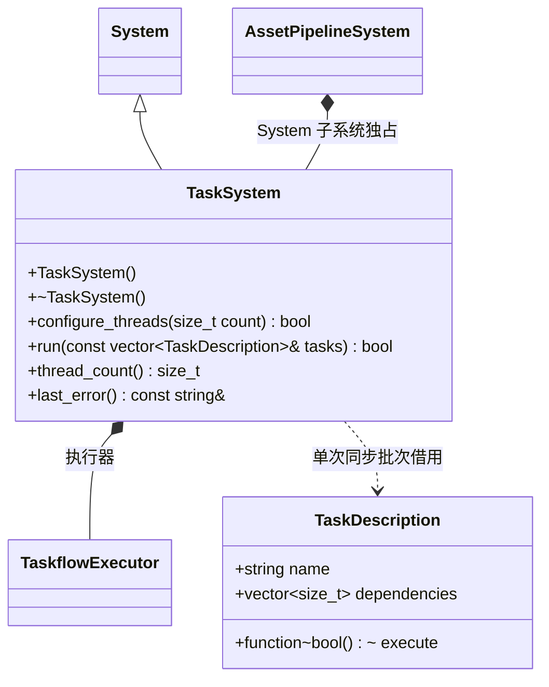

# 编辑器任务系统

[类图索引](../../class-diagrams/index.md)

TaskSystem 是独立编辑器模块，只调度任务及依赖，不理解资源。默认 4 个工作线程；项目 `settings/import.toml` 的 `import_threads` 每次构建读取，范围 1–64。仅空闲时可重新配置；任务批次返回前全部工作完成，依赖失败的任务不执行。拒绝缺失任务函数、越界依赖、重复依赖和环。资源管线通过 System 子系统生命周期拥有它；关闭时等待执行器，之后释放。

宿主按顺序调用初始化、同步批次和关闭，不在另一线程同时销毁系统；`last_error()` 返回的借用仅在下一次操作前有效。
