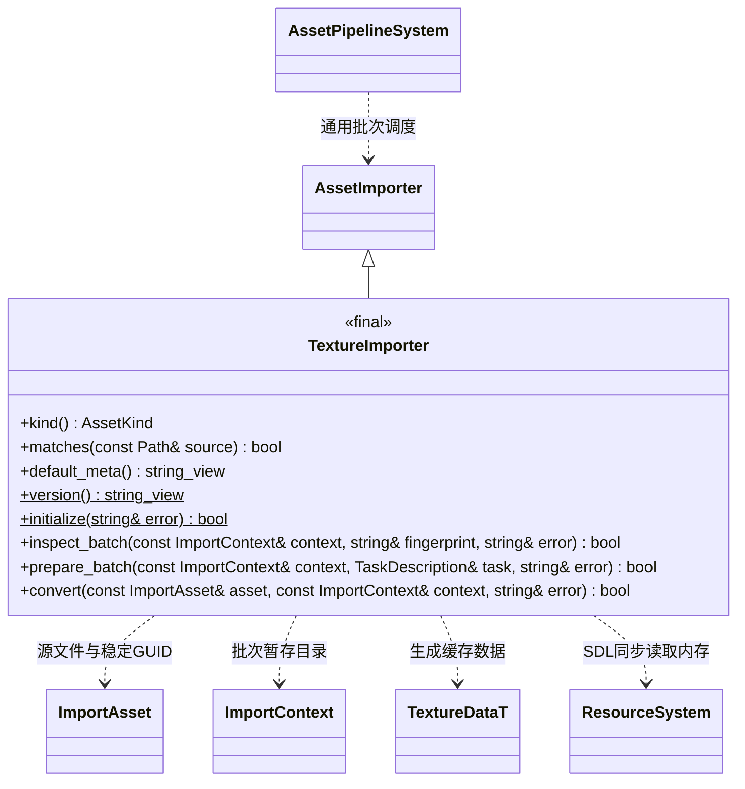

# 贴图导入

[类图索引](../../class-diagrams/index.md) · [资源管线](asset-pipeline-system.md)

PNG、JPG、JPEG 文件作为贴图导入。所有导入设置保存在同名 `.meta` 的 `[texture]` 表；资源源文件、材质及项目设置不复制这些参数。新 meta 写入 UASTC 默认设置；旧图片 `importer = "source"` 必须显式改为 `texture` 并保留原 GUID。

`format` 为 `auto/rgba8/bc7/astc4x4/etc2`，决定运行时转码格式；`compression` 为 `uastc/etc1s`。ETC1S 的 `quality` 范围 1..255、默认 128；UASTC 的 `rdo_quality_scalar` 范围 0.001..50、默认 1，直接采用上游 RDO lambda，越小失真越少。两种质量字段只允许出现在对应压缩模式中，切换模式时相应替换字段。`compression_level` 默认 2，UASTC 范围 0..4，ETC1S 范围 0..5。`srgb`、`mipmaps` 默认 true。未知字段、错误类型和超范围值使整批导入失败，保留上一批缓存。

单张图片尺寸最多 8192×8192，像素总数最多 16777216；解码前读取图片头验证上限。输出支持单图二维纹理，完整 mip 链在导入时生成；显式目标格式由渲染器验证设备支持情况。

仅当增量检查确认本批有贴图需要重新转换时，协调线程才在 Taskflow 下发前初始化编码器；初始化失败清理暂存产物并返回失败。仅查询 MCP、没有图片的构建或全部图片命中缓存时均不初始化编码器。每个 Taskflow 任务使用单线程 BasisU job pool，整体导入并行度由项目 `import_threads` 控制。源文件经 SDL 读入内存，PNG/JPEG 使用 BasisU 自带解码器，避免平台路径编码差异；编码输出不写 stdout，不干扰 MCP 协议。

缓存携带生成 `TextureDataT`、完整 mip 链与 BasisU 数据，经公共实体封装后保存为 `cache/gen/<完整GUID>`；不追加后缀。生成设置、源内容、Schema 与 BasisU 版本共同参与增量键。材质的具名纹理引用进入构建及运行依赖，打包与同步沿用统一 catalog。

实现位于 `src/engine/editor/asset_pipeline/importers/texture_importer.cpp`，通过[导入器注册表](asset-importers.md)选择。kind/default_meta/version 为 noexcept；除 inspect_batch 外的实例方法均为 const。prepare_batch 在协调线程初始化 BasisU，不提供额外任务；后续转换按资源并行。版本与 texture.fbs 指纹只影响贴图及其构建依赖，不使无关资源因编码库升级全部失效。
