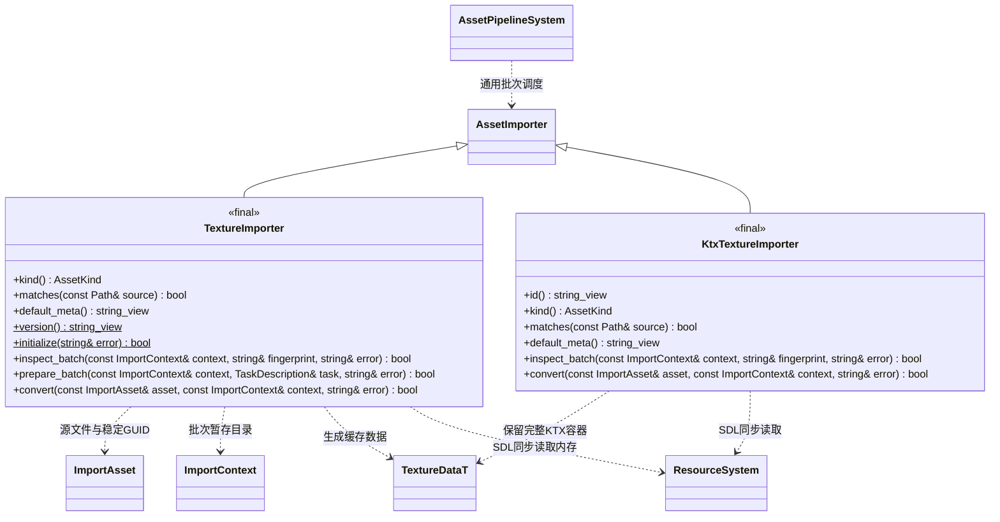
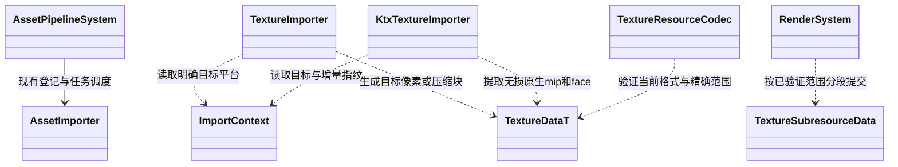

# 贴图导入

[类图索引](../../class-diagrams/index.md) · [资源管线](asset-pipeline-system.md)

**2026-11-07：目标平台原生载荷选项及运行格式 2 已实现。** 导入器公开方法保持，变更在内部转换和生成 Schema。普通图片显式选择 basis / native，默认 basis；KTX 源统一生成 native，不保留旧容器运行分支。

PNG、JPG、JPEG、TGA、QOI、HDR、EXR 文件作为贴图导入。所有导入设置保存在同名 `.meta` 的 `[texture]` 表；资源源文件、材质及项目设置不复制这些参数。新 meta 写入 UASTC 默认设置；srgb 省略时按 LDR/HDR 分别取 true/false，已有显式值保持有效；旧图片 `importer = "source"` 必须显式改为 `texture` 并保留原 GUID。

LDR 的 `format` 为 `auto/rgba8/bc7/astc4x4/etc2`，决定最终 GPU 格式；storage=native 时 auto 在目标平台导入时解析，storage=basis 时保留已有运行时目标选择。HDR 只允许 `auto/rgba16f` 并保持半浮点。`compression` 为 `uastc/etc1s`，native 使用其离线中间结果，basis 保存该编码。ETC1S 的 `quality` 范围 1..255、默认 128；UASTC LDR 的 `rdo_quality_scalar` 范围 0.001..50、默认 1，直接采用上游 RDO lambda，越小失真越少。两种质量字段只允许出现在对应压缩模式中，切换模式时相应替换字段。`compression_level` 默认 2，UASTC 范围 0..4，ETC1S 范围 0..6。`srgb` 对 LDR 默认 true、HDR 默认 false，`mipmaps` 默认 true。HDR 不允许 srgb=true、ETC1S 或 LDR RDO 设置。未知字段、错误类型和超范围值使整批导入失败，保留上一批缓存。

单张图片尺寸最多 8192×8192，像素总数最多 16777216；解码前读取图片头验证上限。输出支持单图二维纹理，完整 mip 链在导入时生成；显式目标格式由渲染器验证设备支持情况。

仅当增量检查确认本批有贴图需要重新转换时，协调线程才在 oneTBB 下发前初始化编码器；初始化失败清理暂存产物并返回失败。仅查询 MCP、没有图片的构建或全部图片命中缓存时均不初始化编码器。每个 oneTBB 任务使用单线程 BasisU job pool，整体导入并行度由项目 `import_threads` 控制。源文件经 SDL 读入内存，所有支持的源格式使用 BasisU 自带解码器（EXR 使用随库提供的 TinyEXR），避免平台路径编码差异；编码输出不写 stdout，不干扰 MCP 协议。

缓存携带生成 `TextureDataT` 和明确 encoding：basis 保存完整编码，native 保存完整 mip / face 范围和最终 GPU 像素 / 块。同一资源只携带所选的一份载荷，经公共实体封装后保存为 `cache/gen/<完整GUID>`，不追加后缀。生成设置、storage、目标平台、源内容、Schema、BasisU / bimg 版本及平台格式映射版本共同参与增量键。native 的中间 Basis 字节不进入运行包。材质的具名纹理引用进入构建及运行依赖，打包与同步沿用统一 catalog。

实现位于 `src/engine/editor/asset_pipeline/importers/texture_importer.cpp`，通过[导入器注册表](asset-importers.md)选择。kind/default_meta/version 为 noexcept；除 inspect_batch 外的实例方法均为 const。prepare_batch 在协调线程初始化 BasisU，不提供额外任务；后续转换按资源并行。版本与 texture.fbs 指纹只影响贴图及其构建依赖，不使无关资源因编码库升级全部失效。

## HDR 烘焙纹理

`.ktx` 由独立 `KtxTextureImporter` 处理，meta 的 `importer = "texture_ktx"`，运行类型仍为 texture。只接入小端 KTX1 的 RGBA16F、RG16F，支持二维和六面立方体，不接入数组或三维纹理。编辑器验证容器并提取完整 mip / face 字节，生成统一 TextureData 格式 2；不重压缩，不携带运行时 KTX 容器分支，源文件保持原样。

新 meta 默认 `[texture] format="auto"; compression="none"; srgb=false`。format 可显式指定 rgba16f/rg16f 且必须与容器一致；这些 HDR 资源必须保持线性。mipmaps 可省略表示保留源链，显式值须与源是否包含多级一致。导入不重算 GGX mip，不压缩 HDR；BasisU 的 quality/compression_level/rdo_quality_scalar 等设置在 KTX 中报错。

容器验证先检查完整标识、整数边界、1/6 面数、每个 face/mip 字节范围与精确总长度，再交给 bimg 交叉验证。接受单 mip 或完整链；cubemap 必须正方形。单个 KTX 最多 63 MiB，为 64 MiB 的运行资源实体上限预留封装空间；RGBA16F 全 mip cubemap 的推荐最大面尺寸为 512。尺寸、面数、mip、格式与生成元数据必须完全一致，截断和错误头不能以缓存命中绕过验证。

## BasisU HDR 源图片

HDR/EXR 复用同一个 TextureImporter，生成 TextureData 格式 2：format=rgba16f、srgb=false。basis 保存上游 UASTC HDR 4×4 编码，native 在编辑器进一步转成 RGBA16F mip 字节；尺寸在解码前检查，EXR 用 TinyEXR 头信息核对。单部件普通 EXR 可用，deep/多部件不接入。RGB 必须有限且在 [0, 65216]，alpha 必须为 1；单通道 Y 解释为不透明亮度。不符合条件会返回错误，避免上游自动缩放、夹值或丢弃透明度。完整 mip 链与辐亮度由同一资源管线生成。

渲染器对 native 直接组织上传，对 basis 在自身任务域转码，并按最终 RGBA16F 字节占用预算，不把 HDR 回退成 RGBA8；IBL 输入同样保持半浮点。UI 明确拒绝 HDR，模型材质及特效复用普通渲染贴图入口。预过滤 IBL、cube、RG16F LUT 和要求无损的数据仍从 KTX 源导入，运行消费 native 载荷。

## 目标平台产物

字段只在[运行数据模型](../../runtime/class-diagrams/scene-data.md#贴图)定义。无新增 TextureCompiler / PlatformAssetManager；转换步骤留在已有导入器中，AssetBuildSystem 只调用目标平台导入并发布结果。

- storage 只接受 basis / native，普通图片省略时为 basis；KTX 源只接受 native。不是版本兼容开关，不会在运行时因字段缺失或设备不支持而切换策略。
- native 的 auto 目标映射：Windows / Linux 为 BC7，macOS / iOS 为 ASTC4x4，Android 为 ETC2；HDR 为 RGBA16F。显式 format 优先。此映射是包的设备能力要求，需在实施时验证目标平台，不能假定所有设备均支持，也不在运行时切换后备载荷。basis 保持现有能力选择，不受该离线映射强制改变。
- 每次 gen 仍只保存一个目标平台；跨平台构建沿用现有停止运行、导入、打包与恢复宿主平台的流程。平台产物不增加 GUID、不产生新的虚拟依赖；manifest / catalog 与字节指纹一起更新。
- 无损 KTX 源保留准确的 RG16F / RGBA16F、面序和 mip 内容。普通图片完整 mip 与中间编码质量保持现有设置，最终格式变化的画面差异须按相同 meta 验证，不能把“无需运行时转码”说成编码效果完全相同。
- 文件 / 内存纹理、内置纹理、UI、影片帧之外的原生贴图扩展和测试夹具一次升级到同一个 TextureData；运行 codec 不接收旧 rgba8 / ktx encoding 或旧格式 1。影片 YUV 帧不是 TextureData，不改变播放器契约。
- 选择 native 可能增加缓存、运行包及 I/O 体积，尤其 HDR；必须同时记录启动 CPU 时间、实际读取字节、内存和包大小，再决定项目采用范围。现有单项尺寸 / 字节上限保留，native 超限在导入阶段明确失败，由调用方显式选择 basis 或调整资源，本批不自动降级、扩大上限或改变未选择 native 的资源支持范围。
