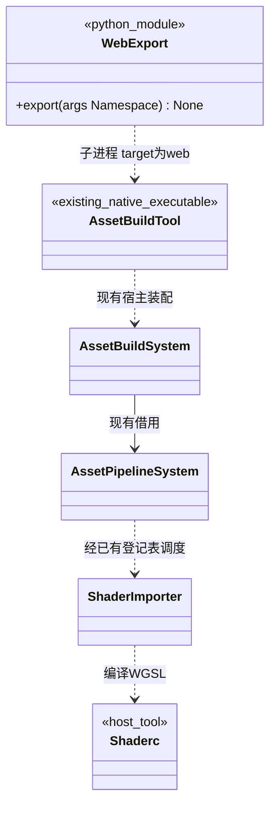

# Web 运行产物导出

浏览器游戏的构建与导出复用现有资源管线；编辑器仍在原生桌面运行。构建和预览命令见[构建指南](../../building.md#webgpu-游戏导出)。

[类图索引](../../class-diagrams/index.md) · [Web 运行宿主](../../runtime/class-diagrams/web-host.md) · [资源构建系统](../../plugins/editor/class-diagrams/asset-build-system.md) · [逐类型资源导入](asset-importers.md)

## 复用关系



WebExport 表示 `platforms/web/export.py` 模块，不是 C++ 类或 System；图中的 Namespace 为既有 argparse 参数对象。其他节点均为现有实现或第三方工具，方法只在所属类图定义。

导出模块只保留一个命令入口 `export(args) -> None`：成功返回，失败按既有 Python 导出工具约定报告错误并保留上一份完整产物。平台选项、模板和包文件选择放在 `platforms/web/`，复用 `scripts/artifact_output.py`、`scripts/resource_catalog.py` 和 `scripts/runtime_settings.py` 的通用能力。

## 目标及数据契约

| 现有能力 | 当前取值或行为 |
| --- | --- |
| AssetPipelineSystem.build_assets 的 target_platform | 接受 web；方法签名保持不变 |
| AssetBuildSystem.build 的 target_platform | 接受 web；沿用实际依赖闭包、包文件与原子发布 |
| ShaderImporter 与内置 Shader 的目标选择 | web 映射 WGSL，顶点／片元／计算及实例化变体保持同一目标 |
| ResourceCatalog 的平台校验 | 接受 web；不新增目录模型或资源格式 |
| 运行设置导出 | 合并 common 与 platform.web，仍生成既有 runtime.json |
| 宿主 shaderc | 启用匹配当前 bgfx API 的 Tint/WGSL 能力；工具在桌面运行 |

运行包只包含编译后的 Shader、脚本及其他资源。源 TOML、源 meta、SQLite、离线导入器、转换前文件和项目源目录不分发。场景、材质、Mesh、脚本沿用当前 Schema 和资源加载接口；不增加 Web 材质种类、Web ShaderImporter 或 Web Scene。

宿主工具和目标依赖分开构建：桌面 shaderc/Tint 产生 WGSL；Emscripten 只编译运行时及所选运行插件，通过 Emdawnwebgpu 接浏览器设备，不给网页加载桌面 Dawn 动态库。需要更新的上游能力继续在 vcpkg 清单／固定版本与 third_party 补丁中声明。

## 导出和编辑器缓存边界

项目继续只保留 `cache/gen/<完整GUID>` 一份导入缓存。Web 导出复用[资源管线的目标切换互斥契约](asset-pipeline-system.md#目标切换互斥)：检查位于共享管线，编辑器在首次导入前登记自己的原生目标，CLI、MCP 和直接 API 调用均不能绕过。

- 跨平台导入前须关闭同项目原生编辑器，idle／preview 也属于活租约；导出器不替用户停止编辑器。
- Web 目标按工具及平台指纹重建必要 GUID 缓存，默认包输出为 `cache/build/web/`，不在 gen 下增加平台子目录。下一次原生编辑器启动按自身目标重建必要缓存。
- 不提供编辑器保持打开时切换 Web 缓存的通路，不建立影子项目或多平台缓存管理类。目录所有者、锁顺序和租约规则只在上述资源管线图维护。
- 导入和打包分别持有现有项目锁，阶段之间复核快照；竞争时允许明确返回忙或版本变化，不混用缓存，不自动重复导入。完成的 Web 运行包独立于后续 cache/gen 的目标变化。

## 包输出

输出位于 `output/web/wasm32/<debug|release>/runtime/<product>/`，由 Emscripten 与本机导出工具生成，例如：

```text
index.html
bootstrap.mjs
engine.mjs
engine.wasm
<必要的 Emscripten worker 文件>
settings/runtime.json
assets/catalog.bin
assets/packs/...
assets/gen/...
```

packs 与 gen 按所选清单实际输出，不要求同时出现。worker 文件由所选固定 Emscripten 构建生成，不在设计中假定某个版本必定使用特定文件名。Web Bootstrap 使用的目录访问器从同一个 FlatBuffers Schema 生成，不复制目录数据结构。

- 复用既有资产快照复制和实体校验，再在 staging 目录加入 Wasm、JS、网页模板和运行设置，全部成功后原子替换输出；失败不覆盖上一份可运行目录。
- 运行资源保持独立，不能嵌入 Wasm 再由启动代码解压；网页启动器只将独立载体下载到虚拟文件系统。
- 发布需要安全上下文；首版 pthread 包还要求正确的 COOP／COEP 和 Wasm 等文件 MIME。服务器部署说明属于产物交付文档，不能把这些响应头错误当成场景加载卡住。
- 导出器核对所选运行插件、目标平台、工具版本和构建产物一致性，不以 shaderc 帮助中出现 wgsl 或 find_package 成功代替实际编译。

## 验证范围

按 [Web 宿主验证门槛](../../runtime/class-diagrams/web-host.md#验证边界)验证一个现有公开范例的真实浏览器闭环；同时检查编辑器原生目标不变、跨平台导出拒绝活跃编辑器、失败保留旧包、运行包无编辑器依赖和测试注入入口。首版成功不代表所有插件、浏览器或复杂场景均已验收。

内置 Shader 的普通、实例化和 surface 变体均按目标重新编译；水面保持自身片元程序。链接成功后生成包含平台、产品、插件、工具链和模块校验值的回执，导出器据此拒绝陈旧或不匹配的运行文件。
