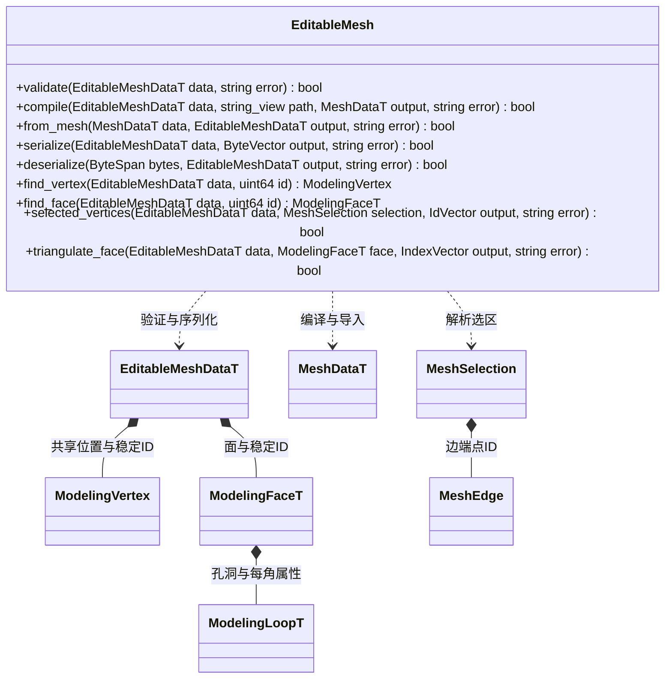

# 可编辑多边形模型

持久数据只由 `include/schemas/runtime/modeling.fbs` 生成。模型区分共享几何顶点与每面角 UV、颜色，支持多边形与洞、稳定身份、多材质和平滑组。核心不依赖编辑器或 MCP。

所有函数为静态普通 C++ 接口。输入借用，输出由调用方拥有；失败清空输出并返回错误。验证限制有限数值、唯一身份、合法环、共面与无自交；编译采用 Earcut 三角化并保留每角 UV、材质和平滑组。空模型可编辑与保存，但不能编译成渲染网格。

`from_mesh` 按位置建立共享顶点，并保持每角 UV、颜色和材质槽。平滑组由共享边两端的输入法线一致性恢复，后续编译按面面积重算法线；硬边不因位置焊接而自动平滑。任意人工指定法线不作为独立持久数据逐值保留。

验证和编译每次建立一次顶点身份索引，多个面共享该索引；不向 Node 或运行时渲染网格加入编辑拓扑缓存。
