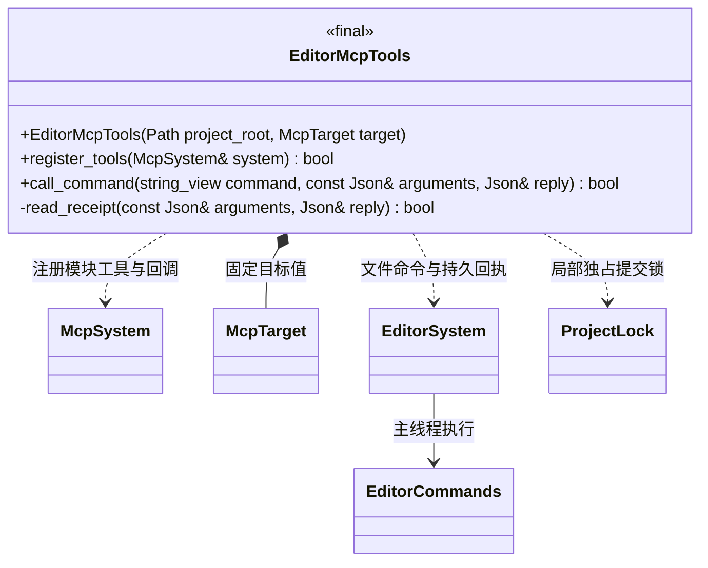

# 编辑器 MCP 工具模块

[类图索引](../../class-diagrams/index.md) · [编辑器命令](../../editor/class-diagrams/editor-commands.md)

模块向 MCP 注册场景查询、组件修改、批量编辑、撤销、重做和回执查询。组件本身提供普通 C++ 接口；MCP 客户端通过文件通道提交命令，编辑器主线程执行。

- 模块须存活到 McpSystem 关闭。工具在初始化前注册，Android 目标保持现有工具集合。
- `register_tools` 成功后，其他编辑器业务模块可在自己的工具回调中借用 `call_command`，复用固定目标的主线程命令通道；不复制客户端，也不修改此模块的工具列表。参数和结果均为 JSON 对象，业务失败保留原回执。直接调用同样执行目标、会话与请求检查。
- 提交前核对项目、编辑器会话和心跳；持有进程锁直至收到回执或等待超时。当前会话尚未完成的请求不能被覆盖。
- 请求与回执包含 `session`、`projectRoot`、`requestId`、`command`。单文件不超过 1 MiB，标识符仅使用 ASCII 字母、数字、下划线和连字符。
- 编辑器先持久化 `editor-receipts/<session>/<requestId>.json`，再发布最新回执。超时返回原请求身份及 `activation=pending`，可用 `get_editor_receipt` 查明结果；超时不表示取消。
- `get_editor_receipt` 可查询已退出会话的回执。查询成功与原操作是否成功分别由工具返回状态及回执 `success` 表示。
- MCP 的 `execute_batch` 对应编辑器命令 `batch`，回执记录实际命令名。每批最多 64 次修改，一批只生成一条撤销记录。
- 批次中的命令名由编辑器注册表解析，只接受已注册的可撤销修改，不在 MCP 固定枚举业务名称；新增模块的修改可共用批次、回滚与历史。

渲染编辑命令增加 `set_camera`、`set_material_texture`；材质命令接受可选 `slot`（默认 0），灯光命令接受类型、范围和聚光半角。相机和灯光编辑仅回滚被请求的字段；贴图编辑记录前后资源身份和版本；撤销重新按路径加载，资源已变更时拒绝旧操作，历史不阻止停止项目或热重载释放资源。所有命令继续走同一主线程事务与撤销栈。场景查询包含投影、灯光类型、全部材质槽及具名贴图。
