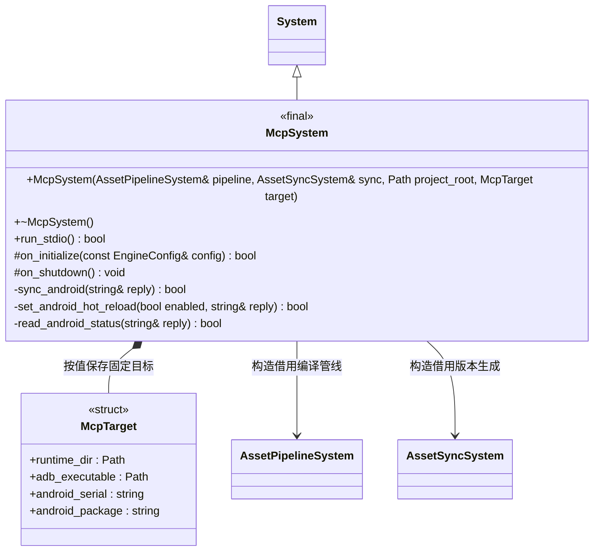
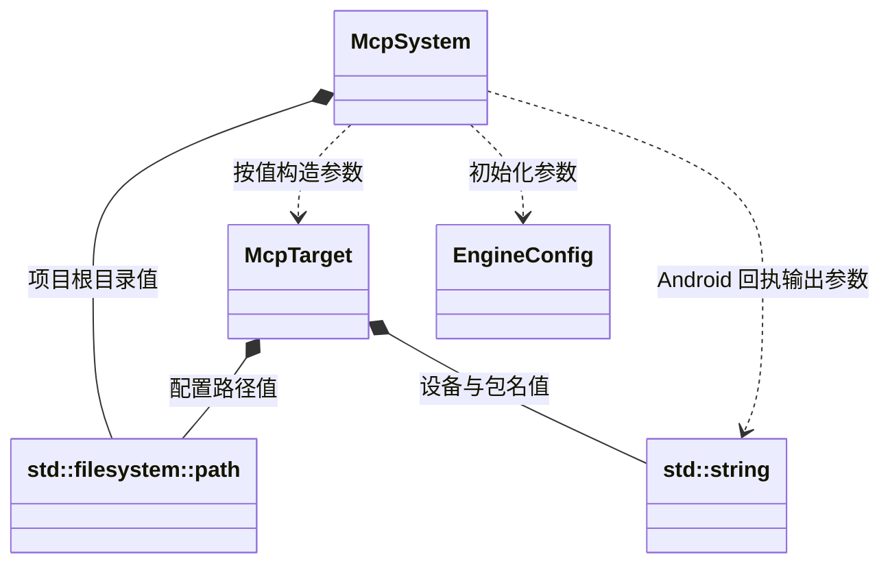
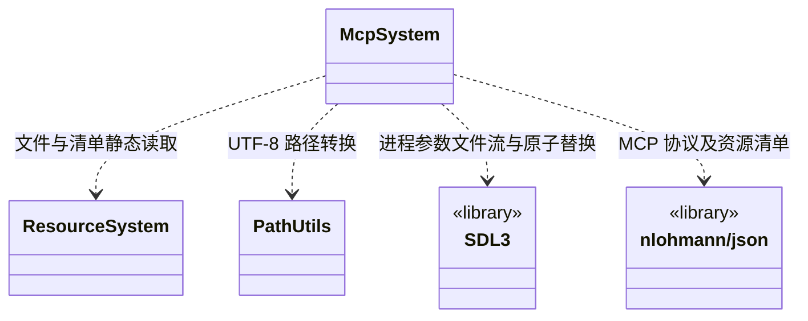

# MCP 工具系统

[类图索引](../../class-diagrams/index.md) · [完整引用关系](../../class-diagrams/references.md)

MCP 服务运行在桌面宿主，借用已初始化的资源管线与同步系统。目标在启动时固定；不在 Android 安装 MCP 服务。

配置值和参数关系（同名节点均指向上图类型）：

文件、平台工具与协议依赖：

- `McpTarget` 为普通配置结构；`runtime_dir` 与 `android_serial` + `android_package` 互斥。`adb_executable` 默认 `adb`，也可明确指定完整路径。
- `McpSystem` 构造按值保存项目根目录和目标，两个系统引用须存活到 MCP 关闭。继承 `System` 生命周期，析构及关闭钩子为 `noexcept`，覆盖方法标注 `override`；返回状态的方法标注 `[[nodiscard]]`。
- 三个 Android 方法为私有实现接口，向 `reply` 输出工具回执文本，通过 `bool` 报告操作状态；不对玩法或其他系统公开新的设备控制接口。
- `Path` 与 `string` 分别简写 `std::filesystem::path` 与 `std::string`，不是新增包装类型。文件读取使用 [ResourceSystem](../../runtime/class-diagrams/resource-system.md)，编码转换使用 [PathUtils](../../runtime/class-diagrams/path-utils.md)；路径安全检查仍归调用者。
- stdio 保留 `initialize`、`notifications/initialized`、`ping`、`tools/list`、`tools/call`；三个工具为 `sync_assets`、`set_hot_reload`、`get_status`，参数不改变。
- 本机目标延续持久目录协议。Android 目标必须明确 adb 序列号和包名，先核验设备状态与 `run-as` 可用性；只支持 debuggable 包。Release 不开放此调试通路。
- Android 文件位于包的私有 `files/`。同步合并设备 `assets/available.json`（若存在）及 `assets/builtin.json` 的文件和删除路径作为基线，在本机复用 `AssetSyncSystem` 生成不可变版本；APK 升级新增的内置路径也参与删除计算。
- 通过 SDL3 独立 argv 启动 adb；设备端只执行固定脚本，动态值严格校验并作 POSIX 单引号转义。逐文件传入私有暂存区，读回校验大小与哈希，最后原子发布完整版本和 `available.json`。设备发布锁防止多宿主同时操作。
- 发布前失败不修改已发布清单，不清理正在运行的版本；只清理本次拥有的暂存文件与锁。最终发布命令的回执丢失时，明确报告“发布未确认”，须查询设备状态判定，不能声称仍是旧版本。中断遗留锁会明确报告，不能自动删除他人锁。
- `set_hot_reload` 原子发布设备 `files/script-control.json`；`get_status` 直接读取设备状态和已发布清单，不以本机镜像代替设备事实。设备操作回执包含序列号和包名；目标探测成功后附持久目录。设备操作前的 TS 编译失败只报告编译错误。
- 可用版本表示文件已同步；运行版本及运行状态来自引擎上次报告。重载始终由引擎决定，MCP 不执行脚本生命周期。
