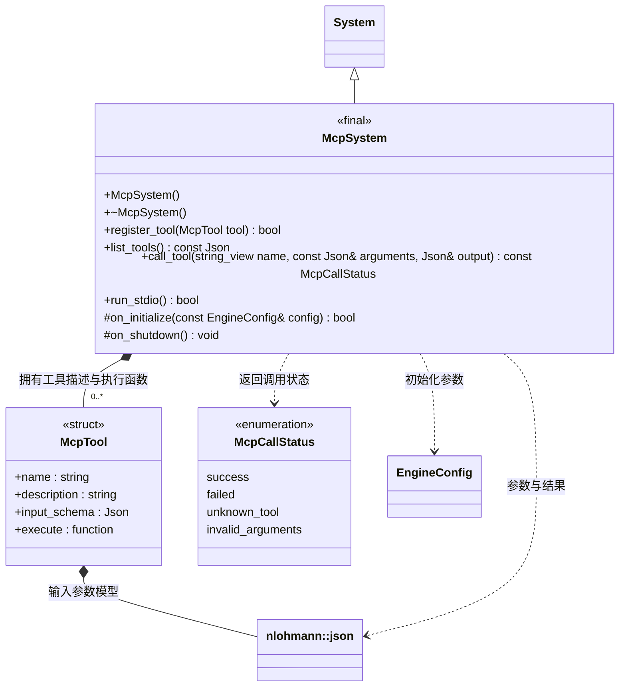

# MCP 协议与工具注册

[类图索引](../../class-diagrams/index.md) · [项目工具模块](project-mcp-tools.md)

McpSystem 只负责 JSON-RPC/MCP 协议、工具登记和调用。它不持有项目、目标设备、资源管线或编辑器对象。各模块在宿主启动时显式注册自己的工具；名称、参数说明和执行函数来自同一条登记记录。

- `McpTool::execute` 为 `std::function<bool(const Json&, Json&)>`，输入已经通过登记 schema 的参数检查；输出为业务 JSON，`false` 表示业务失败。McpSystem 统一包装 MCP `content` 与 `isError`，模块不重复拼接协议回包。
- 工具只可在 `initialize()` 前注册，初始化后工具列表冻结，与 `listChanged=false` 一致。重复名称、空执行函数和不支持的参数模型返回失败。关闭时清空登记表；执行函数捕获的业务对象是借用，宿主保证它们存活到 MCP 关闭。
- 当前参数模型仅支持实际使用的 JSON 类型、对象字段/必填/额外字段、数组元素/长度、数字范围、字符串长度和枚举；子字段允许空 schema `{}`，此时具体值由业务校验；顶层仍须为 object。不支持的关键字在注册时拒绝，不声称提供完整 JSON Schema 引擎。
- `call_tool()` 区分未知工具、参数无效、业务失败和成功；失败时输出为对象或安全空值。未初始化不能执行工具。stdio 入口保持初始化握手、通知、ping、tools/list 和 tools/call。
- 新模块通过 `register_tools(McpSystem&)` 显式登记。无需修改 McpSystem 的集中业务分支，也不要求引擎核心或场景组件包含 MCP 头文件。
