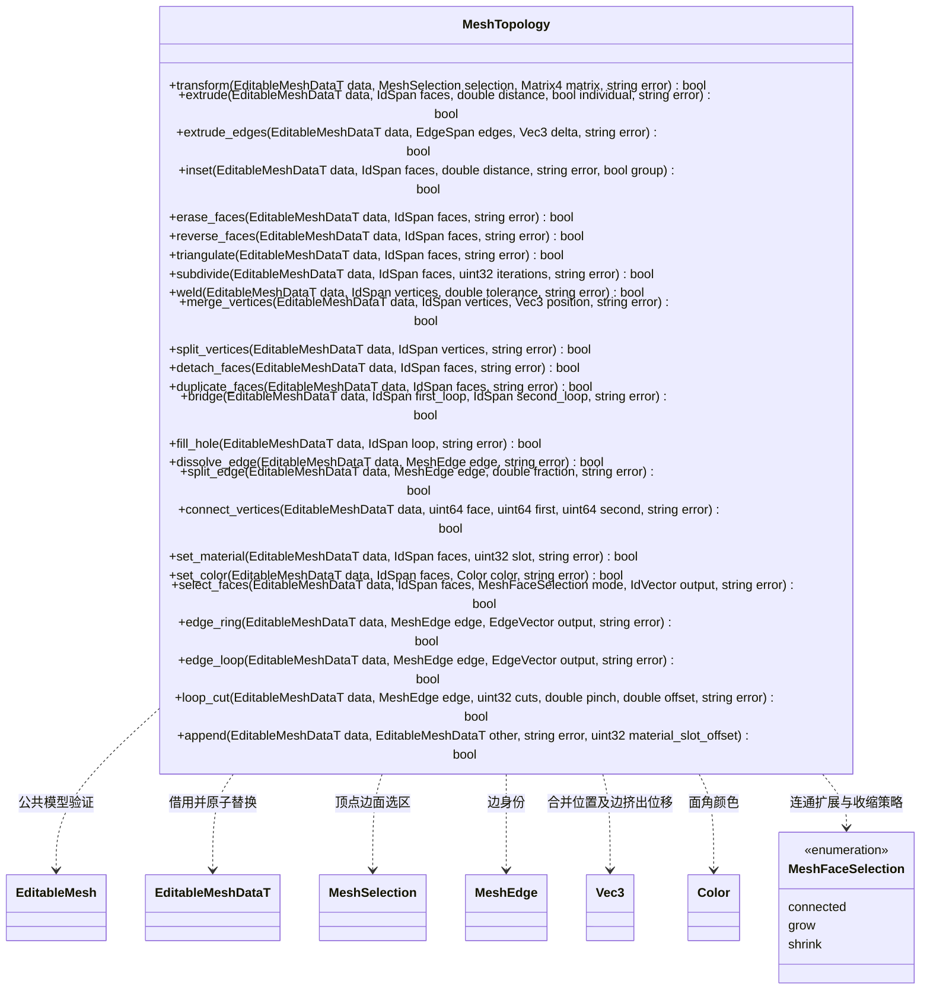

# 多边形拓扑操作

所有操作在候选副本上执行，验证成功后替换原数据。失败保持原数据和身份。新几何分配新 ID，已有未替换几何保留 ID。

- 点、边与面共用仿射变换；局部变换使多边形弯曲时，沿变换前的三角化拆分该面，首面保留原 ID、角属性和材质。负行列式的整体变换同步翻转绕序。
- 面挤出支持组或逐面，支持含洞面；开放边挤出接收明确位移，共享角只复制一次。内部边挤出会产生非流形边，因此返回失败。
- Inset 使用面内等距边偏移，面角 UV、颜色按原面三角形插值。默认逐面；`group=true` 要求同向共面选区，仅偏移整个选区的边界并保留内部共享边，可处理凹区域和孔洞。整体模式不会在选区内部生成边框。过量距离、边界分叉、反转或相交结果返回失败；逐面模式的带洞面需先拆分，整体模式直接处理外环及孔洞。
- 拆点按面分开所选共享顶点，保留原位置、面身份与角属性。细分为面心和共享边中点的四边形细分，未选相邻面同步插入共享中点，不宣称 Catmull–Clark 曲面细分。
- 环切沿连续四边形带传播，支持 1 到 64 条切线、间距和偏移；在非四边形处结束并为边界相邻面补共享点，保持连通。非流形或扭转环返回失败。
- 封洞根据已有边界选择反向绕序。桥接要求等长、不共享顶点的开放环，输入对应关系必须绕序兼容；非平面桥接四边形拆为三角形。
- 溶边要求两个共面、无洞、相同材质和平滑组的相邻面，UV 或颜色接缝不一致时返回失败，避免静默丢失属性。
- 选择查询提供相邻扩展、边界收缩、整块连通、四边形相对边环 `edge_ring` 和沿共享端点延续的边循环 `edge_loop`；后者在无唯一延续的分叉返回失败，在无后继的极点结束。材质与颜色修改同样由核心实现，编辑器只解析请求、管理历史与刷新渲染。
- 合并模型分配新的稳定身份，可偏移来源材质槽；当前与渲染共同限制为 16 个材质槽。
