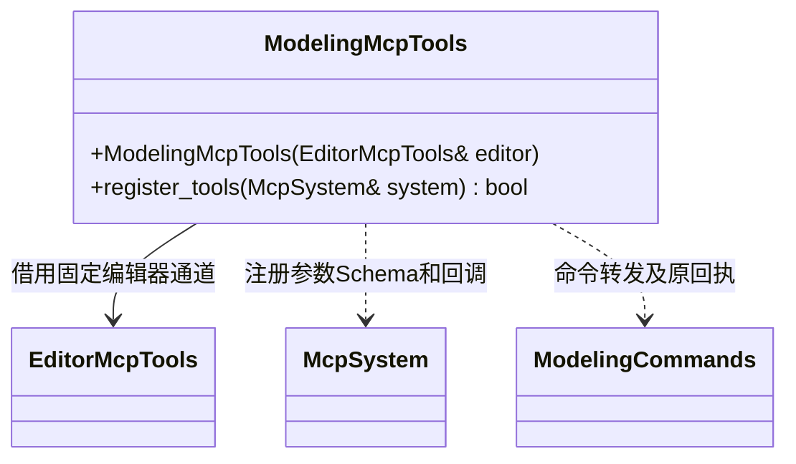

# 建模 MCP 适配

[类图索引](../../class-diagrams/index.md) · [建模编辑业务](../../editor/class-diagrams/modeling-commands.md)

仅负责工具描述、JSON Schema 与转发，不处理几何、不保存资源、不直接改场景。
全部建模工具均走 EditorMcpTools 的项目、会话、请求和回执校验，由编辑器主线程调用核心。
选择、拓扑查询、创建、修改、复制、组合、分离、删除及保存加载均通过 MCP 可操作；
事务、撤销与重做复用 execute_batch/undo/redo。工具失败不伪造成功回执。

modeling_help 提供各 operation 的参数类型、示例、选择方式及适用范围；无需读取源码即可完成工具操作。
场景命令要求 sceneId 和稳定 modelId；可附 nodeId 防止误操作重建后的节点。
建模流程为 get_scene → modeling_create → modeling_get → modeling_select/edit → modeling_save → stop_project → sync_assets。
重新编辑时先 start_project，再 modeling_load 已保存的资源。
MCP 不执行几何和路径处理，参数通过 schema 初检后由编辑器校验真实场景及资源状态。
