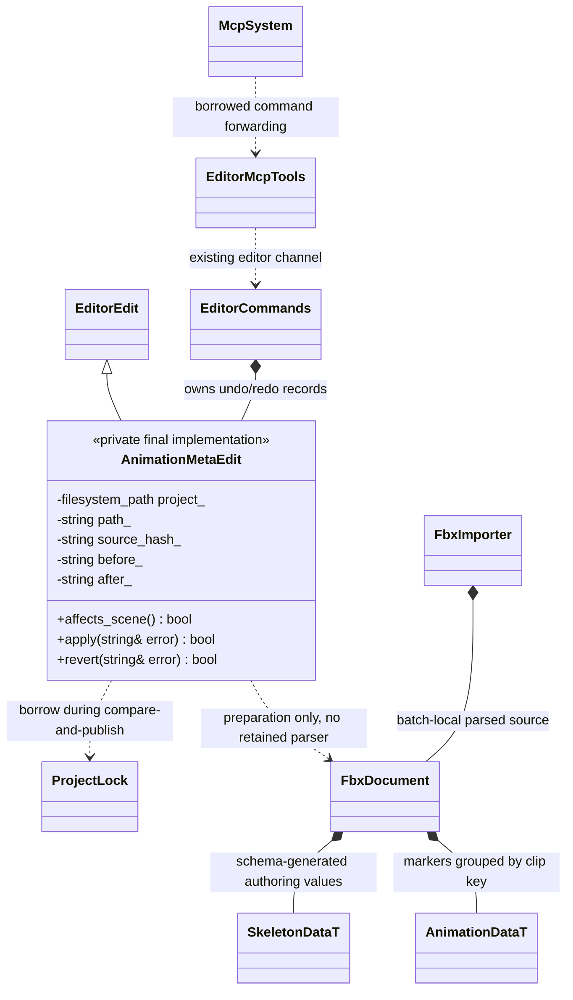

# 动画制作命令与 FBX 元数据

[类图索引](../../../class-diagrams/index.md) · [动画分层](../../../runtime/scripted-animation-controller.md) · [FBX 导入](fbx-importer.md) · [IK 与挂点](../../../runtime/class-diagrams/animation-rigging.md) · [事件](../../../runtime/class-diagrams/animation-events.md)

本页落实已确认的动画制作职责：`editor/animation_tools` 组织制作命令，`editor/asset_import` 的 FBX 导入器拥有源格式解析，运行时消费生成资源。不增加动画编辑 System、独立播放框架或另一套事务。代码已接入，实际构建与功能验收以测试记录为准。

## 入口、依赖与所有权

以下是 `engine::plugins::animation_tools` 命名空间函数，不是新建包装类：

```cpp
[[nodiscard]] bool register_animation_authoring_commands(
    editor::EditorCommands& commands, const std::filesystem::path& project);
[[nodiscard]] bool register_animation_authoring_mcp_tools(
    mcp::McpSystem& system, mcp::EditorMcpTools& editor);
```

命令登记复制项目根路径，不持有 Scene、World、动画播放器或项目脚本对象。MCP 回调借用既有 `EditorMcpTools`，它须存活到 MCP 关闭。宿主显式装配，编辑器核心不 include 或链接制作插件。独立 `engine_animation_tools_editor` 与可选 MCP 工具静态目标分别承担命令实现与协议适配，导入目标不反向依赖编辑器。



`AnimationMetaEdit` 是实现私有的 `EditorEdit`，没有公开到运行时或项目 API。`affects_scene()` 为 `false`，不污染场景修改代次；apply/revert 与批量回滚仍由同一个 `EditorCommands` 管理。切场景清理历史、sceneId 与撤销/重做身份沿用该服务既有规则，不另建资源事务管理器。

## 制作操作

- `get_animation_authoring`：参数 `{path}`，path 为 `assets/` 相对 FBX 路径；返回原 GUID、`sourceHash/metaHash`、精确骨路径、动作子资源 key/时长及四组制作数据。骨路径大小写敏感，例如 `root/Hips/Spine`，不能用骨骼短名猜测目标。
- `set_animation_authoring`：必须携带上述 path 和当前两个 hash；可提供完整 `skeleton_sockets`、`skeleton_aim_ik`、`skeleton_two_bone_ik`、`animation_events` 数组。省略一组即保留，空数组明确清除。先校验全部输入，再创建尚未应用的编辑记录；失败保留原文件和历史。
- 命令只原子编辑原 FBX 的邻接 `.meta`。不修改商业/原始 FBX，不创建虚假的骨架源，不写 `cache/gen`。已有导入监听或显式资源构建负责转换与目录发布；回执的 `reimportPending` 不冒充运行资源已发布。导入失败时旧运行目录仍完整可用。
- apply/revert 重新验证项目内路径、原 GUID、源内容 hash 与预期 meta 全文；外部修改、换源或符号链接会明确失败，不能覆写别人修改。使用既有 `ProjectLock` 与暂存文件原子 rename；不建立新的锁服务。
- 事件轨归动作子资源；socket/IK 归骨架子资源。使用外部 skeleton 的动作 FBX 可以制作自身事件，不能在它的 meta 中追加无人使用的第二套 rig 定义。rig 定义须编辑实际提供该骨架的源 FBX。

## 邻接 meta 格式

```toml
[[skeleton_sockets]]
name = "weapon"
joint_path = "root/Hips/Spine/Hand"
translation = [0.0, 0.0, 0.0]
rotation = [0.0, 0.0, 0.0, 1.0] # quaternion xyzw
scale = [1.0, 1.0, 1.0]

[[skeleton_aim_ik]]
name = "look"
joint_path = "root/Hips/Spine/Head"
order = 0
forward_joint = [0.0, 0.0, 1.0]
up_joint = [0.0, 1.0, 0.0]
offset_joint = [0.0, 0.0, 0.0]

[[skeleton_two_bone_ik]]
name = "arm"
start_path = "root/Hips/Spine/Arm"
middle_path = "root/Hips/Spine/Arm/Forearm"
end_path = "root/Hips/Spine/Arm/Forearm/Hand"
order = 1
mid_axis_joint = [0.0, 0.0, 1.0]
soften = 1.0
twist_radians = 0.0

[[animation_events]]
animation = "animations/walk"
marker_id = 1
time = 0.25 # clip-local seconds, independent of FBX take start time
name = "step"
payload_string = "left" # optional; exactly one payload_bool/number/string
```

TRS 与轴省略时采用 schema 的单位默认值；名称、骨链路径、事件名称/ID/时间为必要输入。事件 payload 可为空，或者为 bool、有限 double、string 三种类型之一，不能同时给出多个类型；`false`、`0`、空字符串都是有效数据。每动作的 marker ID 唯一，事件时间范围为 `[0,duration]`，数组顺序保留作者顺序。源配置数组受制作预算限制，未知字段和错误类型不静默降级。

生成 Skeleton 的公共验证器统一校验精确骨路径、socket 名称唯一、两类 IK 名称共同唯一、单位方向、合法 TRS、祖先链和 soften/twist。`order` 同值允许，执行稳定次序由运行时契约定义。动作未找到、事件越界、零 ID 或 ID 重复在导入前失败；marker ID 范围为 `1..UINT32_MAX`。元数据变化参与导入快照检查及正常增量指纹，不能复用旧 marker/rig 产物。

编辑器采用 **MCP + 配置文件** 的制作路线；窗口仅用于场景预览与实际运行。动画标记、骨骼挂点和 IK 通过上述命令及源 meta 制作，不增加编辑器面板或可视化时间线。
