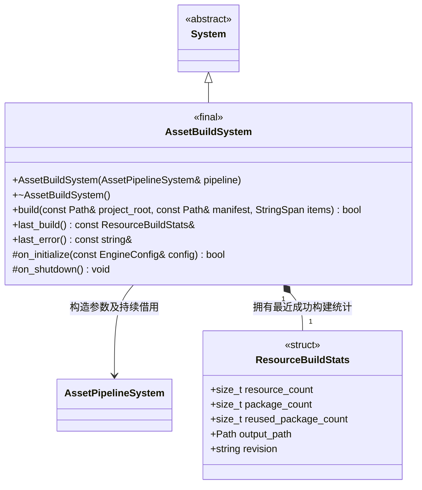
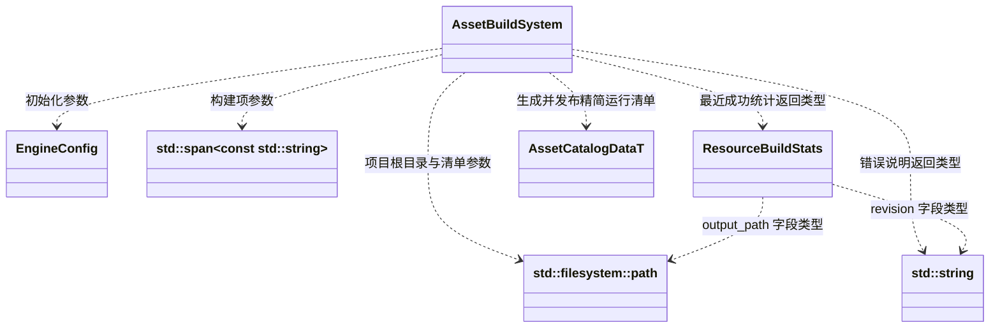

# 资源构建系统

[类图索引](../../../class-diagrams/index.md) · [资源构建说明](../resource-build.md) · [资源管线系统](../../../editor/class-diagrams/asset-pipeline-system.md) · [运行时资源加载](../../../runtime/resource-loading.md)

`AssetBuildSystem` 负责项目资源打包；`AssetPipelineSystem` 负责扫描和增量导入。两个系统分别提交导入缓存与运行输出，不建立跨系统事务。

## 类与公开契约

- `build()` 是同步操作，返回成功或失败。`project_root` 为已通过项目检查的根目录；`manifest` 为相对项目根目录、位于 `settings/` 内的清单路径，拒绝越界。项目检查规则复用编辑器项目模块，不移入核心。
- `items` 只借用本次调用期间的构建项名称；空列表选择清单全部项。构建目标、入口、保留项、输出目录和存储方式来自清单。
- `ResourceBuildStats` 保存精简运行清单中的资源数、合并包数、本次复用包数、绝对输出根目录和发布版本。导入统计仍由资源管线的 `AssetBuildStats` 保存，二者不重复职责。
- `last_build()` 返回内部只读借用，下一次成功构建会更新内容；失败保留上一份成功统计。`last_error()` 返回最近失败说明，成功后清空。两者均不得由调用者释放。

## 参数、返回值与生成数据

本图只引用其他类，不重复定义其方法。`Path`、`StringSpan` 和 `String` 是标准库类型的图示简写，不新增包装类。

`AssetCatalogDataT` 来自 FlatBuffers Schema，其运行清单及存储映射契约由[资源系统](../../../runtime/class-diagrams/resource-system.md)维护。构建系统生成磁盘输出，`build()` 不返回资源实体集合，也不调用核心激活新清单。编辑器协调层直接调用 `update_catalog(data, mounts)`；真机启动读取并更新一次运行清单。

## 生命周期和失败约定

- 编辑器宿主拥有构建系统；它持续借用已初始化的 `AssetPipelineSystem`。资源管线先初始化、后关闭，并存活到构建系统关闭；运行时 `Engine` 不拥有这两个编辑器系统。
- 构造只保存借用，初始化检查依赖就绪。只有系统就绪时允许构建，同一实例不允许并行或重入构建。关闭支持重复调用和部分初始化，清理本系统的暂存状态，不销毁借用的资源管线。
- 借用资源管线完成导入，再根据运行依赖计算所选集合；构建依赖只影响转换失效。未变化的独立文件和包复用，变化的合并包整包重建。
- 正式 gen 缓存仅保存一个目标平台。资源管线检查活动编辑器登记，项目运行时拒绝覆盖，要求调用方先停止；不自动停启。恢复编辑器项目前重新导入宿主平台并更新核心目录，构建系统不激活异平台清单。
- 完整校验暂存输出后发布，打包失败保留旧运行输出；已成功导入的缓存仍可保留。发布后由编辑器直接更新核心目录，工具构建不隐式切换活动项目。
- `builtin/` 固定 GUID 资源通过核心共享的内置身份接口校验，当前由目标平台程序编入的五项资源提供；不作为项目源导入，不复制宿主 GPU 数据，不放行未知 GUID。独立内置目录或包尚未实现。
- 构造为 `explicit`，构造、析构和关闭钩子为 `noexcept`；析构和钩子标注 `override`，状态与查询返回标注 `[[nodiscard]]`。删除复制与移动；不重写空更新钩子，不用异常表达失败。

MCP 只借用并调用本系统；工具约定见[资源构建说明](../resource-build.md#工具入口)。
