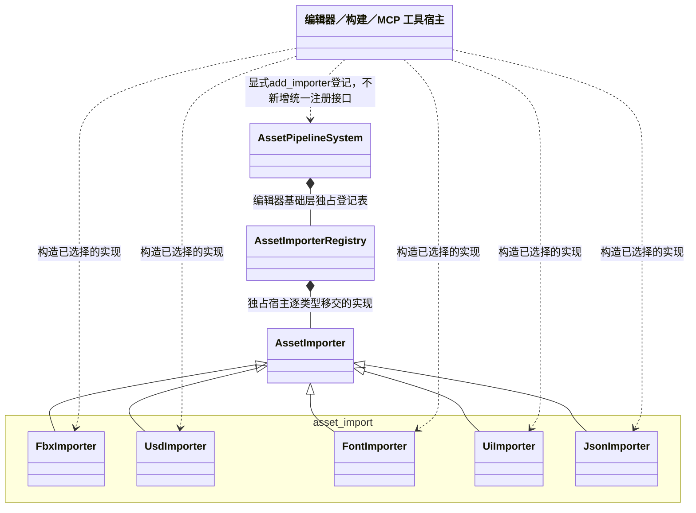

# 统一资源导入插件

[类图索引](../../../class-diagrams/index.md) · [通用导入契约](../../../editor/class-diagrams/asset-importers.md) · [插件清单](../../plugins.md)

本页维护本轮已确认的插件合并边界：五种源格式导入实现统一归 `editor/asset_import`，CMake 目标为 `engine_asset_import`（别名 `engine::asset_import`），命名空间为 `engine::plugins::asset_import`。不增加导入 System、Manager、注册门面或第二套接口；通用契约仍属于编辑器基础层。

`asset_import` 图示分组对应 `engine::plugins::asset_import`，ToolHost 仅表示现有可执行入口，不新增 C++ 类。`AssetImporter`、`AssetImporterRegistry` 属于 `engine::editor::asset_pipeline`，`AssetPipelineSystem` 属于 `engine::editor`。基础管线通过接口调用具体导入器，不 include 或链接本插件。

## 文件与类型归属

| 类型 | 公开头与实现 | 完整方法及格式契约 |
| --- | --- | --- |
| FbxImporter | `plugins/editor/asset_import/fbx_importer.hpp`、同目录 `.cpp` | [FBX](fbx-importer.md) |
| UsdImporter | `plugins/editor/asset_import/usd_importer.hpp`、同目录 `.cpp` | [USD](usd-import.md) |
| FontImporter | `plugins/editor/asset_import/font_importer.hpp`、同目录 `.cpp` | [字体](font-importer.md) |
| UiImporter | `plugins/editor/asset_import/ui_importer.hpp`、同目录 `.cpp` | [UI](ui-importer.md) |
| JsonImporter | `plugins/editor/asset_import/json_importer.hpp`、同目录 `.cpp` | [JSON](json-importer.md) |

表中公开头位于 `include/engine/`，实现位于 `src/engine/`。FBX 文档解析与运动提取的私有文件留在相同实现目录，不暴露到公共头。每种类型继续独立文件、独立 importer id、meta、工具指纹和增量结果；合并构建单元不会合并运行资源身份或必要依赖。

## 依赖与装配

- 源格式的 ufbx、OpenUSD、FreeType 与 JSON/RML 校验依赖由统一插件目标承担；它们不进入运行时核心或运行包。
- 工具宿主继续逐类型构造和调用既有 `add_importer()`，由登记表独占实例。UI 源编辑依赖本插件的 UiImporter 校验能力，`editor/ui` 的依赖指向 `editor/asset_import`。
- 原五个插件名、CMake 目标及命名空间统一迁移，不保留兼容目标、根命名空间别名或旧目录。
- 建模、地形、破坏与特效还承担制作、组件编解码、命令和运行协作职责，保持原插件边界；其导入适配仍可经同一 AssetImporter 接口登记，不把完整插件并入资源导入插件。
- 构建与功能验收记录统一放[测试文档](../../../testing.md)，不把目标存在或 `find_package` 成功当作接入完成。
