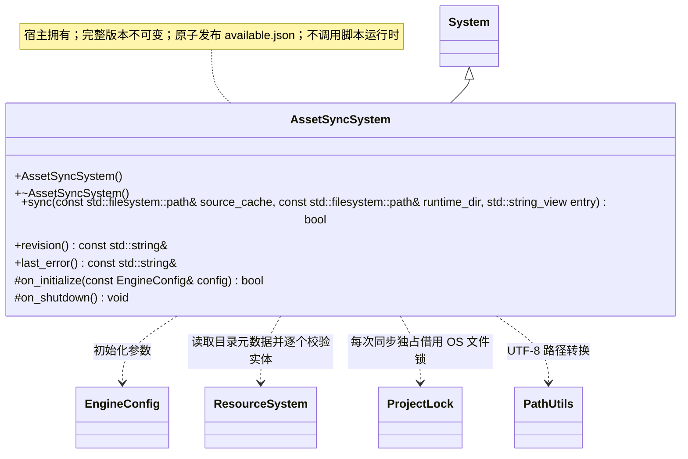

# 资源同步系统

同步输入必须包含有效的统一运行清单及其引用的独立文件或包；无清单的散脚本目录返回失败。由编辑器/宿主明确提交目录；发布监测由运行宿主负责。输入契约见[资源构建](../resource-build.md)和[同步加载设计](../../../runtime/resource-loading.md)。

[类图索引](../../../class-diagrams/index.md) · [完整引用关系](../../../class-diagrams/references.md)

桌面编辑器与同步工具使用的独立根系统，由宿主初始化并反序关闭。跨图引用不重复定义公开方法。

`sync()` 返回是否完整发布，`revision()` 只表示可用版本，不表示脚本已经运行。同步不要求目录包含玩法脚本；`entry` 只是启动提示，宿主负责检查入口、激活资源及执行 Gameplay。

返回状态及只读访问方法标注 `[[nodiscard]]`；析构和清理为 `noexcept`，钩子标注 `override`。`last_error()` 与 `revision()` 为 const noexcept，只读字符串借用在下一次业务操作前有效。

公共路径编码复用 [PathUtils](../../../runtime/class-diagrams/path-utils.md)；路径规范化和安全检查仍由本类负责。

资源输入可以是项目 `cache/` 或独立运行构建目录，只发布 `catalog.bin` 与 `entry.location.path` 引用的唯一载体，挂载限定为部署根 `content`。开发缓存未提供外置内置条目时，运行程序继续使用编入的 bootstrap 定义；打包输出携带独立的内置资源包。有物理位置的条目必须读取实际实体，缺失或损坏不会回退。SQLite、源 meta 与项目设置不进入版本。

路径拒绝越界及符号链接。源目录和暂存目录中的实体逐个校验，同一合并包只复制一次，包摘要通过固定大小缓冲区流式计算，因此包体可以大于单个实体的读取上限。全部校验完成后，发布不可变的 `assets/versions/<revision>/` 快照，再原子更新 `available.json`；失败保留旧可用版本，暂存内容不参与加载。项目导入缓存仍为单份 `cache/gen/`，不创建同步版本子目录。

同步期间持有 `assets/.sync-lock/owner.lock` 的 OS 独占锁，目录和锁文件的存在不表示仍有活动同步。并发进程立即返回占用错误；同步进程异常退出后由 OS 释放锁，下一次同步可直接重试。沿用目录路径容纳旧版本留下的空锁目录，不删除其他进程可能正在使用的锁文件；中断暂存目录不参与发布。

`available.json` 保存 `revision`、`entry`、`files`（路径、大小和 FNV-1a 64 位摘要）及累计 `deleted` 载体路径。运行时按当前完整 catalog 查找项目资源，缺失条目不从旧包补齐；删除后不会恢复旧资源，依据的是这一目录边界，而非 `deleted` 驱动的逐项回退规则。
