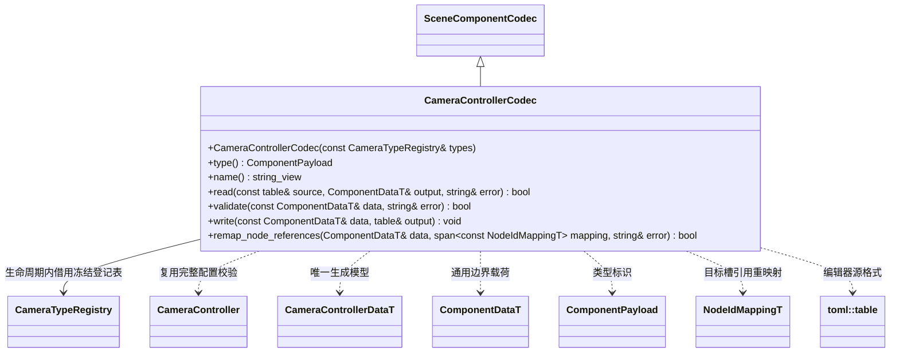

# 相机控制编辑器接入

[运行时相机契约](../../runtime/class-diagrams/camera-controller.md) · [状态机与配置](../../runtime/class-diagrams/camera-state-machine.md) · [类图索引](../../../class-diagrams/index.md)

**状态：已实现；验证范围见[测试文档](../../../testing.md)。** 制作能力归可选编辑器插件 `engine::plugins::camera_editor`，依赖运行时相机契约及编辑器基础；运行时插件不依赖该模块或 MCP。沿用逐组件编解码、事务命令和 MCP 适配，不开发相机图形编辑界面。

Codec 独占交给已有资源管线的登记表；借用的类型表由宿主拥有，先准备后登记，并在 Codec 销毁之后释放。字段、模块类型、参数绑定和引用错误必须报告字段路径；未知字段不静默忽略。具体模块的数据校验归其类型，Codec 只组织生成结构及 TOML 转换。

插件只增加与现有模式相同的显式入口：

- `register_camera_codec(const CameraTypeRegistry&) -> bool`：登记本组件 Codec。
- `register_camera_commands(WorldSystem&, SceneCommands&, EditorCommands&) -> bool`：登记设置、查询及运行参数命令，复用 `ComponentEdit` 事务。
- `register_camera_mcp_tools(McpSystem&, EditorMcpTools&) -> bool`：同时启用 MCP 时创建单独适配目标并登记工具，不让原生相机系统链接 MCP。

| 命令及当前 MCP 工具 | 行为与保存边界 |
| --- | --- |
| `get_camera_controller` | 返回完整配置，包括参数声明、状态、转换、Rig、模块及目标默认引用 |
| `set_camera_controller` | 完整校验后原子替换；编辑操作进入既有撤销／重做及场景保存流程 |
| `set_camera_parameters` | 只写实例运行参数；不进入源配置或撤销历史 |
| `set_camera_target` | 覆盖运行目标槽，区分明确解绑与恢复默认；不写默认引用 |
| `trigger_camera_parameter` | 置位或清除指定触发器；不写默认值 |
| `get_camera_status` | 查询已提交状态、来源状态、混合进度、最终输出及诊断；只读 |

持久目标引用使用所属场景 local ID；编辑命令可接收当前运行 Node ID，由 SceneCommands 显式转换。复制预制体和撤销恢复通过现有 NodeIdMapping 重映射全部目标槽；不将 ECS 实体 ID 或跨场景临时目标写入源配置。

控制组件保存只收集定义及其默认值，不读取求解缓存。显式保存整个场景时，其他组件沿用[活动场景保存](../../../editor/class-diagrams/scene-persistence.md)的当前值快照契约，因此 Transform 和 Camera 会写入它们当时的值。模板的初始镜头使用 Rig 中的明确配置；镜头运行不会自动触发源文件保存。

MCP 参数 Schema 与可用类型清单对应本次宿主实际登记的类型；字段来源为生成 Schema 及逐类型契约。新增类型同步增加其编解码和工具参数说明，不能只登记运行代码却无法保存和重建。制作类型未被宿主启用时明确报错，不丢弃配置后继续导入。
