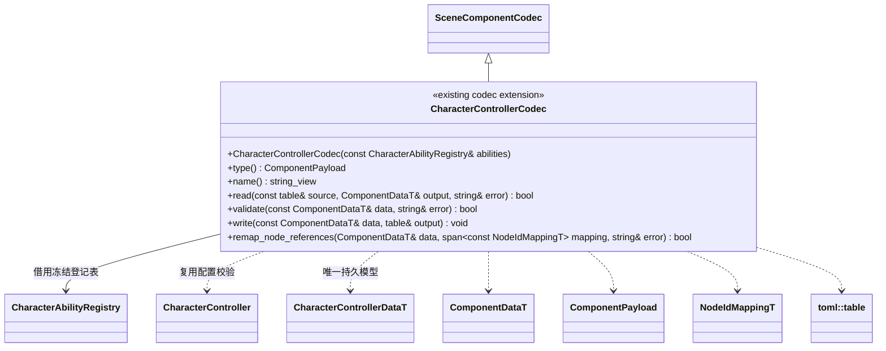

# 角色扩展编辑器接入（设计草案）

[运行时角色设计](../../runtime/class-diagrams/character-control-design.md) · [能力组合](../../runtime/class-diagrams/character-abilities.md) · [当前角色编辑器插件](character-controller.md)

**状态：设计草案，待评审，尚未实现。** 复用已有 `plugins/editor/character_controller/`，升级逐组件 Codec、可撤销命令及 MCP 参数。运行时角色插件不链接编辑器或 MCP；制作接口继续由宿主登记。

Codec 独占交给现有登记表；能力登记表由宿主拥有并覆盖 Codec 生命周期。`register_controller_codec` 升级为接收 `const CharacterAbilityRegistry&` 的入口，继续汇总 Controller、CharacterCamera 和 CharacterVisual 三个 Codec。具体能力类型负责本类型字段识别和校验，基础管线不增加能力名字分支。

CharacterCameraCodec 按[新角色相机契约](../../runtime/class-diagrams/character-integration-design.md)升级生成字段；CharacterVisual 的分类 Schema 与 Codec 保持原职责。组件引用、相机命名目标槽、动作名称和参数名各自按所属数据校验；离线 Codec 不借用运行世界或偷偷创建默认角色／镜头。

| 入口 | 拟议行为 |
| --- | --- |
| `get/set_character_controller` | 完整读取／替换移动、朝向、输入动作声明、能力列表及类型化配置，设置走既有 ComponentEdit 事务 |
| `get_character_status` | 返回实际物理快照、姿态、动作、能力及事件序列，只读 |
| `set_character_input` | 向指定实例提交瞬态输入，用于实际控制与验收；不写场景或撤销历史 |
| `clear_character_input` | 明确取消该实例主动输入与缓冲动作，保留外力 |
| `get/set_character_camera` | 保存命名槽、观察参数映射、状态映射与输入换算，不再保存通用镜头算法参数 |
| `get/set_character_visual` | 保持身体／头部／第一人称部件分类 |

原生及 MCP 命令继续由 register_controller_commands / register_controller_mcp_tools 汇总；MCP 只做协议适配和回执。定义字段来自 FlatBuffers Schema，类型清单来自实际登记集合；未启用的能力不能被静默丢弃后导入。

场景／预制体只保存配置。运行输入、按键边沿、计时、支撑、实际速度及当前能力状态均不持久化。保存完整活动场景时，Transform 等其他组件继续遵守[既有当前值快照契约](../../../editor/class-diagrams/scene-persistence.md)，不新增自动保存或运行状态恢复系统。

接口升级只保留一个版本：同步替换旧位置参数式 SetInput、系统级玩家选择和旧 CharacterCamera 算法字段；公开样例、脚本绑定、工具及现有模块测试一次更新，缓存重新生成。付费／私有角色资产、动作和业务项目不进入通用引擎提交。
