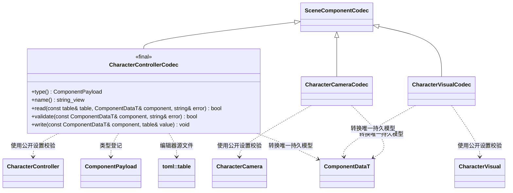

# 角色控制器编辑器插件

运行时组件与输入逻辑见[运行时插件](../../runtime/class-diagrams/character-controller.md)。编辑器插件按玩家输入、跟随相机和表现分类分别提供 TOML 编解码、可撤销编辑命令及 MCP 协议适配，每种类型独立文件。

插件入口：

- `register_controller_codec()` 汇总三个逐类型 Codec，各自实现图中同一组覆写方法，并独占交给资源管线的显式登记表；基础编辑器不 include 该插件。
- `register_controller_commands(WorldSystem&, SceneCommands&, EditorCommands&)` 汇总 `set/get_character_controller`、`set/get_character_camera`、`set/get_character_visual`。各类型负责字段校验与读写，插件内部泛型函数复用已有 `ComponentEdit` 事务。借用的 SceneCommands 提供节点身份，使删除与撤销重建之后仍能正确撤销组件编辑。
- `register_controller_mcp_tools(McpSystem&, EditorMcpTools&)` 汇总对应三个逐类型协议适配；在启用 MCP 时单独链接，不承担运动、碰撞或相机逻辑。

命令中的 `cameraNodeId` 是当前场景运行节点身份，编辑时转换为组件持久的 `camera_node_id = NodeInfo.id`；查询同时返回运行身份和 `cameraLocalId`。TOML 使用 `camera_node_id`，跨场景恢复后通过本地身份重新定位。

`character_controller` 只保存速度、跳跃、观察灵敏度和可空相机引用，MCP 以 `cameraNodeId: "0"` 清除。旧 TOML 的 `mode/eye_height/camera_distance/pitch_min/pitch_max` 明确报错，提示迁移到对应 Camera 节点的 `character_camera`，不能静默丢值。新相机组件保存 `target_node_id`、模式、距离、俯仰范围、碰撞半径与余量；命令 `targetNodeId` 同样转换运行身份与持久身份，返回 `targetLocalId`，传 `"0"` 解除跟随。编辑器内部命令也接受 null 清除引用。表现组件用 `kind` 指定 `body/head/first_person`，不把分类写入核心网格。

核心 CharacterMotor 的 `external_damping` 随场景保存，MCP 使用 `externalDamping`，范围为有限值 `[0,1000]`。场景导入指纹包含 `scene.fbs`，schema 变化会令既有场景缓存重新生成。
