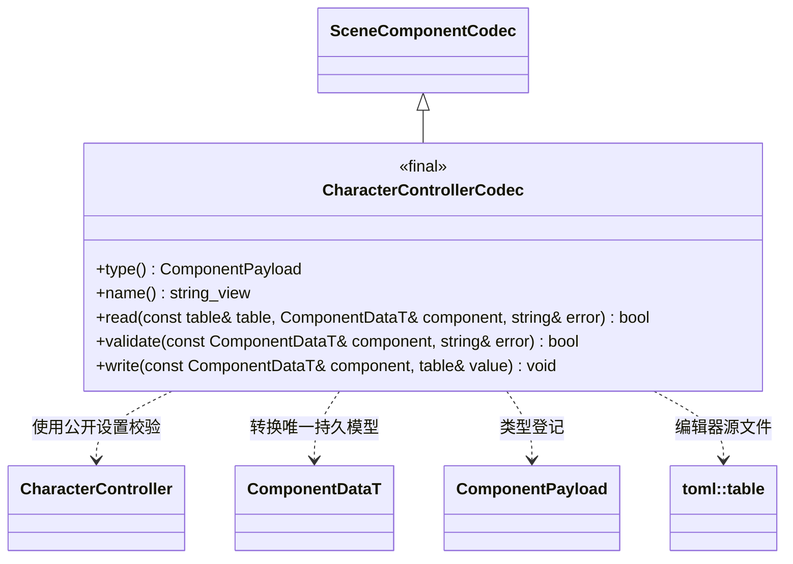

# 角色控制器编辑器插件

运行时组件与输入逻辑见[运行时插件](../../runtime/class-diagrams/character-controller.md)。编辑器插件只提供该组件的 TOML 编解码、可撤销编辑命令及 MCP 协议适配。

插件入口：

- `register_controller_codec()` 将 Codec 独占交给编辑器资源管线的显式登记表；基础编辑器不 include 该插件。
- `register_controller_commands(WorldSystem&, SceneCommands&, EditorCommands&)` 注册 `set_character_controller` / `get_character_controller`；写操作使用已有 `ComponentEdit` 事务。借用的 SceneCommands 提供节点身份，使删除与撤销重建之后仍能正确撤销组件编辑。
- `register_controller_mcp_tools(McpSystem&, EditorMcpTools&)` 仅适配命令名、JSON schema 与结果；在启用 MCP 时单独链接，不承担运动、碰撞或相机逻辑。

命令中的 `cameraNodeId` 是当前场景运行节点身份，编辑时转换为组件持久的 `camera_node_id = NodeInfo.id`；查询同时返回运行身份和 `cameraLocalId`。TOML 使用 `camera_node_id`，跨场景恢复后通过本地身份重新定位。
