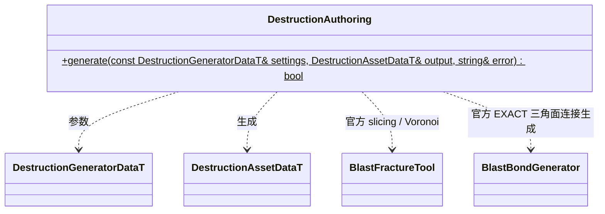

# 建筑破坏预处理

`DestructionGeneratorDataT` 和 `DestructionFracture` 由 `include/schemas/editor/destruction_authoring.fbs` 生成。`DestructionAssetDataT` 由 `include/schemas/runtime/destruction.fbs` 生成，编辑器通过 `engine::editor_data` 使用生成参数。

当前输入为参数化测试盒，底部 y=0、x/z 居中。切片、Voronoi 与 EXACT 三角面连接面积使用官方 ExtAuthoring；不实现另一套切割/连接算法。保留叶碎块作为独立支持节点，忽略只用于编辑过程的不可见父层级。碎块三角网格保留资产局部坐标；接地判定由 `anchor_height` 指定。完整 Authoring 与 Boost Multiprecision 仅属于编辑器依赖，运行时只包含 lowlevel 和损伤 shaders，不使用 PhysX 或 CUDA。

体积和质心使用最终三角几何创建官方 triangle Mesh 后积分，和官方 `ProcessFracture` 的三角几何路径一致；不对包含多边界环的导出面直接做扇形体积积分。连接使用 `bondsFromPrefractured(EXACT)`，避免规则切片中仅接触边或角也被快速切面描述路径连接。回归场景为 2×4×2 的 16 块盒体：总体积 128、正面积面邻接 28 条。
