# 建筑破坏资源与编辑器命令

[类图索引](../../../class-diagrams/index.md) · [Authoring](destruction-authoring.md) · [运行时](../../runtime/class-diagrams/destruction.md)

编辑器插件负责 `.destruction` 描述导入、场景组件编解码和可撤销命令。切割由官方 Blast ExtAuthoring 完成；运行损伤和拆分由运行时破坏插件完成。MCP 只转发编辑器命令，核心和编辑器基础不反向引用插件。

```mermaid
classDiagram
    class AssetImporter
    class DestructionImporter {
        +id() string_view
        +kind() AssetKind
        +matches(const Path& source) bool
        +inspect_batch(const ImportContext& context, string& fingerprint, string& error) bool
        +scan_dependencies(ImportAsset& asset, const ImportContext& context, string& error) bool
        +convert(const ImportAsset& asset, const ImportContext& context, string& error) bool
    }
    class SceneComponentCodec
    class DestructionCodec {
        +type() ComponentPayload
        +name() string_view
        +read(const table& input, ComponentDataT& output, string& error) bool
        +validate(const ComponentDataT& component, string& error) bool
        +scan_dependencies(const ComponentDataT& component, const ImportContext& context, vector~Guid~& dependencies, string& error) bool
        +write(const ComponentDataT& component, table& output) void
    }
    class EditorEdit
    class DestructionStateEdit {
        +DestructionStateEdit(WorldSystem world, uint64 scene, shared_ptr node, shared_ptr revision, ComponentDataT settings, ByteBuffer before, shared_ptr support, float max_gap, float min_coverage)
        +DestructionStateEdit(WorldSystem world, uint64 scene, shared_ptr node, shared_ptr revision, ComponentDataT settings, ByteBuffer before, Vec3 gravity, float elastic_limit, float fatal_limit, uint32 iterations)
        +affects_scene() bool
        +apply(string& error) bool
        +revert(string& error) bool
    }
    class DestructionSettingsEdit {
        +apply(string& error) bool
        +revert(string& error) bool
    }
    class DestructionAuthoring
    class DestructionComponent
    class DestructionGeneratorDataT
    class DestructionAssetDataT
    class DestructionStateDataT
    class ComponentDataT
    class ImportContext
    class ImportAsset
    class AssetPipelineSystem
    class WorldSystem
    class EditorCommands
    class McpSystem
    class EditorMcpTools
    AssetImporter <|-- DestructionImporter
    SceneComponentCodec <|-- DestructionCodec
    EditorEdit <|-- DestructionStateEdit
    EditorEdit <|-- DestructionSettingsEdit
    AssetPipelineSystem *-- DestructionImporter : 登记后独占
    DestructionImporter ..> ImportContext : 输出目录
    DestructionImporter ..> ImportAsset : 源与GUID
    DestructionImporter ..> DestructionGeneratorDataT : 唯一生成参数
    DestructionImporter ..> DestructionAuthoring : 官方离线切割
    DestructionImporter ..> DestructionAssetDataT : 输出独立资源
    DestructionCodec ..> DestructionComponent : 复用校验
    DestructionCodec ..> ComponentDataT : 场景持久数据
    DestructionCodec ..> ImportContext : 资源依赖
    EditorCommands *-- DestructionStateEdit : 独占历史
    EditorCommands *-- DestructionSettingsEdit : 独占历史
    DestructionStateEdit --> WorldSystem : 借用至历史释放
    DestructionSettingsEdit --> WorldSystem : 借用至历史释放
    DestructionStateEdit *-- DestructionStateDataT : 前后序列化快照
    DestructionSettingsEdit *-- DestructionStateDataT : 切换设置保留损伤和姿态
    DestructionSettingsEdit *-- ComponentDataT : 前后设置
    DestructionStateEdit ..> DestructionComponent : 损伤和状态恢复
    DestructionSettingsEdit ..> DestructionComponent : 设置与状态恢复
    McpSystem --> EditorMcpTools : 工具回调借用
    EditorMcpTools ..> EditorCommands : 共用命令通道
```

## 资源与命令

- `.destruction` 使用 TOML：`size`、`fracture = "slices" | "voronoi"`、`slices_x/y/z`（切分份数）、`sites`、`seed`、`bond_health` 和 `anchor_height`。盒子底部位于局部 y=0；节点变换决定场景位置。生成网格、块、接触键保存于独立 `DestructionAssetData`。
- 源资源的邻接 meta 保存唯一 GUID；schema 与 Authoring 工具版本进入增量指纹。导入输出标准 `cache/gen/GUID`。材质由场景组件引用，不成为几何资源的隐式依赖。
- 场景普通节点挂载 `type = "destruction"`，包含破坏资源 GUID、材质 GUID、密度、摩擦和恢复系数；依赖由 codec 显式登记。
- `create_destruction_asset` 负责校验破坏描述和生成结果；项目内路径检查、源文件与唯一 meta 的创建共用编辑器 `asset_io` 普通函数。调用方持有项目资源锁，先拒绝已有源文件或 meta，再写同目录临时文件，依次重命名发布 meta 和源文件；失败清理临时文件，源文件发布失败时回滚本次 meta。使用现有导入流程发布运行资源。
- `set_destruction/get_destruction` 配置并查询资源、设置和运行统计。设置更改保留前后完整状态以便撤销，资源替换可恢复原损伤状态。
- `destruction_damage` 使用世界坐标球体、半径、损伤和冲量；`destruction_reset` 恢复初始结构。二者均可撤销，改变运行状态而非场景初始设置，`affects_scene()` 返回 false。
- 状态命令 handler 只创建记录；首次 apply 执行操作并保存结果，撤销/重做恢复包含键血量、块分组、世界变换和速度的完整快照。以场景、稳定节点、设置与 revision 检查外部修改；正常物理移动不增加 revision，因此不会使撤销失效。同一节点的连续编辑共用预期 revision 游标，每次 apply/revert 后更新；新操作发现外部修改时创建独立游标，使旧记录保持失效，支持多次连续撤销/重做。游标由历史共享拥有，索引只保存弱引用并清理过期项。
- 首版同步计算和提交；当前不建立异步队列或插件专属编辑器模式。

步骤 3：`destruction_refresh_support` 显式指定同场景 `supportNodeId`、`maxGap`、`minCoverage`。复用 DestructionStateEdit 的前后状态快照；首次 apply 执行支撑刷新，undo/redo 恢复完整拆分和物理状态，不重跑地基采样。支撑节点只按稳定身份借用；组件、场景和 revision 校验与其他破坏命令一致。命令不自动修改地形；调用方先提交地形笔刷，再刷新受影响建筑。

支撑刷新未改变 revision 时，历史记录为空操作；撤销/重做不恢复快照、不回退正常物理运动，也不重建节点。

步骤 4：`destruction_apply_stress` 接收 `gravity: [x,y,z]` 世界重力、正数
`elasticLimit` / `fatalLimit`（Pa，后者不得小于前者）、`iterations`（整数 1..1000）
及 `sceneId/nodeId`。首次 apply 调用官方 ExtStress，之后撤销与重做复用前后快照；
不在 undo/redo 重算应力。无损伤时 revision 不变，按空操作处理，保持物理节点及当前运动。
MCP 只显式执行一次；项目固定频率的应力更新仍由项目脚本协调。
