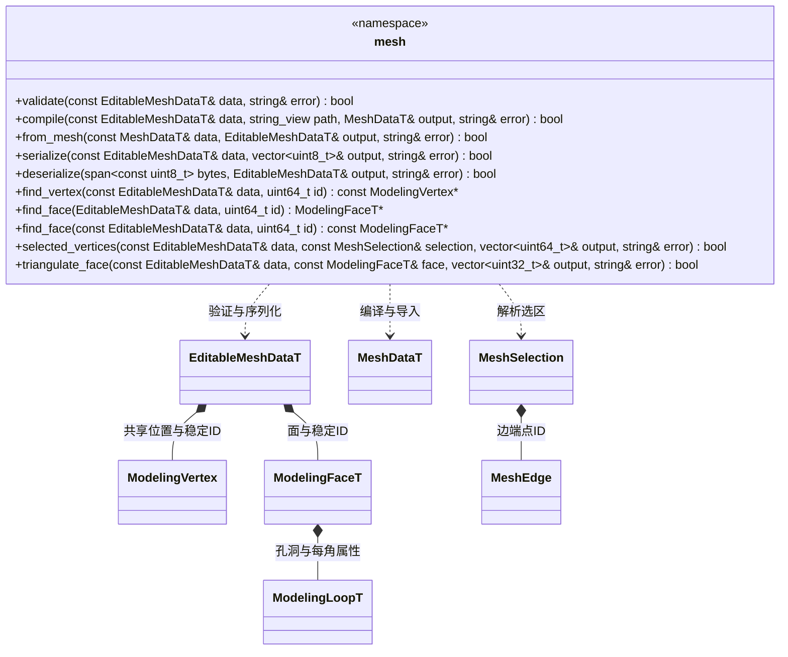

# 可编辑多边形模型

**状态：本轮精简已按确认类图实现。** 四个静态工具类统一为 mesh 命名空间函数；[评审入口](../../../class-diagrams/index.md#全仓精简评审)。

图中的 mesh 表示 `engine::plugins::modeling::mesh` 命名空间，不是 C++ 类。选择、枚举和配置类型仍属于 `engine::plugins::modeling`；生成数据仍属于 `engine::schema`。

持久数据只由 `include/schemas/runtime/modeling.fbs` 生成。模型区分共享几何顶点与每面角 UV、颜色，支持多边形与洞、稳定身份、多材质和平滑组。核心不依赖编辑器或 MCP。

所有操作为普通命名空间函数，保留原参数、返回类型及重载，不新增对象或状态。输入借用，输出由调用方拥有；失败清空输出并返回错误。验证限制有限数值、唯一身份、合法环、共面与无自交；编译采用 Earcut 三角化并保留每角 UV、材质和平滑组。空模型可编辑与保存，但不能编译成渲染网格。

`from_mesh` 按位置建立共享顶点，并保持每角 UV、颜色和材质槽。平滑组由共享边两端的输入法线一致性恢复，后续编译按面面积重算法线；硬边不因位置焊接而自动平滑。任意人工指定法线不作为独立持久数据逐值保留。

验证和编译每次建立一次顶点身份索引，多个面共享该索引；不向 Node 或运行时渲染网格加入编辑拓扑缓存。

## 函数归属与一次迁移

| 原静态类 | 目标命名空间 | 方法定义页 |
| --- | --- | --- |
| EditableMesh | `engine::plugins::modeling::mesh` | 本页的验证、编译、转换、序列化和选区函数 |
| MeshPrimitives | 同上 | [基本体](mesh-primitives.md)的 create、polygon |
| MeshTopology | 同上 | [拓扑](mesh-topology.md)的拓扑及选区运算 |
| MeshGeometry | 同上 | [几何与 UV](mesh-geometry.md)的几何、UV 和平滑运算 |

四组函数名和重载没有冲突，目标保留原方法名。例如 `EditableMesh::validate` 改为 `mesh::validate`，`MeshPrimitives::create` 改为 `mesh::create`。声明与实现继续按原有功能文件组织，每个函数只在所属页定义；跨图只引用 mesh。旧四个类及其兼容转发一并移除，ModelingCommands、导入器和原生调用方一次更新。MCP 工具名称、编辑器命令、序列化格式、资源 GUID 和建模算法保持。

返回状态或借用的函数标注 nodiscard；只读索引查询保留原 const 数据参数和 noexcept，可能分配的计算函数不新增 noexcept。第三方对象留在函数内部，不通过图中的函数组导出。
