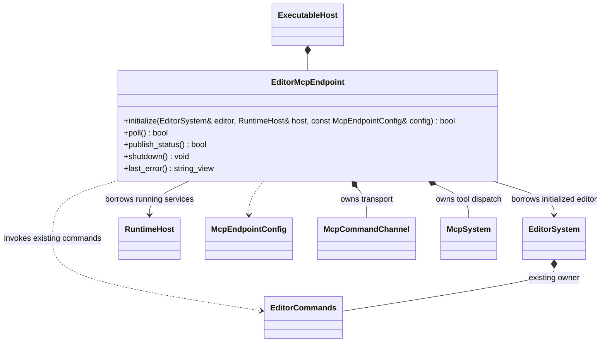
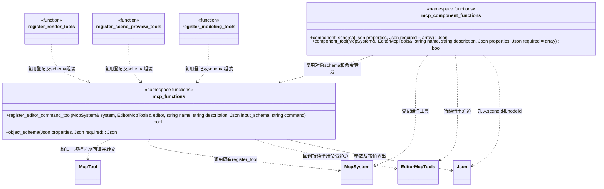

# 编辑器 MCP 工具模块

[类图索引](../../../class-diagrams/index.md) · [编辑器命令](../../../editor/class-diagrams/editor-commands.md)

模块向 MCP 注册项目启停、场景查询、组件修改、批量编辑、撤销、重做和回执查询。组件本身提供普通 C++ 接口；MCP 客户端通过文件通道提交命令，编辑器主线程执行。

## 独立 MCP 端点

[独立运行时 MCP](../../runtime/class-diagrams/mcp-runtime-test.md)与本节共用通道。端点把编辑器进程内的命令通道与回执发布移到 editor/mcp 插件；EditorCommands 的编辑事务、历史及普通执行接口继续属于编辑器核心。

- 编辑器可执行宿主独占 EditorMcpEndpoint，在编辑器和 RuntimeHost 都已初始化后绑定，在二者关闭前先关闭端点。宿主每帧在协调安全点调用 poll 和 publish_status；EditorSystem 不包含或链接 MCP 插件。
- 端点使用 EditorSystem.commands() 的既有借用构造通道 Handler，按原来的事务和身份规则执行命令。EditorCommands 不认识通道、MCP 或测试构建。
- 通道的无重复执行、持久回执与会话校验统一复用 runtime/mcp。端点独占文件监听与项目状态发布，EditorSystem 只推进已有玩法准备和编辑业务。
- 状态/帧/截图工具通过 runtime/mcp 的共享工具登记函数复用原生查询；编辑工具继续由现有模块登记。测试能力关闭时不登记或编译临时脚本执行，普通编辑功能保持可用。
- 等待回执发布成功再关闭编辑器的安排由端点与宿主承担，保留原有关闭时机和请求身份；编辑器核心无需为 MCP 增加依赖。其他编辑事务不因通道移动改变可撤销语义。
- 端点关闭前在编辑器命令服务和运行宿主仍有效时重新采样状态，绕过普通心跳节流，保留最后一帧的真实故障；随后发布 closed，再由宿主关闭借用的编辑器与运行服务。
- start_project 的受理结果包含 prepareId；启动查询和终态记录释放转发至 GameplaySession，复用 [运行时 MCP 工具契约](../../runtime/class-diagrams/mcp-runtime-test.md#状态与工具契约)。EditorMcpEndpoint 不推进启动、不复制启动状态机；命令回执不代替业务完成。普通编辑器构建可查询原生启动状态，临时脚本注入仍须测试构建。
- 本节只定义新增 EditorMcpEndpoint，McpSystem、McpCommandChannel 和 McpEndpointConfig 的唯一契约见各自引用页。现有 EditorMcpTools 仍是工具进程的客户端适配，端点不是其别名或第二个客户端。

## 共用工具登记目标

**状态：本节共用函数已按确认类图实现。** 各模块的直接转发工具共用登记函数和对象 schema 函数；EditorMcpTools 继续拥有项目及目标配置并提供命令通道，McpSystem 继续只管理协议和工具表。两者不合并。

- 图中 mcp_functions 表示 `engine::plugins::mcp` 的两个命名空间函数，不生成同名类、注册表或管理器。声明放插件公开的 `mcp/editor_tool_registration.hpp`，供已声明依赖 mcp 的编辑器插件复用；参数类型沿用现有 McpTool/Json，不新增工具描述模型。
- mcp_component_functions 表示 `engine::plugins::mcp::tools` 的现有组件函数，声明合并到同一公开登记头，实现统一放 `editor_tool_registration.cpp`。component_schema 加入两个非空字符串身份字段并设为必需；component_tool 将同名编辑器命令交给公共转发函数，失败保留原日志和返回值。内部各模块 register_* 声明不导出，插件不包含 MCP 私有头文件。
- register_editor_command_tool 标注 nodiscard。name、description、input_schema 按值转交 McpSystem；command 独立于工具名，按值捕获到回调中，因此工具别名仍可映射到不同的编辑器命令。editor 是持续借用，必须存活到 McpSystem 清空登记。空命令拒绝；其他登记限制、失败状态及登记时机沿用 register_tool。
- 回调仅调用 editor.call_command(command, arguments, reply)，原样保留返回状态、回执和 pending 身份；不增加等待、重试、参数改写或异常。需要参数翻译的工具仍自行登记原处理函数；execute_batch 到 batch 等映射必须显式给出。
- object_schema 接受对象 properties 和字符串数组 required，按值组装现有 type/properties/required/additionalProperties=false；即使 required 为空也保留该字段。参数与各字段限制由类型文件声明，合法性由 McpSystem 统一检查；不建立通用 schema DSL。函数保留分配行为，不标 noexcept。
- 渲染、预览、建模、烘焙、UI、动画制作及 Prefab 的直接转发登记复用此入口；特定参数、默认值、范围、工具名称及逐模块显式装配保持。字段只在工具所属文件定义，公共函数不集中登记业务工具。

## 命令通道

McpCommandChannel 的协议、所有权和唯一方法定义见[运行时 MCP](../../runtime/class-diagrams/mcp-runtime-test.md#端点与通道)。EditorMcpEndpoint 从 EditorCommands 的 get_project_status 读取同安全点状态，合并普通宿主、加载及帧快照。后台任务只持有序列化值和路径，不读取 ECS 或 VM。

## 延迟关闭编辑器

`start_project`、`stop_project` 为无参数非撤销命令，复用同一会话校验、OS 提交锁和持久回执。启动仍在项目资源锁内刷新目录并开始玩法，预览与玩法保持互斥。

`close_editor({delayMs?})` 使用同一命令通道，由 EditorSystem 内部登记，无新增公开类或方法。默认 500 ms，可选 100～10000 ms。先返回 `scheduled: true`；只有持久回执发布成功后才开始单调时钟计时，发布失败保留请求并重试，不重复执行。重复请求不延长原截止时间。

延时到期后投递现有 SDL 退出事件，由宿主走正常清理；源文件保存仍须显式调用，关闭请求不替用户保存。MCP 工具进程独立存活，仍可查询原完成回执；调度完成、进程退出和客户端已读是不同状态。此工具不加入可撤销批次。

`set_node_state` 和 `set_component_state` 使用同一编辑通道与撤销栈；后者接收 `get_scene` 返回的 `componentType`，两者至少提供 `enabled` 或 `visible` 布尔值。查询分别返回局部状态与继承后的 `active/visibleInHierarchy`，修改父节点不覆盖后代局部选择。
