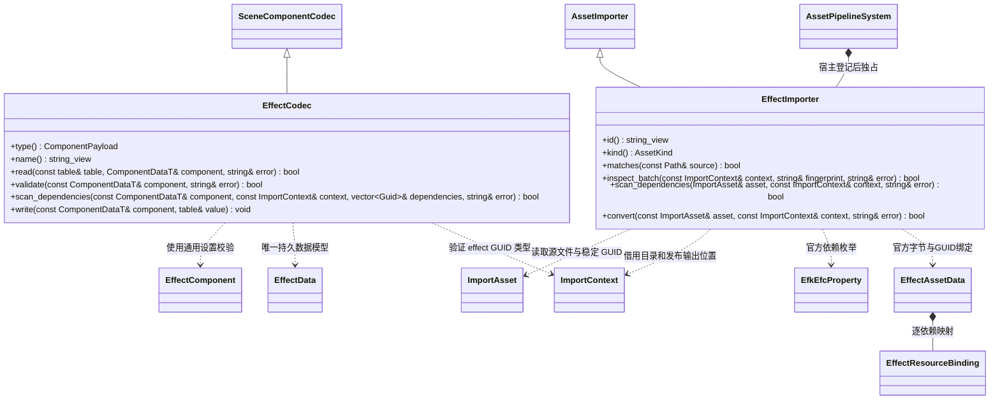

# 特效导入与编辑器工具

[类图索引](../../../class-diagrams/index.md) · [运行时特效](../../runtime/class-diagrams/effects.md)

特效编辑器插件负责官方 `.efkefc` 资源导入、场景组件编解码、可撤销设置命令及 MCP 协议适配。运行时播放和绘制由独立运行时插件完成；基础编辑器不 include 或链接具体特效插件。宿主按 CMake 插件清单装配。

## 导入契约

- `.efkefc.meta` 使用普通 `guid/importer/meta_version`，`importer = "effect"`。`EffectAssetData`（EFCT）只封装原样保留的官方 `.efkefc` 字节与依赖路径/GUID/类型绑定，以 `AssetKind::effect` 发布到标准 `cache/gen/GUID`；特效节点和算法仍由官方格式表达，不重新实现特效格式。运行插件解析这一标准 FlatBuffers 资源，基础资源核心只保存字节。
- 用 Effekseer 1.80.8 官方 `EfkEfcFile` 检查容器及运行数据存在，`EfkEfcProperty::Load` 读取 Color/Normal/Distortion/Model/Curve 依赖。官方解析器的兼容补丁集中在 `third_party/patches/`，构建期应用到缓存副本，不在导入器复制二进制解析器。
- 依赖默认相对 `.efkefc` 所在目录解析。meta 可通过 `[[resources]] path = "Texture/Particle01.png"` 与 `resource = "effects/textures/particle01.png"` 显式映射作者引用到项目资源；这是通用资源重定位参数，不更改官方二进制，也不自动猜测大小写。拒绝重复及未声明的映射键、绝对路径、URI、控制字符、越过 `assets/` 根或符号链接逃逸。分隔符统一为 `/` 并规范化相对路径，再通过当前批次 GUID 目录及类型表验证。最终绑定保留作者路径与资源 GUID，运行包不依赖源目录布局。
- 图片必须已由标准管线识别为 Texture；Color 引用要求图片 meta 中 `srgb=true`（默认），Normal/Distortion 引用要求 `srgb=false`，不能同一 GUID 同时承担两种颜色空间。`.efkmodel` 以独立 Source 字节资源保留。当前运行时尚无 Curve loader，`.efkcurve` 引用明确拒绝。所有实际引用同时进入增量构建和运行依赖，按 GUID 去重；管线负责缓存、原子发布、共享加载及反向卸载。
- 自定义材质、音效和曲线依赖明确拒绝；未知容器、官方解析失败或未识别依赖类型不静默丢弃。`.efkproj`、旧 `.efk` 与 `.efkpkg` 不冒充可播放资源。
- `EfkEfcProperty` 只提供依赖信息，不能判断 GPU 粒子节点。导入和运行共用运行时插件 `validate_effect(ByteView, string&)`：通过官方 Setting 的 GPU factory 回调识别不支持的 GPU 粒子，用官方 Effect 节点接口校验扭曲、软粒子、自定义材质等能力；不依赖空依赖列表推测支持状态。

## 场景与命令契约

场景以普通节点挂载 `type = "effect"`，保存 `effect` GUID、`speed`、`loop`、`play_on_awake` 与通用 `enabled`。`EffectCodec` 复用运行时组件校验；`SceneComponentCodec::scan_dependencies` 是默认空的通用扩展方法，由场景导入逐组件调用，使特效引用进入场景依赖，无需基础编辑器识别插件类型。

- `register_effect_codec()` 登记场景 TOML 编解码器；`EffectImporter` 由宿主交给现有 AssetPipelineSystem 登记。
- `register_effect_commands(WorldSystem&, SceneCommands&, EditorCommands&)` 提供 `set_effect/get_effect`，沿用 `ComponentEdit` 与稳定节点身份实现撤销重做。`effect` 参数采用标准资源路径，查询同时返回 `effectGuid`。
- `get_effect` 是唯一查询入口，同时返回组件设置与即时播放状态；`play_effect/pause_effect/stop_effect` 操作当前场景组件的即时播放状态，不修改持久场景设置，也不进入撤销历史。不保留重复查询入口。
- `register_effect_mcp_tools(McpSystem&, EditorMcpTools&)` 注册上述六项命令，全部要求当前 `sceneId/nodeId`；MCP 只转发参数，不持有特效算法或图形后端。

本文件描述接口和边界，平台与实际效果验证以对应运行记录为准。
