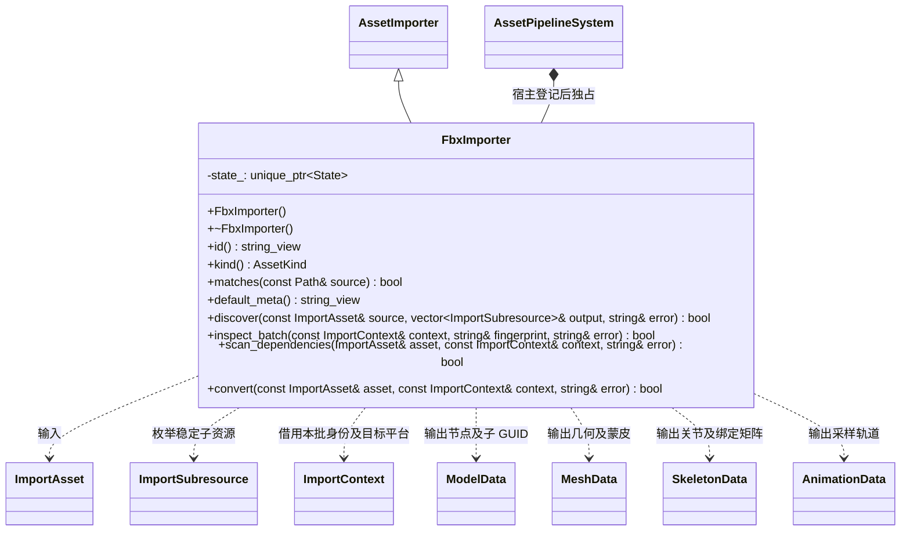

# FBX 模型资源导入

FBX 是可选编辑器插件，使用固定版本 ufbx 读取模型。编辑器基础管线只认识导入接口和子资源身份；运行时只读取生成后的 FlatBuffers，不包含 ufbx 或编辑器策略。

- 插件 id 为 `fbx`，主产物为 `model`；子资源逻辑路径是源路径加 `meshes/<节点层级>`、`skeleton`、`animations/<动画名称>`。源 meta 保存主 GUID 和所有子 GUID，复制/冲突遵循基础管线规则。
- 源文件与 meta 中的 `[[subresources]]` 构成编辑器虚拟对象包。运行时 Model v2 仅保存可实例化层级以及节点引用的 Mesh/Material；Mesh 与 Animation 分别引用所需 Skeleton，Model 不持有同源动画列表。打包按选中根及实际依赖裁剪，同源分组不形成运行时依赖。
- `discover` 解析每个源一次；后续并行转换只读本批解析结果。骨架与动画使用生成 Schema，未建立另一份持久化模型。
- `.meta` 中 `sample_rate` 默认 30，只接受 1–240 的有限数值；`skeleton` 必须是字符串，可引用其他 FBX 的骨架子资源，用于导入同一骨架的外部动画。显式参数类型错误返回失败，不回退默认值。动画节点按完整层级路径对应，目标骨架缺少动画的末端关节使用静止姿态；加权骨骼及祖先缺失不能静默忽略。
- 动画固定间隔采样始终保留源片段精确末帧；若倒数采样点与末帧编码为相同 float 时间，仅去除倒数点。其他无法严格递增的时间仍失败，避免重复关键帧或丢失末端姿态。
- `.meta` 的 `normals` 默认 `"import"`，保留源法线；`"generate"` 使用 ufbx 的拓扑及平滑组重新生成，未指定平滑组时采用平滑法线。参数变化参与增量构建，未知值或非字符串返回失败。该选择只属于编辑器导入插件，运行时读取最终 Mesh 法线。
- `.meta` 的 `scale_factor` 默认 `1.0`，接受 `[0.0001, 10000]` 内有限数值；`rotation_offset` 默认 `[0.0, 0.0, 0.0]`，必须恰好包含三个有限数值，以度为单位按 XYZ 顺序旋转。两项通过 ufbx 根变换与统一坐标/米制转换组合，一致影响 Model、Mesh、Skeleton 和 Animation；运行脚本不修补导入尺寸或朝向。外部骨架引用要求源与骨架的这两项配置完全一致，否则失败；不猜测或自动补偿。
- `.meta` 可用 `[[material_remaps]]` 按 Mesh 子资源 key 配置完整材质槽：`mesh = "meshes/root/..."`、`materials = ["project/materials/body.material", ...]`。`mesh` 必须存在且不能重复；材质数组必须与导入节点的材质槽数量一致，所有槽均为非空的标准材质逻辑路径，解析后的资源必须是 Material。未配置的 Mesh 使用内置默认材质；显式无效配置直接失败，不回退默认值。
- 私有状态在 `discover` 保存本批 FBX 文档与按源文件索引的材质映射快照，转换任务只读这些数据。`inspect_batch` 重新解析并比较映射及已有导入参数，检测发现阶段之后的修改；基础管线在发布前继续校验源与完整 meta 指纹。映射变更参与该源的增量构建，不改变主资源与子资源 GUID；失败批次不发布部分运行资源。
- Model 节点的 `material_guids` 直接来自校验后的映射，依赖扫描使用同一解析规则，仅加入节点真正使用的材质及 Mesh。材质的 Shader/Texture 依赖由原有材质导入器维护；不在脚本实例化后修补导入配置，不新增运行时设置类型或项目专用分支。
- 坐标统一为右手 Y 向上、米；保留根变换。网格角点拆分后保持原控制点权重，选择最高四个影响并归一化。当前生成线性蒙皮，对不支持的变形类型明确失败。
- 共享骨骼逆绑定的一致性按米归一化后，双向比较 `inverse(A) * B` 与 `inverse(B) * A` 是否接近单位变换，避免骨骼局部单位放大浮点误差；真实位姿冲突、非有限或奇异矩阵仍失败。
- MCP 使用现有资源导入、打包、同步命令驱动管线，不复制 FBX 解析或骨骼转换实现。
