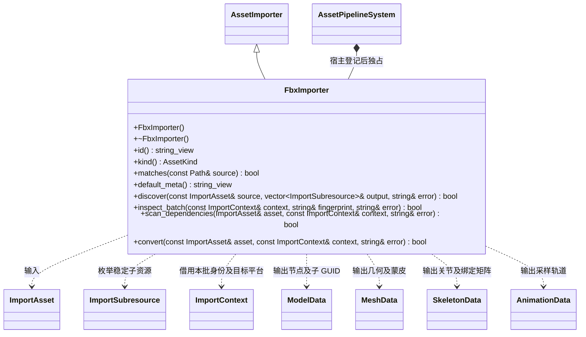

# FBX 对象包导入

FBX 是可选编辑器插件，使用固定版本 ufbx 读取模型。编辑器基础管线只认识导入接口和子资源身份；运行时只读取生成后的 FlatBuffers，不包含 ufbx 或编辑器策略。

- 插件 id 为 `fbx`，主产物为 `model`；子资源逻辑路径是源路径加 `meshes/<节点层级>`、`skeleton`、`animations/<动画名称>`。源 meta 保存主 GUID 和所有子 GUID，复制/冲突遵循基础管线规则。
- `discover` 解析每个源一次；后续并行转换只读本批解析结果。骨架与动画使用生成 Schema，未建立另一份持久化模型。
- `.meta` 中 `sample_rate` 默认 30，只接受 1–240 的有限数值；`skeleton` 必须是字符串，可引用其他 FBX 的骨架子资源，用于导入同一骨架的外部动画。显式参数类型错误返回失败，不回退默认值。动画节点按完整层级路径对应，目标骨架缺少动画的末端关节使用静止姿态；加权骨骼及祖先缺失不能静默忽略。
- `.meta` 的 `normals` 默认 `"import"`，保留源法线；`"generate"` 使用 ufbx 的拓扑及平滑组重新生成，未指定平滑组时采用平滑法线。参数变化参与增量构建，未知值或非字符串返回失败。该选择只属于编辑器导入插件，运行时读取最终 Mesh 法线。
- 坐标统一为右手 Y 向上、米；保留根变换。网格角点拆分后保持原控制点权重，选择最高四个影响并归一化。当前生成线性蒙皮，对不支持的变形类型明确失败。
- MCP 使用现有资源导入、打包、同步命令驱动管线，不复制 FBX 解析或骨骼转换实现。
