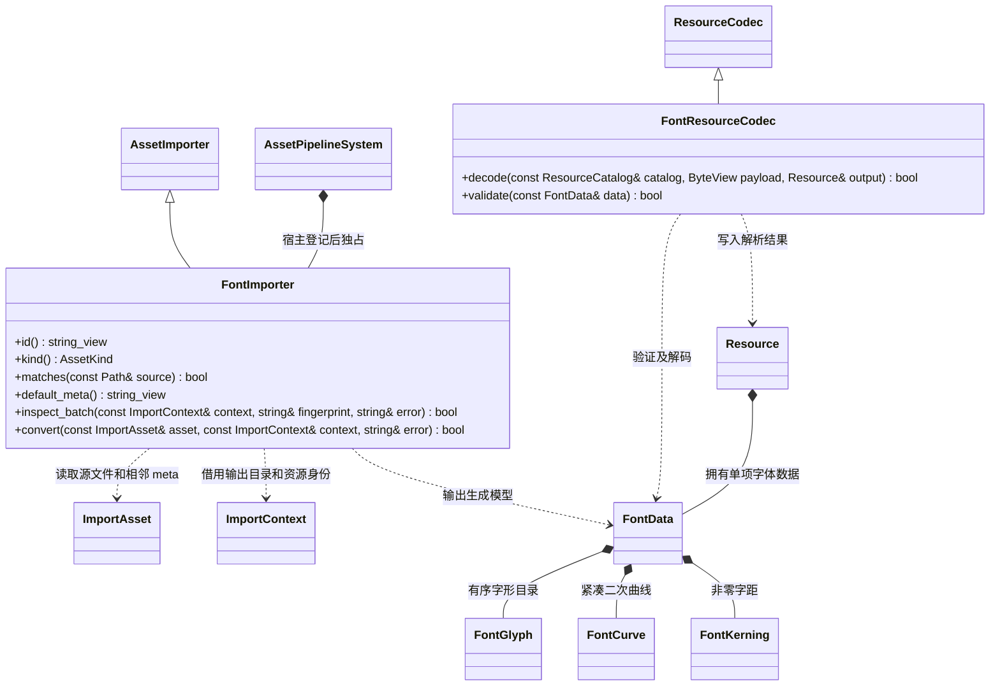

# 字体资源导入

字体源文件只由编辑器插件解析。核心读取独立 FontData 资源，UI 和三维文字共用其字形、度量与曲线；运行时不解析 TTF，也不依赖 FreeType。

- `FontImporter` 位于 `plugins/editor/font_import/`；`FontResourceCodec` 与生成数据位于核心。
- 字形坐标和度量统一归一化到 em；`units_per_em` 保留来源信息。字号和颜色属于使用者，不为每个字号生成资源。
- 所有字形共享一个紧凑曲线数组，以偏移和数量定位；方向保持源轮廓的非零绕组语义。运行时可建立共享 GPU 曲线数据。
- 字符范围、字体集合 face 索引、kerning 开关写在源 `.meta`；参数和工具版本参与增量指纹。源文件 GUID 对应唯一 `cache/gen/GUID`。
- 首阶段支持 TrueType 二次轮廓；遇到 CFF/三次曲线明确返回失败，不能静默使用固定近似。公开 FreeType API 用于解析，不使用授权 C4 的实现内容。
