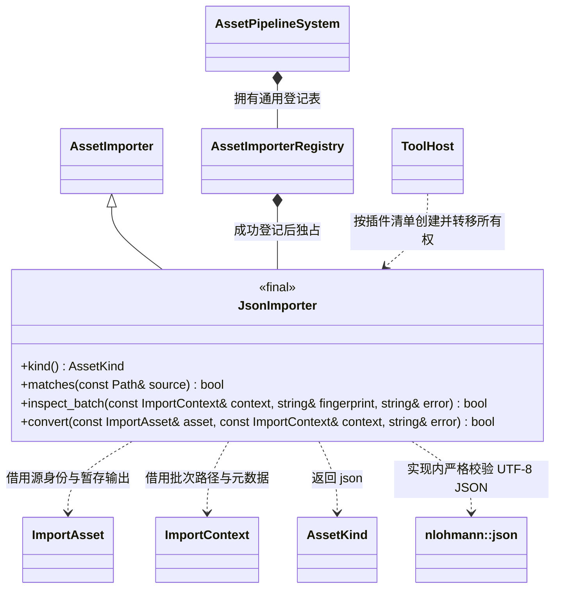

# JSON 资源导入

归属：[统一资源导入插件](asset-import.md)，命名空间 `engine::plugins::asset_import`；本页只维护这一类型的源格式、公开方法和数据关系。

[类图索引](../../../class-diagrams/index.md) · [通用导入契约](../../../editor/class-diagrams/asset-importers.md) · [JSON 脚本读取](../../runtime/class-diagrams/json-script-api.md)

项目将地图、武器等配置保存为独立 `.json` 资源；引擎只校验 JSON 格式并提供标准资源读取，字段模型、配置版本和资源使用时机由项目脚本定义。JsonImporter、资源类型登记与三个工具宿主装配已按本图接入。

## 唯一新增导入类

`JsonImporter` 位于 `engine::plugins::asset_import`，与其余源格式实现共用 `editor/asset_import` 插件。它继承编辑器基础的 `AssetImporter`；宿主创建后通过现有 `AssetPipelineSystem::add_importer` 转交注册表独占。ToolHost 仅表示编辑器、资源构建和 MCP 三个可执行入口，不新增宿主包装类。

`kind` 为 `const noexcept`，其余查询和转换遵循通用导入契约；`matches`、`convert` 为 `const`，`inspect_batch` 为普通重写方法。四个方法均为 `override`、`[[nodiscard]]`。不增加初始化、关闭、缓存或任务管理接口。

- `kind()` 返回在既有 `AssetKind` 尾部追加的 `json`，保持已有类型数值；继承的 `id()` 返回 `json`。
- `matches` 通过现有扩展名规范化工具识别 `.json`。相邻 `.json.meta` 仍由管线生成和维护唯一 GUID，importer 为 `json`；不增加 JSON 专用 meta 字段。
- `inspect_batch` 的指纹包含导入器版本、既有 nlohmann/json 版本及本图约定的校验规则；只因本类型输入或工具变化失效，不触摸未变化依赖。
- `convert` 读取非空、至多 **4 MiB 字节**的严格 UTF-8 JSON。拒绝 UTF-8 BOM、非法编码、原始 NUL 字节、注释、尾逗号、截断及有效值后的多余内容；允许对象、数组、字符串、数字、布尔和 null，字符串中的合法 `\u0000` 转义可以保留。nlohmann/json 使用不抛异常的校验接口。
- 校验成功后，源载荷逐字节写入管线提供的暂存输出，不改空白、字段顺序或字符串内容，不产生 JSON FlatBuffers 模型。管线继续负责既有资源信封、内容指纹、`cache/gen/GUID`、SQLite 索引和整批原子发布；失败返回 false 与上下文错误，保留旧发布版本。
- 继承现有空依赖实现，不覆盖 `scan_dependencies`；JSON 中的字符串按普通业务数据处理，不解释为资源路径、GUID 或依赖，不从 meta 增加 JSON 专用依赖规则。

## 运行时与构建边界

运行时将 `json` 显式登记到现有 [BinaryResourceCodec](../../../runtime/class-diagrams/resource-codecs.md)，通过 [Resource.bytes()](../../../runtime/class-diagrams/resource.md) 保存原始载荷；不增加 JsonResource、JsonCodec、JSON System 或 Manager。JSON 内容只在脚本门面读取时解析，核心资源层不链接 nlohmann/json。

JSON 实现依赖编辑器基础的 `AssetImporter`，私有复用仓库已选的 `nlohmann_json::nlohmann_json`；通用管线仍不依赖具体插件。统一 `cmake/plugins/editor/asset_import.cmake` 管理五种导入器的源码与离线依赖，目标为 `engine_asset_import`（`engine::asset_import`）。插件默认随资源管线选择，也可整体关闭；关闭时不创建目标或宿主装配分支。运行包只包含资源载荷和运行时绑定，不包含导入插件。

项目 `settings/editor-resource-build.toml` 在显式精简清单中列出 JSON 配置和实际使用的场景、武器等入口，再由现有依赖收集器闭包构建。UI 贴图继续通过 `.rml.meta` 声明依赖。JSON 字符串不会把未列入入口、也未被其他标准资源引用的场景或武器带入包中。

## 实现位置与验证

- 追加类型与解码登记：`include/schemas/runtime/asset_catalog.fbs`、`src/engine/runtime/resource/codecs/resource_codecs.cpp`。
- 新增导入器：`include/engine/plugins/editor/asset_import/json_importer.hpp`、`src/engine/plugins/editor/asset_import/json_importer.cpp`。
- 插件选择与条件链接：`cmake/plugins/editor/asset_import.cmake`、`cmake/plugins/selection.cmake`、`cmake/editor/hosts.cmake`。
- 宿主按启用状态登记：`src/editor_main.cpp`、`src/asset_build_main.cpp`、`src/mcp_main.cpp`。
- 验证合法/非法 JSON、UTF-8、BOM、4 MiB 边界、原字节保留、空依赖、旧版本保留，以及插件开启/关闭的目标和装配。脚本读取的实现与测试见[JSON 脚本接口](../../runtime/class-diagrams/json-script-api.md)。

定向测试位于 `tests/plugins/editor/asset_import/json_importer_test.cpp`，目标 `engine_json_importer_test`，CTest 名称 `editor.json_importer`；覆盖上述格式、字节边界、空依赖、GUID/meta、增量复用及失败保留旧版本。`resource.codecs` 另覆盖 json 类型的标准信封和原字节读取。实际运行的构建、测试和平台限制统一记录在[测试与范例](../../../testing.md)，不从测试源码存在推断已经验证。
