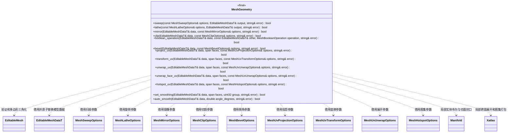

# 建模几何操作

图中的建模类、枚举和配置类型属于 `engine::plugins::modeling`；生成数据仍属于 `engine::schema`。

`MeshGeometry` 位于插件的纯 C++ 核心。它只读取和修改 FlatBuffers 生成的可编辑模型，
不认识场景、编辑器、文件、JSON 或 MCP。编辑器负责选择、撤销、持续镜像状态与资源发布，
MCP 通过编辑器注册的命令调用这些能力。每次操作先在候选数据上完成，失败不改调用者模型。

- 扫掠使用平行传输标架，可设置自定义二维轮廓、开放路径、扭转和端面；闭环路径需要
  独立处理标架接缝，当前明确拒绝重合首尾，避免用重叠端盖假装闭合。旋转体绕 Y 轴生成。
- 镜像通过反射变换与反转绕序保持正面，可复制并焊接镜像平面上的公共顶点。
  调用方通过 `require_half_space` 要求源模型仅占一个半空间，持续镜像使用此约束
  防止复制出交叉重叠壳体。半空间判定属于几何核心，模式状态属于编辑器。
- 布尔接受闭合、有向流形；切割封口复用 Manifold。非封口切割可处理开放表面。
- 边倒角接受闭合凸多面体及真实边选择，支持段数和截面形状，拒绝凹体、退化边、
  越界宽度与非流形输入；不会用面内缩替代边倒角，也不会静默退化为普通切角。
- UV 支持平面、盒、圆柱与球投影、变换、按长宽比匹配 Hotspot。`unwrap_uv` 使用
  xatlas 自动切分曲面图表、选择其平面/LSCM 等参数化算法并打包，支持显式接缝、
  保留输入 UV 接缝、分辨率提示、留白和旋转。接缝限定图表分组，自动算法可以增加接缝。
  如图表在多边形内部产生接缝，仅将该面三角化以保留独立面角 UV。
  `unwrap_face_uv` 另外提供逐面独立平面岛打包，适用于明确要求每面分开的工作流。
- 面材质、UV、颜色和平滑组随布尔输入传递；新切面使用调用方指定的材质槽。
- 操作可能改变拓扑身份，编辑器负责重新验证已有选择；几何核心不保存选择历史。
