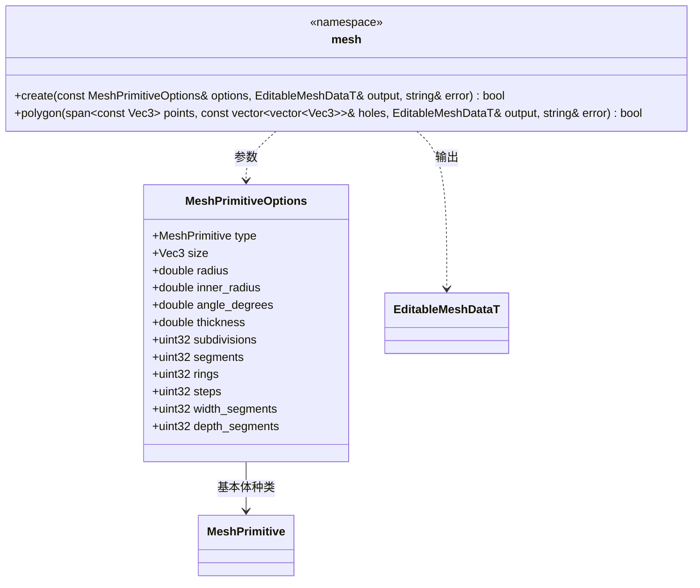

# 参数化基本体

**状态：本轮精简已按确认类图实现。** 四个静态工具类统一为 mesh 命名空间函数；[评审入口](../../../class-diagrams/index.md#全仓精简评审)。

图中的 mesh 表示 `engine::plugins::modeling::mesh` 命名空间，不是 C++ 类。选择、枚举和配置类型仍属于 `engine::plugins::modeling`；生成数据仍属于 `engine::schema`。

支持方块、网格平面、圆柱、圆锥、经纬球、环面、三棱柱、直楼梯、拱体、管、门框、弧形楼梯、XY 精灵平面、二十面体细分球，以及含洞的自定义共面多边形。

- `size` 控制直角基本体尺寸；圆形基本体使用 `radius`，环面用 `inner_radius` 表达管半径，拱体、管和弧形楼梯用其表达内半径。
- `segments`、`rings` 控制旋转分段，`width_segments`、`depth_segments` 控制平面网格；门框使用 `thickness`，二十面体球使用 `subdivisions`（0 到 5），楼梯使用 `steps`。
- 圆柱/球/环面的平滑组与每角 UV 独立，纹理接缝不打断几何共享。全部封闭基本体均验证三角化后的边双向配对与正体积。
- 生成结果使用统一可编辑模型，后续拓扑和材质操作与基本体类型无关。参数超限或退化几何返回失败并清空输出。
