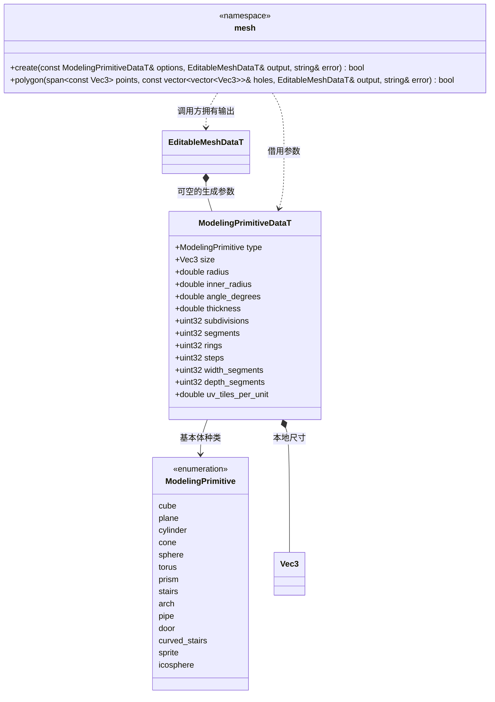

# 参数化基本体

本图定义基本体生成参数与默认 UV 契约。接口和源格式只维护当前版本，不提供旧类型、参数别名或旧格式读取。

建模用于基础场景搭建，复杂模型由 DCC 制作。保留现有 14 类基本体和已有几何操作，不以完整复刻其他建模工具为验收目标。

`mesh` 表示 `engine::plugins::modeling::mesh` 命名空间。持久生成参数唯一声明在 `include/schemas/editor/modeling.fbs`，C++ 直接使用生成的 `engine::schema::ModelingPrimitiveDataT`，不另存 JSON 参数或维护第二份手写持久模型。

## 生成与保存

- `create` 生成拓扑、默认表面属性和 UV，并将实际使用的生成参数写入 `output.primitive`。参数验证失败时清空输出并返回具体错误。其他字段及所有权见[可编辑模型](editable-mesh.md)。
- `primitive` 表示最近一次创建或重建的输入；后续点面、UV 或材质槽编辑不会把它变成当前几何的尺寸描述。实际尺寸通过[模型边界查询](modeling-commands.md#模型查询)取得。
- `polygon`、扫掠、旋转体及从普通 Mesh 恢复的编辑网格不附带基本体生成参数。不提供通用修改器栈或完整建模历史。
- 不适用的原生配置字段必须保持默认值；按 `type` 校验有限数值、尺寸、内外半径、角度及分段约束。不能接受影响不了该形状的非默认值。
- 生成参数跟随可编辑模型保存和恢复。复制、重建、组合及镜像的参数归属见[建模编辑业务](modeling-commands.md#按参数重建)。

## 对外参数

下表是 `modeling_create`、`modeling_rebuild` 和 `modeling_help` 共用的基本体参数契约；未知或不适用字段明确报错。创建时省略字段使用默认值，重建时省略字段保留已保存的生成值。

| shape | 允许的专用参数 | 语义及默认值 |
| --- | --- | --- |
| `cube`、`prism` | `size` | XYZ 尺寸，默认 `[1, 1, 1]` |
| `plane` | `width`、`depth`、`widthSegments`、`depthSegments` | XZ 平面，尺寸默认 1，分段默认 1 |
| `sprite` | `width`、`height` | XY 平面，尺寸默认 1 |
| `cylinder`、`cone` | `radius`、`height`、`segments` | 半径 0.5，高 1，圆周分段 24 |
| `sphere` | `radius`、`segments`、`rings` | 半径 0.5，圆周分段 24，纬向分段 12 |
| `torus` | `radius`、`tubeRadius`、`segments`、`rings` | 主半径 0.5，管半径 0.25，分段 24 / 12 |
| `stairs` | `size`、`steps` | X 为行进长度，Y 为总高，Z 为宽度；尺寸 `[1, 1, 1]`，8 级 |
| `arch` | `radius`、`innerRadius`、`depth`、`angleDegrees`、`segments` | 外半径 0.5，内半径 0.25，Z 厚度 1，180 度，24 段 |
| `pipe` | `radius`、`innerRadius`、`height`、`segments` | 外半径 0.5，内半径 0.25，高 1，24 段 |
| `door` | `size`、`thickness` | XYZ 外尺寸 `[1, 1, 1]`，边框厚度 0.1 |
| `curved_stairs` | `radius`、`innerRadius`、`height`、`angleDegrees`、`steps` | 外半径 0.5，内半径 0.25，总高 1，180 度，8 级 |
| `icosphere` | `radius`、`subdivisions` | 半径 0.5，细分默认 2，范围 0 到 5 |

尺寸、半径和厚度要求有限且大于 `1e-9`，上限 `1e12`；圆周／纬向分段为 3～256，平面分段和台阶数为 1～256。内半径或管半径须小于外半径；拱体和弧形楼梯角度在 `(0,360)`，每级弧形台阶小于 180 度；门框厚度小于半宽及总高。

所有基本体另接受 `uvTilesPerUnit`，默认 1，要求为有限正数且不超过 `1e12`。编辑器将 `width` / `height` / `depth` 写入生成数据 `size` 的对应轴；未使用的轴保持 1。`tubeRadius` 写入环面生成数据的 `inner_radius`。这些是当前字段映射，不接受被替换的 `size` 或 `innerRadius` 写法作为别名。

参数定义在建模插件内部共享，原生校验按形状检查字段，编辑业务据此生成参数 Schema 和帮助；MCP 不维护另一套允许字段。`polygon`、`sweep`、`lathe` 保持各自明确的输入，不接受上述基本体专用参数。

## 默认 UV

- `uvTilesPerUnit = 1` 表示模型本地长度每 1 单位重复一次纹理。方块、平面及其他平面表面使用本地长度投影，避免不同尺寸物体都被压到 `0～1`。
- 圆柱侧面按圆周长和高度定标，圆锥侧面按圆周长和斜长定标；端盖使用平面投影。球、环面及细分球保留适合该表面的接缝和参数化，以半径对应的弧长定标。曲面不承诺全表面等距展开。
- 圆周接缝保留每角 UV，不能因位置共享而将纹理跨接缝拉伸。平滑组和法线行为保持所属几何契约。
- 创建和重建自动生成默认 UV；后续显式 `project_uv`、`transform_uv`、`unwrap_uv` 继续修改当前网格。
- Node 的缩放不隐式改写源 UV。需要保持格子物理比例时，通过基本体尺寸重建；任意拓扑编辑后可显式重新投影。此职责不进入运行时 Shader 或 Transform。
