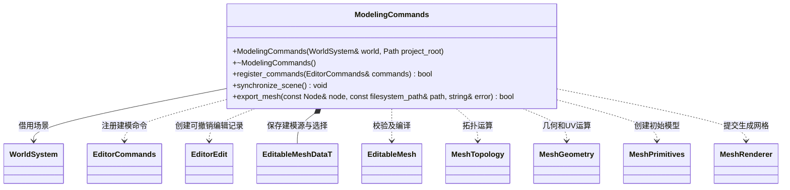

# 建模编辑业务

[类图索引](../../../class-diagrams/index.md) · [核心建模](editable-mesh.md)

编辑器负责场景身份、选择、撤销与源资源文件；全部几何运算调用插件的纯 C++ 核心。
核心不识别编辑器、项目目录或 MCP，运行时仍只消费生成的 MeshData。

- 模块借用 WorldSystem；必须存活到 EditorCommands 释放全部处理函数和编辑记录。
- 以完整 sceneId 和稳定 modelId 定位对象，modeling_get 返回当前 nodeId。几何修改保持节点；创建和删除的撤销会重建节点并获得新 nodeId，旧 nodeId 明确拒绝。模型内部顶点与面 ID 保留。
- 宿主每次场景生命周期更新后调用 noexcept synchronize_scene；场景身份改变立即清理旧编辑源快照，再按项目 mesh 路径恢复保存的可编辑源；旧场景命令拒绝执行。
- `modeling_create/get/select/edit/delete/duplicate/combine/separate/save/load` 各自注册。修改通过 EditorEdit；复用已有 batch/undo/redo，不建立另一条历史。
- 几何运算在候选副本上执行，完整编译通过才替换节点网格。撤销校验前后快照，失败不改变对象。
- 保存为 assets 内的 .mesh TOML；渲染数组兼容资源管线，附加 modeling 字段保存 schema 生成数据，meta/GUID 继续由资源管线管理。
- 文件访问拒绝绝对路径、越界、符号链接和非 .mesh 后缀；保存采用同目录临时文件替换。
- modeling_help 在空编辑器也可查询操作参数和示例；选择支持 replace/grow/shrink/connected/edge_ring/edge_loop，操作均由 C++ 核心计算。
- mirror_mode 为编辑器会话状态：enable 保留原始可编辑半边模型并派生镜像渲染；cancel 移除派生部分；finish 将镜像烘焙到源模型。三者可撤销。核心验证源模型位于镜像平面的单一半空间；跨过平面的编辑失败且保持源模型、派生网格不变。保存时写入烘焙后的完整几何，源文件不携带活跃编辑模式。
- Boolean 将另一对象的世界变换转换到目标局部空间，组合将各源对象变换烘焙到新对象；坐标空间选择归编辑器，模型变换和布尔算法归纯 C++ 核心。
- save 是非撤销文件发布，不能进入 batch；不私自生成 meta 或开启导入系统。发布后通过既有 sync_assets 导入与同步，GUID/meta/cache 由资源管线维护。
- 删除仅接受根级、无子节点且仅有 Transform 与 MeshRenderer 的建模对象，防止撤销丢失其他业务组件。复制及分离有父节点的模型时，把可见世界变换烘焙到新根节点的模型数据。
- 面操作要求非空面选区或 all=true；顶点、边选择不会隐式扩展成全部面的 UV、材质或平滑组修改。
- replace 接受显式空选择并可撤销；unwrap_uv 的 seams=[] 表示没有显式接缝。边列表拒绝重复及反向重复，不把空选择自动扩展为几何操作的全选。
- 本模块保存、加载 .mesh 建模资源；[ScenePersistence](../../../editor/class-diagrams/scene-persistence.md) 通过宿主注入 export_mesh 回调保存完整场景，其余相机、灯光、变换与材质持久化均由编辑器场景模块负责。
