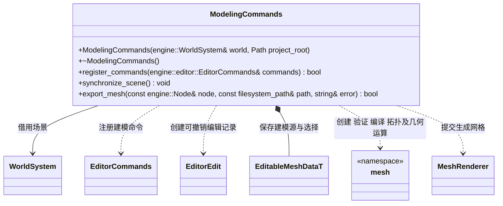

# 建模编辑业务

建模命令支持按参数重建、生成参数查询及本地／世界包围盒。基本体参数与 UV 规则见[参数化基本体](mesh-primitives.md)。

图中的建模类、枚举和配置类型属于 `engine::plugins::modeling`；生成数据仍属于 `engine::schema`。 `WorldSystem`、`Node` 等运行时类型属于 `engine`，`EditorCommands`、`EditorEdit` 属于 `engine::editor`。

[类图索引](../../../class-diagrams/index.md) · [核心建模](editable-mesh.md)

编辑器负责场景身份、选择、撤销与源资源文件；全部几何运算调用插件的纯 C++ 核心。
核心不识别编辑器、项目目录或 MCP，运行时仍只消费生成的 MeshData。

- 模块借用 WorldSystem；必须存活到 EditorCommands 释放全部处理函数和编辑记录。
- 以完整 sceneId 和稳定 modelId 定位对象，modeling_get 返回当前 nodeId。几何修改保持节点；创建和删除的撤销会重建节点并获得新 nodeId，旧 nodeId 明确拒绝。一般编辑保留未替换元素的身份；参数重建分配新顶点与面 ID。
- 宿主每次场景生命周期更新后调用 noexcept synchronize_scene；场景身份改变立即清理旧编辑源快照，再按项目 mesh 路径恢复保存的可编辑源；旧场景命令拒绝执行。
- `modeling_create/rebuild/get/select/edit/delete/duplicate/combine/separate/save/load` 各自注册。修改通过 EditorEdit；复用已有 batch/undo/redo，不建立另一条历史。
- 几何运算在候选副本上执行，完整编译通过才替换节点网格。撤销校验前后快照，失败不改变对象。
- 建模源保存为 assets 内的 `.mesh` TOML，以 `[modeling]` 中的 FlatBuffers 数据为唯一模型源，不输出冗余渲染数组；普通非建模 `.mesh` 仍由所属导入器处理。meta/GUID 继续由资源管线管理。
- 文件访问拒绝绝对路径、越界、符号链接和非 .mesh 后缀；保存采用同目录临时文件替换。路径校验、建模源 TOML 读写及 hex 编解码集中在插件内部 `modeling_source_io.cpp`；不持有场景、选区或撤销状态，`ModelingCommands` 继续负责身份校验与事务。
- modeling_help 在空编辑器也可查询操作参数和示例；选择支持 replace/grow/shrink/connected/edge_ring/edge_loop，操作均由 C++ 核心计算。
- mirror_mode 为编辑器会话状态：enable 保留原始可编辑半边模型并派生镜像渲染；cancel 移除派生部分；finish 将镜像烘焙到源模型。三者可撤销。核心验证源模型位于镜像平面的单一半空间；跨过平面的编辑失败且保持源模型、派生网格不变。保存时写入烘焙后的完整几何，源文件不携带活跃编辑模式。
- Boolean 将另一对象的世界变换转换到目标局部空间，组合将各源对象变换烘焙到新对象；坐标空间选择归编辑器，模型变换和布尔算法归纯 C++ 核心。
- save 是非撤销文件发布，不能进入 batch；不私自生成 meta 或开启导入系统。发布后通过既有 sync_assets 导入与同步，GUID/meta/cache 由资源管线维护。
- 删除仅接受根级、无子节点且仅有 Transform 与 MeshRenderer 的建模对象，防止撤销丢失其他业务组件。复制及分离有父节点的模型时，把可见世界变换烘焙到新根节点的模型数据。
- 面操作要求非空面选区或 all=true；顶点、边选择不会隐式扩展成全部面的 UV、材质或平滑组修改。
- replace 接受显式空选择并可撤销；unwrap_uv 的 seams=[] 表示没有显式接缝。边列表拒绝重复及反向重复，不把空选择自动扩展为几何操作的全选。
- 本模块保存、加载 .mesh 建模资源；[ScenePersistence](../../../editor/class-diagrams/scene-persistence.md) 通过宿主注入 export_mesh 回调保存完整场景，其余相机、灯光、变换与材质持久化均由编辑器场景模块负责。

## 按参数重建

`modeling_rebuild({sceneId, modelId, nodeId?, parameters})` 借用当前基本体的生成参数，合并本次参数修改，再调用 `mesh::create` 生成完整候选。`parameters` 为对象，允许为空以重新应用已保存参数；形状不变，允许字段见[基本体参数表](mesh-primitives.md#对外参数)。

- 仅带 `primitive` 的基本体模型可重建；普通 Mesh、组合模型及没有来源参数的模型返回明确错误。持续镜像模式开启时拒绝重建，调用方先取消或结束镜像。
- 重建明确替换全部源几何和每角／每面属性，包括此前的点面编辑、UV、颜色、平滑组与面材质分配。它不重放旧编辑，也不维护修改器栈；工具描述和回执必须说明这一语义。
- 保留 `modelId`、`nodeId`、名称、父子关系、Transform、现有材质槽绑定及其他组件；生成面使用默认材质槽 0。此操作不销毁再创建节点，不自动修改碰撞体参数或保存文件。
- 顶点与面从原 `next_id` 继续分配新身份，旧选区清空；不能让旧点面 ID 指向另一块新几何。耗尽身份时失败，原对象保持不变。
- 验证、编译和渲染网格替换作为一次 `EditorEdit` 发布，可放入 `execute_batch`，支持撤销／重做；失败保留旧几何、参数、身份、选择与渲染结果。回执返回当前模型摘要和 `geometryReset=true`。
- 非烘焙的完整复制保留生成参数；合并结果、分离后的两部分、烘焙父变换的副本以及烘焙镜像结果清空生成参数。原模型未参与修改时不清空其参数。
- 保存／重载保留生成参数；原路径再次保存沿用既有 meta/GUID。运行包只消费编译后的 Mesh。

## 模型查询

`modeling_get` 保持已有 ID、分页拓扑、计数和选择字段，每个模型摘要增加：

| 字段 | 契约 |
| --- | --- |
| `primitive` | 没有来源参数时为 `null`；否则为 `{shape, parameters}`，只返回该形状的有效参数及 `uvTilesPerUnit`，表示最近生成输入 |
| `bounds.local` | 当前可见网格的本地轴对齐包围盒 `{min:[x,y,z], max:[x,y,z], size:[x,y,z]}` |
| `bounds.world` | 将当前可见顶点按节点世界变换转换后计算的世界轴对齐包围盒，结构同上；包含祖先变换 |

边界基于实际派生渲染几何，包含持续镜像结果，不使用原始生成尺寸冒充当前边界；无顶点时对应边界为 `null`。非有限几何或无法取得有效世界变换时查询失败，不返回伪造的零边界。仅在查询时计算，不增加运行时跨帧缓存或逐帧统计。
