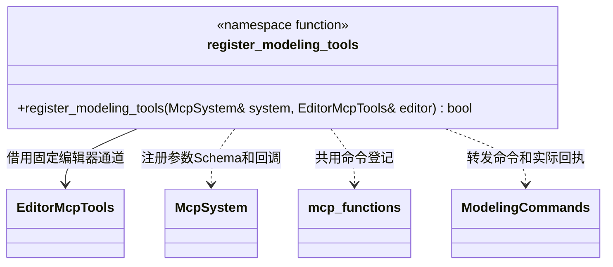

# 建模 MCP 适配

`modeling_create` 按形状约束参数，`modeling_rebuild` 在原节点重新生成基本体，查询返回生成参数与边界。完整契约分别维护在[基本体](mesh-primitives.md)与[建模编辑业务](modeling-commands.md)，本页只定义适配职责。

登记函数属于 `engine::plugins::modeling`，借用 `engine::plugins::mcp` 的通道。几何计算、事务及资源发布仍由建模编辑业务承担。

- `register_modeling_tools` 没有适配器对象或独立状态；宿主保证通道存活到 McpSystem 关闭。共用登记入口见[工具登记](editor-mcp-tools.md#共用工具登记目标)。
- 所有命令通过 EditorMcpTools 的项目、会话、请求和回执校验，在编辑器主线程执行。失败不能伪造成功回执。
- 创建、重建、选择、编辑、复制、组合、分离和删除复用 `execute_batch` / `undo` / `redo`；文件保存不进入可撤销批次。
- `modeling_create` 的 Schema 按 `shape` 约束 `parameters`；编辑器再次检查当前形状的参数，不只依赖 MCP 初检。重建未传形状，由 `modelId` 对应的生成参数决定合法字段。
- `modeling_help({operation?, shape?})` 可以在空编辑器查询。`shape` 仅用于 `create` / `rebuild`：返回对应形状允许的字段、类型、默认值、有效范围和示例；不传 `shape` 时返回各形状的参数表。无效组合明确报错。
- 帮助、Schema 与业务校验共用建模插件内部的参数定义；MCP 不另维护一份默认值或参数列表。
- `modeling_get` 原样返回真实生成参数和边界，语义见[模型查询](modeling-commands.md#模型查询)。工具描述明确重建将重置几何编辑，同时保留场景节点并支持撤销。
- 工具使用 `sceneId` 和稳定 `modelId` 定位；可附 `nodeId` 防止误用旧节点。新增数据不改变这套身份契约。

典型流程为 `get_scene → modeling_create → modeling_get → modeling_edit/rebuild → modeling_save`。资源导入和项目重载仍通过已有项目命令完成，操作说明见[建模插件](../modeling.md#资源保存)。
