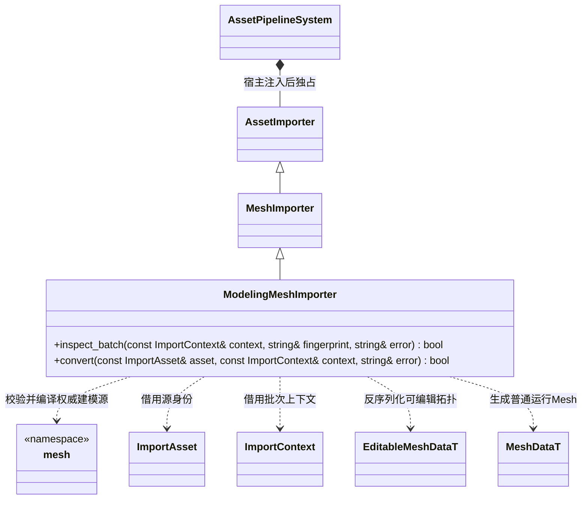

# 建模资源导入

本模块公开方法见下图；纯数据函数见[建模计算](editable-mesh.md)。

建模源版本为 2，保存生成参数，不保存冗余渲染数组。导入器仍只编译编辑几何，不将生成参数写入运行时 Mesh。

建模导入属于 `engine::plugins::modeling`。宿主把插件实现注入编辑器资源管线；编辑器及运行时均不依赖建模插件。

`inspect_batch` 加入普通 Mesh Schema、建模 Schema 和插件转换版本；注入、移除或格式改变都会使旧缓存失效。`convert` 为 const，只读批次输入，失败不发布产物。普通 `.mesh` 调用基类转换；含 `[modeling]` 的资源必须验证并反序列化权威 FlatBuffers 数据，再编译运行 Mesh，不能使用冗余渲染数组。插件不在正式运行包内，包内只包含普通 Mesh 实体。

只接受当前编辑源版本，旧版本报错；仓库源数据离线升级并保留 GUID，缓存按新指纹重新生成。不保留旧格式解码或从冗余数组恢复的分支。普通非建模 `.mesh` 是另一种现有资源源类型，不用于兜底读取无效建模源。

目标 `engine::modeling_importer` 向下链接编辑器资源管线和建模几何库；宿主决定是否链接及注入。新增建模功能不修改编辑器的资源分派。
