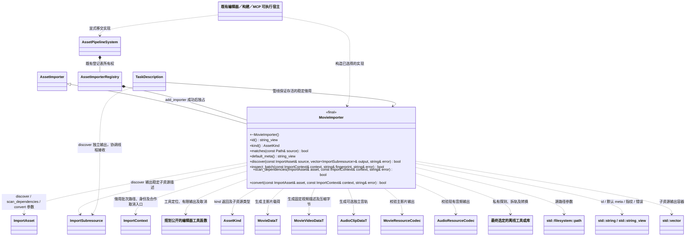

# 影片原始资源导入（规划／待实现）

本页是待评审的设计，尚未新增导入器、影片资源类型或编码工具依赖。运行数据以[影片资源](../../../runtime/class-diagrams/movie-data.md)为准；编码方案尚未选择。运行包最终只装配选定的一套实现，不在逐资源 meta 中选择后端，也不提前建立多后端框架。FFmpeg 仅是编辑器离线探测、拆轨和转码工具的候选。

[统一导入插件](asset-import.md) · [导入基础契约](../../../editor/class-diagrams/asset-importers.md) · [异步导入增量](../../../editor/class-diagrams/asset-import-jobs.md) · [影片编辑命令](movie-mcp-tools.md)

## 类、签名与关系

`MovieImporter` 属于 `engine::plugins::asset_import`，加入已有 `editor/asset_import` 插件；不新增插件、System、Manager 或注册门面。公开头规划为 `include/engine/plugins/editor/asset_import/movie_importer.hpp`，实现规划为对应 `src/engine/plugins/editor/asset_import/movie_importer.cpp`。

图中只定义本导入器的必要覆盖方法；其他节点是既有类型或跨图引用，不重复定义其方法。

- `id()` 固定返回 `movie`；`kind()` 返回规划中的 `schema::AssetKind::movie`。`matches()` 识别首版明确支持的原始 MP4/MOV；扩展输入格式必须同时补充识别、探测和验证，不能仅靠扩展名宣称支持。
- 析构为 `noexcept override`；全部列出方法覆盖现行 `AssetImporter`。`id/kind/default_meta` 为 `const noexcept`；`matches/discover/scan_dependencies/convert` 为 `const`；`inspect_batch` 建立工具与转换指纹。状态与查询返回标注 `[[nodiscard]]`。
- `discover` 失败时清空 `output`，不创建或改写 GUID。`convert` 失败或收到取消请求时不留下可被管线当作成功结果的完整输出；临时文件始终限于本批暂存目录。
- 未列出的 `module_path/prepare_batch/finalize_dependencies` 沿用基类默认契约；不把影片登记成脚本模块。若实际选定工具确需批准备，再以现有 `TaskDescription` 契约评审增量，不预设新的作业类。

## 一个原始文件的身份与输出

原始 `assets/movies/studio.mp4` 保留在编辑器，邻接 `studio.mp4.meta` 保存主 GUID、导入参数及子资源身份。主影片使用源资源已有主 GUID，`discover()` 只枚举可选子资源，不再为主影片分配第二个 GUID。

`discover()` 早于 `inspect_batch()`，因此直接通过[既有 discover 的异步执行规划](../../../editor/class-diagrams/asset-import-jobs.md#子资源发现的异步执行)完成源流探测。主 GUID 与默认 meta 已就绪后，协调线程提交任务，worker 调用原签名并输出已验证的音轨子描述；管线保证导入器存活且同实例发现串行。工具输出与执行时间有界，外部探测通过工具函数的内部时限检查回调停止并回收超时进程；超时是发现失败。协调线程在任务完成且源/meta 指纹仍匹配后才接收子描述，不在 poll 中同步探测，不依赖后续 inspect_batch，也不增加探测缓存接口。原 discover 没有批次取消参数，已开始的探测须返回并回收后才完成取消，不承诺即时取消。

| 输出 | 身份 | 载荷与真实运行依赖 |
| --- | --- | --- |
| 主 Movie | 源 meta 的主 GUID，`subresource_key` 为空 | 一个 `MovieDataT` 保存 `encoding_version`，其中 `MovieVideoDataT` 保存视频描述与固定视频载荷；有音轨时仅以 `audio_guid` 引用 AudioClip |
| 可选 AudioClip | `discover()` 返回稳定 key `audio`、kind `audio`，GUID 由管线写入源 meta 的 `[[subresources]]` | 复用 `AudioClipDataT` 与现有音频载荷；不反向引用 Movie |

影片启用声音且选中的源音轨存在时才枚举 `audio`；无音轨或明确关闭声音时，主影片的 `audio_guid` 为空。首版仅导出选中的一条音轨，不建立多音轨播放器。关闭后已记录的 `audio` 子 GUID 保持休眠，重新开启时复用；切换所选音轨改变内容，不改变这个逻辑音轨的身份。移动源文件及其 meta 保留身份，复制按现有规则产生新身份，冲突不得静默改写。

主影片不保留原始容器中的第二份压缩音轨，也不在视频载荷中再次嵌入 PCM。源格式仅是编辑输入，不能把“容器能读”当作运行时直接接受原始 MP4/MOV 的承诺。

主产物完整位于 `cache/gen/<主GUID>`，可选音轨完整位于 `cache/gen/<音轨GUID>`；无扩展名、类型前缀或版本子目录。Movie 元信息和视频字节属于同一个主实体，不能把描述与实际视频拆到 catalog 未定位的旁路文件。首版沿用单项最多 64 MiB 的有界读取契约；超限返回明确错误，不承诺长片流式播放。

## 参数、源处理与指纹

导入参数保存在原始文件邻接 meta 的 `[movie]`，涵盖所选视频流、裁剪区间、目标尺寸、帧率、视频质量与是否提取音轨；只公布最终实现已支持的参数和值域。既有身份字段及 `[[subresources]]` 仍由管线维护，编辑命令不得覆盖。

音轨的采样率、声道与 gain 沿用现有音频导入参数语义，不在 `[movie]` 再造一套同义设置。MovieImporter 拆出所选音轨后生成现有 `AudioClipDataT`，复用音频规范化和校验能力；原始 MP4/MOV 不伪装为 WAV 后交给仅识别 WAV 的 `AudioImporter`。启动时长、启动后场景和是否等待业务准备属于调用方，不能写进导入器策略。

原始容器的旋转、显示尺寸、帧率、颜色信息和时间戳属于导入器的识别与归一化职责。视频与音轨使用同一个裁剪区间并归零到共同时间原点，写入影片 Schema 要求的有理时间与颜色描述；不能分别截取后靠运行时猜测偏移。首版按播放器的 SDR 8 位边界验证，尚未实现的 HDR 转换等输入明确拒绝，不静默错标颜色或丢失时间信息。

`inspect_batch()` 的工具指纹包含导入器版本、最终输出 `encoding_version`、Movie/Audio 相关 Schema、选定离线工具版本及影响输出的编码配置；源字节与完整 meta 摘要继续由管线记录。`target_platform` 沿用既有批次输入，不在单个资源选择解码后端。当前尚未选定的编码器名称、码率映射、质量档位及源格式支持范围不写成已实现能力。

`convert()` 根据 `asset.subresource_key/kind` 生成本次请求的一项主 Movie 或 AudioClip，读取经过批次指纹检查的同一源与参数，验证实际输入与发现出的子资源一致；不额外维护一套前置探测结果缓存。视频分支不重复解码音频，音频分支不重复编码视频；若选定工具有自有线程，必须显式约束在导入预算内，不能由每项任务再启动无界并行。使用外部工具时通过[规划公开的 find_import_tool/run_import_tool](../../../editor/class-diagrams/asset-import-jobs.md#编辑器共享的最小离线工具函数)定位、合作取消和限制输出；现有 `src/` 私有 helper 不作为插件公开能力。直接链接库的方案须同样支持合作取消。成功退出仍须校验格式、边界、帧率、时长和音轨输出，不能只检查工具退出码。

## 依赖、任务与发布

`scan_dependencies()` 对主 Movie 只登记实际存在的 `Movie -> AudioClip` 运行依赖；AudioClip 不依赖主 Movie。两项的源字节和 meta 已进入各自指纹，不因同源或父子关系额外建立互相依赖，也不把音轨 GUID 自动记成主影片的构建依赖。若以后允许外部音轨源，才按实际引用登记构建输入。

管线组织扫描、稳定子 GUID、失效判断、Task 依赖与暂存输出，并统一封装资源实体、校验依赖、提交 SQLite 和原子发布完整 `gen/catalog`。主影片或音轨任一转换、验证、取消检查失败，本批不发布新运行版本；之前成功的缓存与目录继续可用。合法源文件和 meta 编辑不因转换失败被静默回退。

构建从实际使用入口收集主 Movie 及其音轨依赖，仍输出现有 `catalog.bin`、`gen/` 或 `packs/`。资源同步继续使用完整 catalog 和其存储定位；原始 MP4/MOV、meta、SQLite 与离线工具不因影片导入进入运行版本。接口和发布边界见[影片数据](../../../runtime/class-diagrams/movie-data.md)、[资源构建](asset-build-system.md)与[项目 MCP](project-mcp-tools.md)。

宿主先初始化任务域与管线，再通过现有 `add_importer()` 移交 MovieImporter。构建期间冻结登记，关闭先合作取消并等待批次退出，再清空导入器，最后关闭借用任务域；上下文、发现输出与输出路径不得早于任务释放。
