# 影片编辑与 MCP 工具（规划／待实现）

本页是规划契约，当前尚未实现影片命令、预览或异步导入 MCP 工具。影片播放能力以[MoviePlayer](../../../runtime/class-diagrams/movie-player.md)为准，资源格式与编码版本以[影片资源](../../../runtime/class-diagrams/movie-data.md)为准；未选定编码后端，不把离线工具候选写成已安装能力。

[影片导入](movie-importer.md) · [通用异步导入增量](../../../editor/class-diagrams/asset-import-jobs.md) · [编辑器命令通道](../../../editor/class-diagrams/editor-commands.md) · [现有项目 MCP](project-mcp-tools.md)

## 最小对象与完整关系

影片 MCP 使用普通登记函数 `engine::plugins::mcp::register_movie_tools()`，不新增 `MovieMcpTools` 类、窗口、渲染设备或作业框架。必要的 `MovieEditorCommands` 属于 `engine::editor`，只协调编辑器借用的管线、专用播放器实例和主线程命令；不拥有资源系统、GPU、音频设备或 worker。

规划公开头与实现分别位于 `include/engine/editor/movie/movie_editor_commands.hpp`、对应 `src/engine/editor/movie/movie_editor_commands.cpp`；工具登记位于 `include/engine/plugins/editor/mcp/movie_mcp_tools.hpp`、对应 `src/engine/plugins/editor/mcp/movie_mcp_tools.cpp`。现有可执行宿主显式装配，不新增插件。

```mermaid
classDiagram
    direction TB
    class MovieEditorCommands {
        <<final>>
        +MovieEditorCommands(AssetPipelineSystem& pipeline, MoviePlayer& player, ResourceSystem& resources, TaskSystem& tasks, Path project_root)
        +~MovieEditorCommands()
        +register_commands(EditorCommands& commands) bool
        +update(double delta_time) bool
        +preview_handle() MoviePlaybackHandle
        +close() void
    }
    class RegisterMovieTools["mcp::register_movie_tools"] {
        <<function>>
        +register_movie_tools(McpSystem& system, EditorMcpTools& editor) bool
    }
    class EditorCommands
    class EditorMcpTools
    class McpSystem
    class McpTool
    class EditorHost["既有编辑器可执行宿主"]
    class AssetPipelineSystem
    class AssetImportStatus
    class ImportedSourceInfo
    class ResourceSystem
    class ResourceLoad
    class TaskSystem
    class MovieDataT
    class MoviePlayer
    class MoviePlaybackHandle
    class MoviePlaybackStatus
    class MovieStopReason
    class MovieFrame
    class RenderSystem
    class AudioSystem
    class Path["std::filesystem::path"]
    class Json["nlohmann::json"]

    EditorHost *-- MovieEditorCommands : 独占命令协调对象
    EditorHost *-- MoviePlayer : 独占专用于影片预览的实例
    EditorHost --> RenderSystem : 复用已初始化 GPU 与窗口
    EditorHost --> AudioSystem : 复用宿主音频服务
    MovieEditorCommands --> AssetPipelineSystem : 持续借用；转发通用导入
    MovieEditorCommands --> MoviePlayer : 持续借用；该实例仅由本工具驱动
    MovieEditorCommands --> ResourceSystem : 借用已导入资源的通用读取能力
    MovieEditorCommands --> TaskSystem : 借用编辑器域执行文件摘要与参数 I/O
    MovieEditorCommands *-- ResourceLoad : 一次描述读取请求，不另建资源缓存
    MovieEditorCommands *-- MoviePlaybackHandle : 保存自身预览身份值
    MovieEditorCommands *-- Path : 拷贝规范化项目根输入
    MovieEditorCommands ..> EditorCommands : 登记主线程处理函数
    MovieEditorCommands ..> AssetImportStatus : 查询批次快照，不持有 worker 状态
    MovieEditorCommands ..> ImportedSourceInfo : 管线复制最近成功指纹
    MovieEditorCommands ..> MovieDataT : 临时读取已导入描述并复制为结果
    MovieEditorCommands ..> MoviePlaybackStatus : 序列化预览状态
    MovieEditorCommands ..> MovieStopReason : 显式停止自身预览
    MovieEditorCommands ..> Json : 命令参数、结果与错误
    MovieEditorCommands ..> MoviePlaybackHandle : preview_handle 返回值
    EditorHost ..> MovieFrame : 逐帧临时读取并提交全屏画面
    RegisterMovieTools ..> McpSystem : 登记工具参数
    RegisterMovieTools ..> EditorMcpTools : 回调持续借用并调用 call_command
    RegisterMovieTools ..> McpTool : 创建描述、schema 与转发回调
    RegisterMovieTools ..> Json : 工具参数模型
    EditorMcpTools ..> EditorCommands : 既有会话校验、文件通道与持久回执
```

`RegisterMovieTools` 和 `EditorHost` 只是函数、宿主的图示节点，不新增同名 C++ 类。MoviePlayer、MoviePlaybackHandle、MoviePlaybackStatus、MovieFrame 的字段和方法只在运行时所属类图定义。

- `MovieEditorCommands` 不可复制或移动。构造只保存借用及项目路径值；析构、`close()`、`preview_handle()` 为 `noexcept`，后者为 `const`；状态返回与查询标注 `[[nodiscard]]`。
- 本类不包含或链接具体 MovieImporter。ResourceSystem 与 TaskSystem 也由原宿主初始化并持续借用：前者读取已导入描述，后者仅执行文件摘要和参数 I/O；不在此探测原始媒体、编码或管理资源缓存。
- `register_commands()` 仅登记一次，返回状态必须检查。注册回调借用本对象；宿主先释放命令服务及其回调，再关闭并销毁本对象，最后销毁播放器、管线和共享系统。部分注册失败时不得继续进入帧循环。
- `register_movie_tools()` 的状态返回同样标注 `[[nodiscard]]`，只在 McpSystem 初始化前登记；所捕获的 EditorMcpTools 借用必须覆盖 MCP 关闭。它不保存编辑器主进程内对象的地址，跨进程只使用既有命令通道。
- 专用 MoviePlayer 实例复用运行时实现与宿主 GPU/AudioSystem；它不能是玩法正在使用的同一播放器实例。MovieEditorCommands 仅保存自己的 MoviePlaybackHandle，关闭时停止并 release 自己的预览；不批量释放其他业务的资源。
- `update()` 在主线程协调本工具受理的导入 poll 与影片 `update()`；Task 完成派发仍属于原编辑器循环。宿主用 `preview_handle()` 向同一播放器查询 `frame()`，立即经现有渲染服务全屏提交；不跨 update/release 或 GPU 结构变化保存 MovieFrame 借用。
- 单次转码或影片错误分别记录为作业、预览失败状态，不使编辑器退出；`update(false)` 只表示非法时间值、失效借用等协调或服务级错误。重复状态查询不清除错误，也不重新执行失败操作。
- 生命周期结束时，对本工具受理且仍在途的导入只提交合作取消，管线仍负责最终回收；宿主必须在关闭管线及任务域前完成取消和清理。关闭预览本身不取消独立的资源导入。

## 命令与职责

以下均通过 `EditorMcpTools::call_command()` 进入原 `EditorCommands` 主线程通道；MCP 不直接调用播放器、离线工具或 GPU。新命令不改变既有 `ProjectMcpTools` 的现行方法。

| 命令 | 参数与结果 | 边界 |
| --- | --- | --- |
| `get_movie_import` | `path` 发起读取并返回 `request`；`request` 查询完成后返回 meta、主/音轨 GUID、已导入 Movie 描述、`sourceHash/metaHash` 与 `imported/stale` | 不探测原始源流；当前大文件摘要走 Task，成功记录由管线的 `imported_source_info()` 提供 |
| `set_movie_import` | `path, expectedSourceHash, expectedMetaHash, settings`；受理返回 `request`，完成后用 `get_movie_import(request)` 取得更新后的哈希与 `importRequired` | 文件摘要和参数发布走普通 Task；保留主 GUID、休眠子 GUID 与其他 meta 段；不隐式启动导入 |
| `import_assets` | 可选 `targetPlatform`；返回非零 `job` 与受理状态 | 调用既有管线的规划异步增量，扫描完整项目但只转换失效项；不是影片专属发布入口 |
| `get_asset_import` | `job`；返回通用 `AssetImportStatus` | 命令请求回执和导入作业身份分别维护，重复查询不再运行转换 |
| `cancel_asset_import` | `job`；返回取消请求受理情况与当前状态 | 复用管线合作取消；只有最终 `cancelled` 才表示任务和暂存已清理 |
| `open_movie_preview` | `path`；返回新预览 handle 与状态 | 打开已导入的 Movie 逻辑路径，复用 `MoviePlayer::play(path, out handle)`，不直接播放任意原始磁盘文件 |
| `get_movie_preview` | 无参数；返回当前 handle、MoviePlaybackStatus 与错误 | 无活动预览时明确返回空预览；不把历史完成回执当作仍在播放 |
| `set_movie_preview_paused` | 当前 `handle, paused`；返回状态 | 比对当前预览身份后调用同一播放器的 `set_paused()`，不能以旧 handle 影响新预览 |
| `close_movie_preview` | 当前 `handle`；返回关闭状态 | 活动请求先 `stop(handle, MovieStopReason::stopped)`，终态直接 `release(handle)`；再次关闭同一已关闭实例不得重复释放，旧 handle 不能关闭后来打开的影片 |

首版仅全屏播放，不在此声明 seek、loop、volume、任意区域、UI 动态贴图或场景材质影片纹理。原始音轨 gain 属于导入参数；MCP 预览不增加尚未设计的实时音量入口。JSON 中批次 ID 与 MoviePlaybackHandle 的整数身份沿统一十进制字符串规则，类型定义以所属类图为准。

## 源参数修改、进度和发布

`set_movie_import` 用源/meta 双哈希防止覆盖外部编辑，复用项目锁、路径与符号链接校验及同目录暂存替换。meta 中的原始 GUID 和 `[[subresources]]` 只能由现有身份规则维护。它与既有 `save_ui_source` 一样是非撤销源文件命令，不把资源 meta 强塞进要求活动 sceneId 的场景撤销栈，也不自动重导入或切换当前运行版本。转码受理、取消、预览开关同样不放入可撤销 batch。

`get_movie_import` 的源信息首版仅指邻接 meta；尺寸、帧率、时长和颜色等描述只取已经成功导入的 MovieData，不承诺原始 MP4/MOV 的流摘要。由管线的规划 `imported_source_info(project_root, path, output)` 读取已有成功记录，不直接访问 SQLite；worker 计算当前源/meta 摘要后与该值快照比较，得到是否过期。尚未导入返回 `imported=false/stale=true/description=null`；已导入描述标注其成功修订，不能把过期缓存解释为当前原始媒体信息。

源文件摘要与参数 I/O 按现有 UI 源命令模式由协调线程提交普通 Task，worker 只持有输入值和独立结果，不捕获活动场景、播放器、ResourceSystem 或管线 this。已导入描述通过 ResourceSystem 现有异步加载请求取得，复制所需字段后释放临时引用；成功修订在后台读取期间变化时明确报告过期或要求重读，不能拼接不同代际的数据。一个在途参数读写请求就足够，`request` 状态只负责结果回收，不构成转码队列；完成结果重复读取不重复写 meta。完整探测和转换只能进入[通用导入批次](../../../editor/class-diagrams/asset-import-jobs.md)，不能在 MovieEditorCommands 中另维护探测器、资源缓存、数据库或发布目录。

资源导入完成只表示 `gen/catalog` 整批发布；编辑器显式通过现有环境提交新目录，再由调用方决定是否重开预览。不能在 `set_movie_import`、导入完成或同步成功后偷偷停止/重启项目。

`build_resources()` 继续按现有使用入口收集 Movie 与其 AudioClip 依赖；`sync_assets()` 继续发布完整运行版本。成功同步仅表示版本可用，实际激活仍由运行宿主决定。不增加 `publish_movie`、影片专用运行目录或第二套同步协议。启动与业务消费关系分别见[启动播放](../../../runtime/class-diagrams/movie-startup.md)和[影片脚本接口](../../runtime/class-diagrams/movie-script-api.md)。

## 预览互斥与终态

影片、场景预览和项目运行共享同一编辑器窗口；互斥决定归现有 Editor 协调层。已运行项目或存在未关闭的场景预览时，打开影片预览明确拒绝并报告当前状态；先通过对应操作结束原用途，不由 MCP 静默销毁未保存场景。影片预览活动时，启动项目或切换场景预览也通过同一协调层有序关闭旧影片、停止声音并释放其 handle。

预览不保存到场景、预制体或项目 Model，不创建占位 Node/Component。播放完成按 MoviePlayer 的音频排空和尾帧合同进入终态；重复状态查询和后续 editor update 不重复发完成事件或重新开播。尾帧只在合同允许的有效 handle 下借用，release 后不能继续使用。关闭或退出编辑器时解除全屏提交，停止并释放自己的实例，再关闭共享 GPU/音频服务；窗口最小化与恢复按同一宿主暂停策略驱动，不建立另一套播放器时钟。
