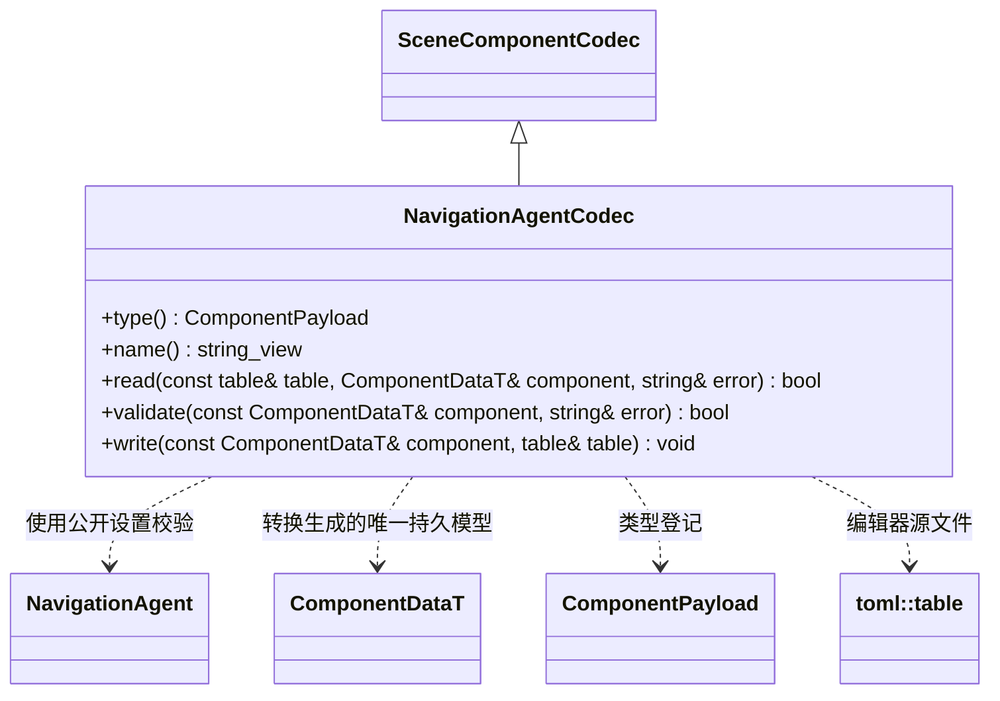

# 多人导航组件编辑器插件

[脚本接口](../../runtime/class-diagrams/navigation-script-api.md) · [类图索引](../../../class-diagrams/index.md)

`engine::plugins::navigation_crowd::NavigationAgentCodec` 由独立 `editor/navigation_crowd` 插件提供，依赖同名运行时插件和基础资源管线。`register_navigation_agent_codec()` 显式登记且可重复调用；各编辑器宿主只在目标启用时装配，核心资源管线不引用具体插件。

TOML 组件类型为 `navigation_agent`，字段为 `radius/height/max_speed/max_acceleration/separation_weight/arrival_distance/face_velocity`。缺省采用 schema 默认值；读取先完整校验再提交，失败保留原 ComponentDataT。运行状态、目标、速度和组件实例身份均不落盘。所有方法遵守 SceneComponentCodec 的限定符，状态结果为 `[[nodiscard]]`，type/name 为 `const noexcept`。
