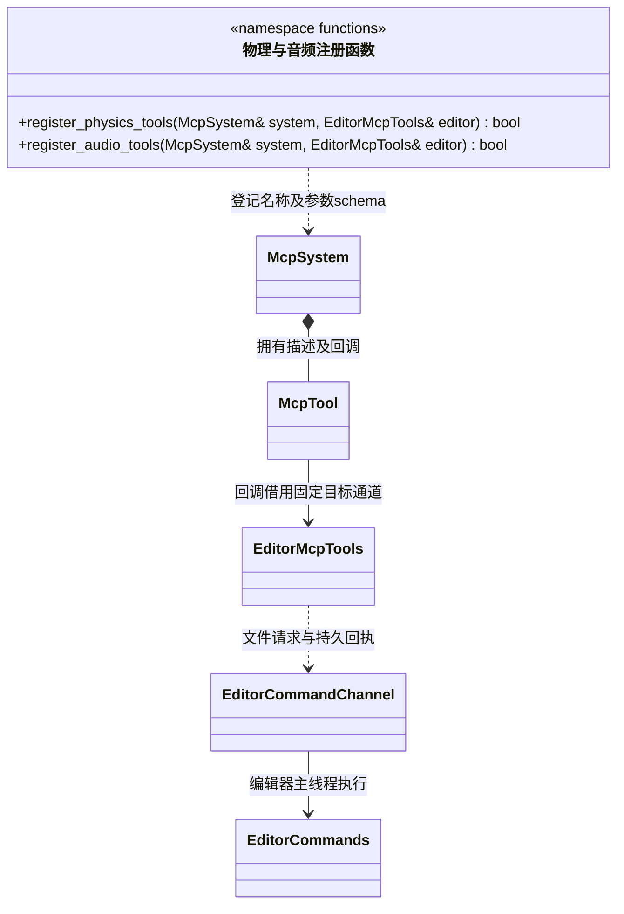

# 物理与音频 MCP 适配

[类图索引](../../../class-diagrams/index.md) · [编辑器工具通道](editor-mcp-tools.md) · [组件编辑命令](../../../editor/class-diagrams/component-commands.md)

适配代码属于 `engine::plugins::mcp`，物理和音频各自一个注册文件；不新增拥有场景或设备的工具类。

图中的注册函数分组只是命名空间展示，不是 C++ 类。回调只调用 `EditorMcpTools::call_command()`，不包含场景组件、Jolt、SDL 音频或资源导入算法。编辑器工具模块须覆盖已注册回调的生命期。它们由 `EditorMcpTools::register_tools()` 登记；Android 目标不启用桌面场景编辑工具。

| 工具 | 参数（均要求 `sceneId`、`nodeId`） |
| --- | --- |
| `set_collider` / `get_collider` | 设置支持 `enabled`、`shape`（box/sphere/capsule）、`halfExtents`、`radius`、`halfHeight`、`center`、`friction`、`restitution`、`isTrigger`；查询只传身份 |
| `set_rigid_body` / `get_rigid_body` | 设置支持 `enabled`、`motion`（static_body/kinematic/dynamic）、`mass`、`gravityFactor`、`linearDamping`、`angularDamping`、`linearVelocity`、`angularVelocity` |
| `add_impulse` | `impulse` 三分量数组；提交动态刚体冲量 |
| `set_audio_source` / `get_audio_source` | 设置支持 `enabled`、`clip`、`volume`、`pitch`、`loop`、`playOnAwake`、`spatial`、`minDistance`、`maxDistance` |
| `set_audio_listener` / `get_audio_listener` | 设置支持 `enabled`、`volume` |
| `play_audio` / `pause_audio` / `stop_audio` / `get_audio_state` | 只传身份；返回 `playback` 和 `playing` |

音频状态为 0 stopped、1 pending、2 playing、3 paused、4 failed；播放请求成功不等于设备已经开始输出。可撤销设置与非撤销运行操作由编辑器命令定义，MCP 不另建事务、状态或历史。参数范围与实际执行结果由核心组件和系统检查，协议层先拒绝未知字段及类型不匹配。
