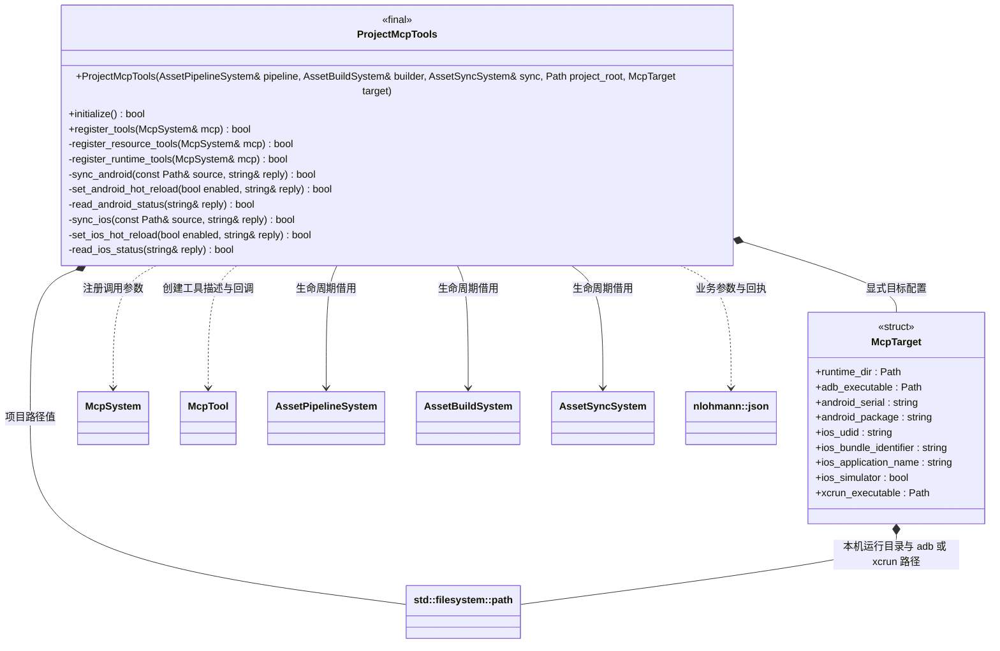
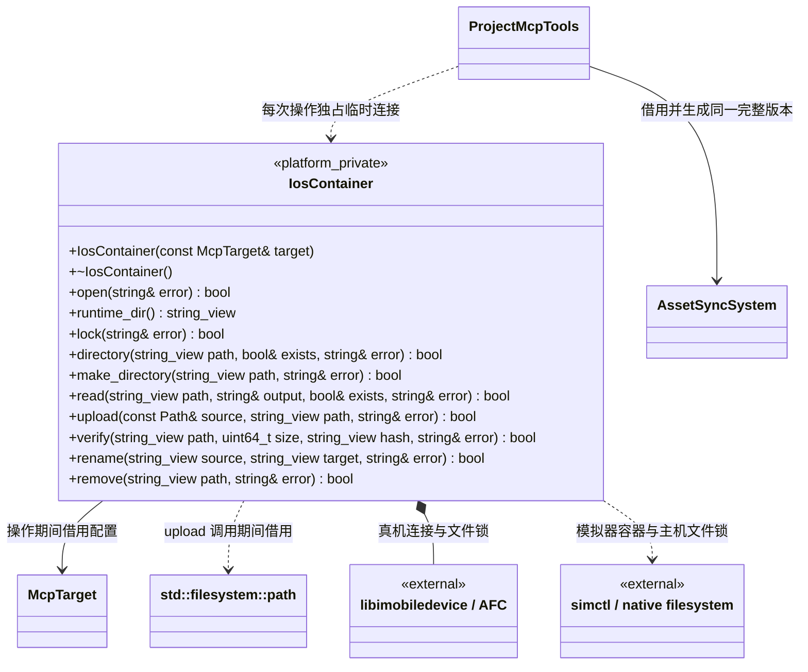

# 项目 MCP 工具模块

[类图索引](../../../class-diagrams/index.md) · [协议与注册](../../runtime/class-diagrams/mcp-system.md)

ProjectMcpTools 是现有项目工具的业务适配模块，显式保存项目与运行目标，借用资源系统并向通用 McpSystem 登记工具。资源与运行调试分别维护注册及实现文件；Android 和 iOS 传输由各自平台目录中的模块私有实现负责。项目启停由 EditorMcpTools 通过统一命令通道登记。

规划入口：[影片编辑与 MCP（待实现）](movie-mcp-tools.md)通过普通 `register_movie_tools()` 与既有编辑器命令通道组织参数、预览和通用异步导入。参数查询仅提供 meta、已导入 Movie 描述与过期状态，不由 MCP 或编辑器核心再探测原始媒体；资源构建与发布继续复用本页 `build_resources/sync_assets`。当前这两个工具仍同步执行，不能将[异步导入规划](../../../editor/class-diagrams/asset-import-jobs.md)当作已经实现的能力；本页现行方法保持不变。

- `McpTarget` 为普通配置结构；本机 `runtime_dir`、Android 的 serial + package、iOS 的 UDID + bundle identifier + application name 三组选定目标互斥，必需字段不全时拒绝初始化。`adb_executable` 默认 `adb`；`xcrun_executable` 默认 `xcrun`，仅用于 iOS 模拟器。目标值由工具拥有，平台连接只在单次调用期间借用。
- `ProjectMcpTools` 构造按值保存项目根目录和目标，三个系统引用须存活到 MCP 关闭。普通业务模块不继承 System；初始化与工具注册通过 bool 报告状态。
- Android、iOS 各三个方法为私有实现接口，向 `reply` 输出工具回执文本，通过 `bool` 报告操作状态；只在主图定义方法，下方平台图仅引用 ProjectMcpTools。它们不向玩法或其他系统公开设备控制接口。
- `Path` 与 `string` 分别简写 `std::filesystem::path` 与 `std::string`，不是新增包装类型。文件读取使用 [ResourceSystem](../../../runtime/class-diagrams/resource-system.md)，编码转换使用 [PathUtils](../../../runtime/class-diagrams/path-utils.md)；路径安全检查仍归调用者。
- stdio 支持 `initialize`、`notifications/initialized`、`ping`、`tools/list`、`tools/call`。工具包括 `build_resources`、`sync_assets`、`set_hot_reload`、`get_status` ；无参数 `start_project`、`stop_project` 由 EditorMcpTools 登记并复用统一命令通道。项目启停面向本机编辑器；Android、iOS 支持同步与热重载控制，编辑器项目启停返回未支持错误。
- 启停通过 EditorMcpTools 的统一通道检查会话、心跳及项目，使用 OS 提交锁与逐请求持久回执。传输超时保留原 requestId 并返回 pending，可用 get_request_receipt 查询命令执行/受理结果；project-status 只报告当前运行观察，不承担去重或历史启动结果。start_project 返回 prepareId，业务完成通过 get_gameplay_prepare 查询，归档后 release_gameplay_prepare；唯一契约见[运行时 MCP](../../runtime/class-diagrams/mcp-runtime-test.md#状态与工具契约)。
- 本机 `get_status` 保留脚本版本字段，并合并编辑器运行状态、会话、最后请求结果和错误；只有这类具有心跳的项目状态才能按心跳过期标记离线。设备容器文件只提供最近上报，不能当作活动进程证明；iOS 的具体返回边界见[状态与查询](#ios-状态与只读查询)。
- 本机目标延续持久目录协议。Android 目标必须明确 adb 序列号和包名，先核验设备状态与 `run-as` 可用性；只支持 debuggable 包。Release 不开放此调试通路。
- Android 文件位于包的私有 `files/`。设备已有 `assets/available.json` 时，以该完整发布版本作为同步基线；首次同步直接复用 `AssetSyncSystem` 发布完整 catalog 及引用载体，与桌面一致，无需先启动应用导出包内清单。运行时只使用选中的完整目录，缺失条目不从 APK 回退，因此无需 APK 文件删除基线。
- 通过 SDL3 独立 argv 启动 adb；设备端只执行固定脚本，动态值严格校验并作 POSIX 单引号转义。逐文件传入私有暂存区，再通过每次最多 1 MiB 的分块读回累积校验哈希；每块核对文件大小、返回长度与退出回执，允许合并包大于单实体读取上限。完整校验后才原子发布版本和 `available.json`。设备发布锁防止多宿主同时操作。
- 发布前失败不修改已发布清单，不清理正在运行的版本；只清理本次拥有的暂存文件与锁。最终发布命令的回执丢失时，明确报告“发布未确认”，须查询设备状态判定，不能声称仍是旧版本。中断遗留锁会明确报告，不能自动删除他人锁。
- `set_hot_reload` 原子发布设备 `files/script-control.json`；`get_status` 直接读取设备状态和已发布清单，不以本机镜像代替设备事实。设备操作回执包含序列号和包名；目标探测成功后附持久目录。设备操作前的资产编译失败只报告编译错误。
- 可用版本表示文件已同步；运行版本及运行状态来自引擎上次报告。重载始终由引擎决定，MCP 不执行脚本生命周期。

资源同步以统一 catalog 及其 storage location 引用的文件发布完整设备快照；未指定 source 时先调用资产管线增量导入。MCP 不解析数据库，也不自行实现脚本重载。Android 使用相同清单和 adb 事务协议；APK 与设备运行验证范围见[测试与范例](../../../testing.md)。

`sync_assets` 同步全部 catalog 条目，包括编译脚本、场景、Mesh、材质、Shader，以及原始图片/二进制等通用资源；不按脚本扩展名筛选。项目 settings、源.meta、SQLite 和未引用gen产物不进入运行版本。availableRevision 是完整资源发布版本，activeRevision 是引擎已接受的运行版本；同步发布成功不代表项目已启动或版本已经生效。纯资源 catalog 也可同步，无需 scripts/game.js；entry 仅作为玩法启动提示。

## 资源构建和部署接入

ProjectMcpTools 持续借用已初始化的 AssetPipelineSystem、AssetBuildSystem 与 AssetSyncSystem。`build_resources(manifest?, items?, targetPlatform?)` 读取项目 settings 内的可选清单（默认 editor-resource-build.toml，缺失全量），未指定 targetPlatform 时使用已配置目标的平台，显式参数可覆盖，调用构建系统并返回 revision、resources、packages、reusedPackages 和 output。

`sync_assets()` 增量导入后同步整个运行目录；可选 `source` 为项目内已构建输出目录，提供后只同步，不导入、不改写 cache/gen。两种输入均按 catalog 的存储定位收集散文件或包，不猜测每个 GUID 都有独立物理文件。

导入与打包复用管线的活动编辑器检查；项目仍运行时返回明确错误要求先 stop_project，不自动停启。同步已有不可变输出不会覆盖活动编辑器缓存，可在运行时准备新候选，hot_reload 关闭时不激活。构建、同步、启动是独立操作。

## iOS 应用容器同步

- 本机、Android、iOS 目标互斥。iOS 必须显式指定设备 UDID、bundle identifier 和编译时 application_name；模拟器与真机明确区分，不接受 booted 等隐式设备选择。xcrun_executable 仅供模拟器的宿主工具定位，默认 xcrun。
- IosContainer 仅属于 platforms/ios/editor/plugins/mcp/，不链接进游戏。一次工具调用独占连接、句柄及按需取得的发布锁；析构反序释放，支持部分初始化，不能复制或移动。它只处理应用容器文件操作，不提供场景或脚本运行能力；runtime_dir 为 const noexcept 借用查询，其返回值只在连接对象存活期间有效。
- 真机使用 vcpkg 固定版本的 libimobiledevice，通过 House Arrest 的 VendContainer 访问明确应用，拒绝退回 Documents 或其他应用；设备必须已配对、信任电脑且允许该开发应用容器访问。模拟器只用 simctl 获取指定已安装应用的数据容器，之后通过主机文件系统处理同一相对目录。
- 运行根为 Library/Application Support/<application_name>，相对选中应用容器；模拟器回执同时带真实主机目录，真机回执带容器内目录、UDID 与 bundle identity。不能用本机镜像代替设备事实。
- 完整版本仍由 AssetSyncSystem 生成 catalog、散文件/合并包及 available.json；iOS 传输暂存后逐项分块读回校验，先提交不可变版本，最后原子重命名 available.json。发布失败保留原清单；最终提交回执不明时明确报告未确认，不虚报回滚。
- lock 使用模拟器主机文件锁或真机 AFC flock；锁句柄持有到本次事务结束，常驻锁文件不是活动发布证明。不得用先检查再 mkdir 代替互斥锁，也不删除其他发布者的锁或旧资源版本。
- read 用于有上限的 JSON 文件；verify 按最多 1 MiB 分块检查大小和已有资源哈希。所有路径均相对应用运行根，拒绝越界、符号链接、异常文件类型及不完整读写；输出在失败时清空或保持明确状态。
- set_hot_reload 只原子写入 script-control.json；get_status 读取真实 script-status.json 和已发布清单。版本选择、资源准备和玩法切换全部复用 GameplaySession，正式应用不增加网络或运行态 MCP 端点。上传／校验失败不改发布清单；候选校验与脚本预检失败保留旧运行；开始替换后目录应用或新玩法初始化失败则保持停止并报告，不能承诺任意脚本副作用回滚。具体切换边界只由[玩法会话](../../../runtime/class-diagrams/gameplay-session.md#会话与资源生命周期)定义。
- 平台传输通过 bool 返回成功/失败，error 为英文上下文。rename 的成功边界为原子改名完成；remove 只用于本次拥有的暂存文件。所有公开于本私有模块的方法均在宿主调用线程同步执行，不暗示已激活新版本。

上游接口见 [House Arrest](https://libimobiledevice.org/docs/libimobiledevice/latest/house__arrest_8h.html)、[AFC 文件系统](https://libimobiledevice.org/docs/libimobiledevice/latest/afc_8h.html)。

## iOS 状态与只读查询

> **已实现。** 容器打开和状态查询只读；无报告与最近停止均不代表设备离线。沿用现有方法与 JSON 回执，不增加状态 System、心跳线程或通用设备 Manager。

- open 只确认所选设备和已安装应用、取得连接并确定相对运行根；不创建运行目录、资源目录或锁文件。应用容器必须存在，首次启动前运行根可以不存在；read/directory 将缺失作为正常的 exists=false 返回。写操作的 make_directory/upload/lock 再按需要建立经过路径检查的父目录。
- `get_status` 不调用 lock、make_directory 或任何发布操作。设备失联、权限不足、未安装、状态格式损坏返回失败及具体错误；不把访问失败伪装成可用的 offline 结果，也不凭用户填写的 application name 创建一个空目录再报告设备状态。
- `availableRevision` 是当前读取的发布清单值，不证明引擎已使用；`activeRevision`、`runId`、`running`、`hotReload` 与运行错误来自最后一次引擎上报。清单和状态是两次独立读取，不能伪称同一帧快照。两者相等只证明最近记录匹配，不证明进程现在存活。

| 读取事实 | state | running | 完成含义 |
| --- | --- | --- | --- |
| 状态文件尚不存在 | `unreported` | null | 没有运行报告，不判断是否在线 |
| 最近报告 running=true | `lastReportedRunning` | true | 最近一次报告玩法在运行，无实时心跳保证 |
| 最近报告 running=false | `lastReportedStopped` | false | 最近一次报告玩法已停止，不等于应用离线 |
| 访问或格式错误 | 无成功状态 | 不伪造 | bool=false，并返回带目标身份的错误 |

真实运行测试的 session、tick、场景加载和截图状态来自[运行测试端点](../../runtime/class-diagrams/mcp-runtime-test.md)，不是上述磁盘版本状态。当前 `--ios-*` 目标没有该测试通道的桌面适配；模拟器的人工文件通道验证不等于真机远程测试能力已经交付。
