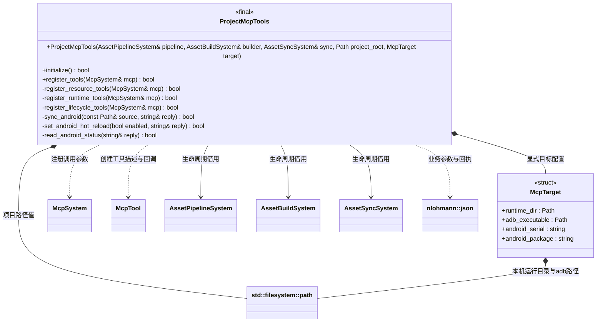

# 项目 MCP 工具模块

[类图索引](../../../class-diagrams/index.md) · [协议与注册](mcp-system.md)

ProjectMcpTools 是现有项目工具的业务适配模块，显式保存项目与运行目标，借用资源系统并向通用 McpSystem 登记工具。资源、运行调试、项目启停分别维护注册与实现文件；Android 传输继续由模块私有实现负责。

- `McpTarget` 为普通配置结构；`runtime_dir` 与 `android_serial` + `android_package` 互斥。`adb_executable` 默认 `adb`，也可明确指定完整路径。
- `ProjectMcpTools` 构造按值保存项目根目录和目标，三个系统引用须存活到 MCP 关闭。普通业务模块不继承 System；初始化与工具注册通过 bool 报告状态。
- 三个 Android 方法为私有实现接口，向 `reply` 输出工具回执文本，通过 `bool` 报告操作状态；不对玩法或其他系统公开新的设备控制接口。
- `Path` 与 `string` 分别简写 `std::filesystem::path` 与 `std::string`，不是新增包装类型。文件读取使用 [ResourceSystem](../../../runtime/class-diagrams/resource-system.md)，编码转换使用 [PathUtils](../../../runtime/class-diagrams/path-utils.md)；路径安全检查仍归调用者。
- stdio 支持 `initialize`、`notifications/initialized`、`ping`、`tools/list`、`tools/call`。工具包括 `build_resources`、`sync_assets`、`set_hot_reload`、`get_status` 以及无参数 `start_project`、`stop_project`。项目启停面向本机编辑器；Android 支持同步与热重载控制，项目启停返回未支持错误。
- 启停读取编辑器会话和心跳，校验项目路径后，携带请求编号原子发布 `project-control.json`；等待 `project-status.json` 对同一请求的完成回执。发布成功只表示已请求，超时明确返回未确认及请求编号，可继续查询状态；不能声称已完成。互斥发布锁防止两个 MCP 进程覆盖未确认请求。
- `get_status` 保留脚本版本字段，并合并编辑器运行状态、会话、最后请求结果和错误。心跳过期标记离线，磁盘历史状态不能当作活动进程证明。
- 本机目标延续持久目录协议。Android 目标必须明确 adb 序列号和包名，先核验设备状态与 `run-as` 可用性；只支持 debuggable 包。Release 不开放此调试通路。
- Android 文件位于包的私有 `files/`。同步合并设备 `assets/available.json`（若存在）及 `assets/builtin.json` 的文件和删除路径作为基线，在本机复用 `AssetSyncSystem` 生成不可变版本；APK 升级新增的内置路径也参与删除计算。
- 通过 SDL3 独立 argv 启动 adb；设备端只执行固定脚本，动态值严格校验并作 POSIX 单引号转义。逐文件传入私有暂存区，再通过每次最多 1 MiB 的分块读回累积校验哈希；每块核对文件大小、返回长度与退出回执，允许合并包大于单实体读取上限。完整校验后才原子发布版本和 `available.json`。设备发布锁防止多宿主同时操作。
- 发布前失败不修改已发布清单，不清理正在运行的版本；只清理本次拥有的暂存文件与锁。最终发布命令的回执丢失时，明确报告“发布未确认”，须查询设备状态判定，不能声称仍是旧版本。中断遗留锁会明确报告，不能自动删除他人锁。
- `set_hot_reload` 原子发布设备 `files/script-control.json`；`get_status` 直接读取设备状态和已发布清单，不以本机镜像代替设备事实。设备操作回执包含序列号和包名；目标探测成功后附持久目录。设备操作前的资产编译失败只报告编译错误。
- 可用版本表示文件已同步；运行版本及运行状态来自引擎上次报告。重载始终由引擎决定，MCP 不执行脚本生命周期。

资源同步以统一 catalog 及其 storage location 引用的文件发布完整设备快照；未指定 source 时先调用资产管线增量导入。MCP 不解析数据库，也不自行实现脚本重载。Android 使用相同清单和 adb 事务协议；APK 与设备运行验证范围见根 [README](../../../../README.md#验证范围与限制)。

`sync_assets` 同步全部 catalog 条目，包括编译脚本、场景、Mesh、材质、Shader，以及原始图片/二进制等通用资源；不按脚本扩展名筛选。项目 settings、源.meta、SQLite 和未引用gen产物不进入运行版本。availableRevision 是完整资源发布版本，activeRevision 是引擎已接受的运行版本；同步发布成功不代表项目已启动或版本已经生效。纯资源 catalog 也可同步，无需 scripts/game.js；entry 仅作为玩法启动提示。

## 资源构建和部署接入

ProjectMcpTools 持续借用已初始化的 AssetPipelineSystem、AssetBuildSystem 与 AssetSyncSystem。`build_resources(manifest, items?)` 读取项目 settings 内的清单，调用构建系统并返回 revision、resources、packages、reusedPackages 和 output。

`sync_assets()` 增量导入后同步整个运行目录；可选 `source` 为项目内已构建输出目录，提供后只同步，不导入、不改写 cache/gen。两种输入均按 catalog 的存储定位收集散文件或包，不猜测每个 GUID 都有独立物理文件。

导入与打包复用管线的活动编辑器检查；项目仍运行时返回明确错误要求先 stop_project，不自动停启。同步已有不可变输出不会覆盖活动编辑器缓存，可在运行时准备新候选，hot_reload 关闭时不激活。构建、同步、启动是独立操作。
