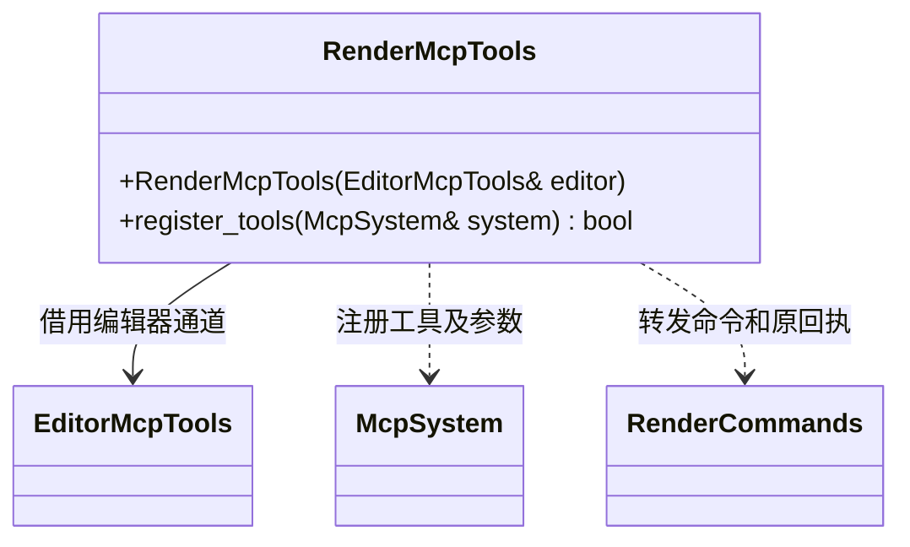

# 渲染 MCP 适配

[类图索引](../../../class-diagrams/index.md)

工具为 get_render_settings、set_render_settings、capture_frame、get_frame_capture。路径策略与撤销归编辑器，图形和截图处理归渲染器；MCP 不生成图片，也不把已接受请求报告为完成。

渲染设置工具同时暴露三色环境光（ambientTricolor、ambientSkyColor、ambientEquatorColor、ambientGroundColor）与雾设置（fogMode、fogColor、fogStart、fogEnd、fogDensity），只转发编辑器命令；数值校验、原子提交和撤销继续走相同入口。颜色为线性 0..1，雾距离满足 0 <= start < end，density 为非负有限值。fogMode 支持 none、linear、exponential、exponential_squared；保留 linearFog 兼容入口，仅用于切换 linear/none，与显式 fogMode 同时提供时必须一致。查询中的 linearFog 是当前模式是否为 linear 的派生值，内部只保存一个模式。
