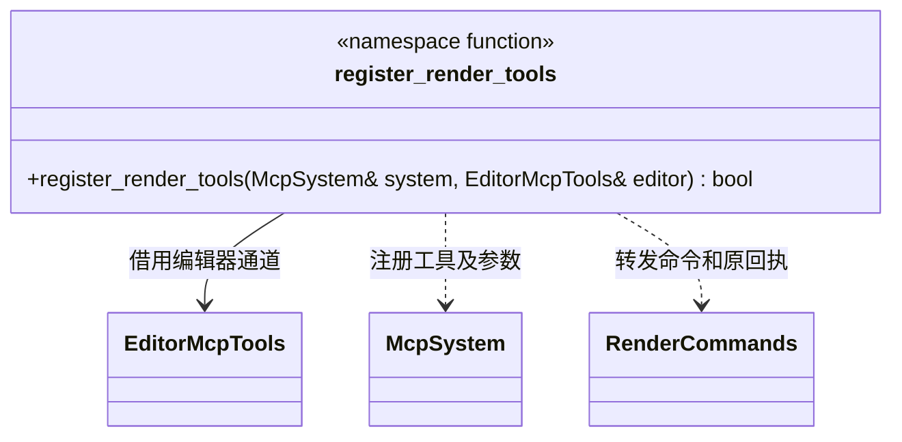
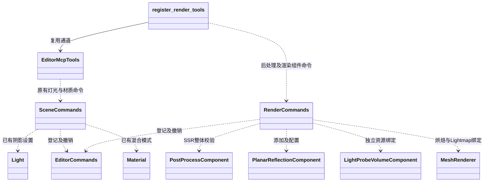

# 渲染 MCP 适配

[类图索引](../../../class-diagrams/index.md)

工具为 get_render_settings、set_render_settings、set_render_stats、capture_frame、get_frame_capture。路径策略与撤销归编辑器，图形和截图处理归渲染器；MCP 不生成图片，也不把已接受请求报告为完成。

屏幕空间 AO 通过 `aoEnabled`、`aoRadius`、`aoStrength`、`aoPower`、`aoFadeStart`、`aoFadeEnd` 暴露，同曝光归相机后处理域。MCP Schema 使用协议支持的 minimum/maximum，半径严格大于零、淡出起止先后关系由编辑器及原生组件整体校验；协议声明不使用不支持的 exclusiveMinimum。

HDR/Bloom 使用 `hdrEnabled`、`bloomEnabled`（布尔值）、`bloomThreshold`（0..100）、`bloomIntensity`（0..10）、`bloomRadius`（0.25..4）。协议层描述独立字段类型与范围，编辑器和组件校验 `bloomEnabled` 必须依赖 `hdrEnabled`，两开关可同批原子更新。MCP 不自动为开启 Bloom 开启 HDR，不自动为关闭 HDR 关闭 Bloom。

`set_render_stats {"enabled": true|false}` 只转发统计面板开关并返回保存的 `enabled` 状态。默认关闭，开关不区分待机、场景预览或玩法，也不修改场景和撤销历史；显示由 bgfx 自带的 `BGFX_DEBUG_STATS` 完成。

渲染设置工具同时暴露三色环境光（ambientTricolor、ambientSkyColor、ambientEquatorColor、ambientGroundColor）与雾设置（fogMode、fogColor、fogStart、fogEnd、fogDensity），只转发编辑器命令；数值校验、原子提交和撤销继续走相同入口。颜色为线性 0..1，雾距离满足 0 <= start < end，density 为非负有限值。fogMode 支持 none、linear、exponential、exponential_squared；保留 linearFog 兼容入口，仅用于切换 linear/none，与显式 fogMode 同时提供时必须一致。查询中的 linearFog 是当前模式是否为 linear 的派生值，内部只保存一个模式。

有活动场景时 set_render_settings 直接编辑并保存场景组件参数，修改标记场景未保存，支持撤销/重做；无场景时只允许修改 clearColor。MCP 不创建自己的场景参数状态，也不将参数写入脚本。

方向光级联字段为 `shadowCascades`（整数 1、2、4）、`shadowDistance`（大于 0 且不超过 100000）、`shadowSplitLambda`（0..1）与 `shadowCascadeBlend`（0..0.3）。`shadowResolution` 表示灯请求的阴影尺寸，方向光级联在分配的区域内排布；完整 atlas 的预算由启动配置 `shadow_atlas_size` 决定。MCP 只转发和描述参数，组件校验、撤销以及保存仍由已有编辑器命令完成。

## 本轮渲染能力的编辑入口

以下增量已按评审接入现有编辑器命令；可用工具以当前构建的 `tools/list` 为准。底层能力沿用已批准的[渲染契约](../../../runtime/class-diagrams/forward-lighting-reflections.md)，不增加新的渲染类或全局参数副本。

以上类仅引用既有契约，未新增公开 C++ 方法；工具按所属类继续显式登记。MCP 输入字段的新增和编辑语义在这里评审：

| 工具 | 增量参数或返回值 | 归属 |
| --- | --- | --- |
| `get/set_render_settings` | `ssrEnabled`、`ssrResolutionScale`、`ssrMaxSteps`、`ssrMaxDistance`、`ssrThickness`、`ssrRoughnessCutoff` | 沿现有后处理域，活动相机上的 PostProcessComponent；无场景时拒绝场景效果修改 |
| `set_light` | `castShadows`、`shadowResolution`、`shadowBias` | 对当前指定 Light 生效；方向光、点光和聚光灯使用相同原生接口 |
| `set_material_blend_mode` | `sceneId/nodeId`、可选 `slot`、`mode` 为 `opaque/alpha_blend/premultiplied` | 普通材质；不要把字符串转换为具名数值 Shader 参数 |
| `get/set_planar_reflection` | `sceneId/nodeId`；set 接受 `enabled`、`resolutionScale`、`clipBias` | 普通 PlanarReflectionComponent；set 可添加缺少组件，要求已有 MeshRenderer |
| `get/set_light_probe_volume` | `sceneId/nodeId`；set 接受 `enabled`、`resource` | 普通 LightProbeVolumeComponent；逻辑资源路径映射 GUID，空字符串显式清空，不能传 OS 路径 |
| `get/set_mesh_lighting` | `sceneId/nodeId`；set 接受 `castShadows`、`bakeStatic`、`lightmap` | 已有 MeshRenderer；不会顺便创建网格；lightmap 路径为空表示清空 |
| `get_scene` | 返回上述组件和材质的当前字段 | 保持分页及完整十进制字符串身份；不返回 GPU handle |

所有 set 至少提交一个可变字段，先按原生完整状态校验，再原子写入。SSR 分辨率 `[0.25,1]`、步数整数 `[8,256]`、距离 `(0,100000]`、厚度 `(0,10]`、粗糙度 `[0,1]`；平面比例 `[0.25,1]`、裁剪偏移 `[0,1]`；灯阴影分辨率为 `[128,8192]` 的 2 次幂，bias `[0,0.1]`。其余值和资源有效性由现有组件校验，不在 MCP 重建一份渲染规则。

新增组件编辑复用 EditorEdit 与现有批量/undo/redo/save_scene。快照包括组件启用状态、生成数据及资源版本；失败移除本次创建的组件，撤销不覆盖玩法后来修改的状态。查询不存在的组件返回明确失败，不自动添加。Lightmap 和探针沿现有烘焙身份校验；绑定成功不能被报告为烘焙成功。

平面和探针的 `enabled` 使用已有 `Component::set_enabled`，不加入它们的 payload；通用 `get_scene` 已有组件启用字段，本轮只补缺失的类型数据。探针 `resource` 映射 `probes_guid`，查询分别返回配置路径/GUID 和 `valid`：变换偏离烘焙位置可能使当前采样无效，但不能因此把配置报告为未绑定。

`set_mesh_lighting.lightmap` 复用 `MeshRenderer::set_lightmap` 的条件：独立网格资源、完整 UV2、无蒙皮/变形、有效 Transform 和线性非立方体纹理。失败保留原绑定；`bakeStatic=true` 不会生成 UV2 或执行烘焙。查询同样区分已配置资源与当前绑定有效性。

水面吸收、折射率、厚度、粗糙度及贴图按材质声明继续用 `set_material_parameter/texture`。分簇容量、阴影 atlas 预算属于启动配置，不制造无法即时生效的 MCP 热修改开关。验收覆盖参数边界、缺失组件、资源类型、撤销/重做、保存后重载及真实画面。

实现使用既有 `ComponentEdit` 保存组件快照，资源绑定额外持有资源版本并在撤销／重做前检查；平面反射重做仍要求 MeshRenderer 存在。网格照明编辑只调用照明字段的原生 setter，不通过恢复整个 MeshRenderer 重建网格、丢失材质覆盖或清除瞬态变形。

查询 `get_light_probe_volume` 返回 `resource`、`resourceGuid` 和 `valid`；`get_mesh_lighting` 返回 `lightmap`、`lightmapGuid`、`lightmapValid`、`castShadows`、`bakeStatic`。配置 GUID 未变而烘焙变换失效时，路径／GUID 仍返回，只有有效性为 false。已经失效的 Lightmap 绑定不能通过当前 setter 恢复其旧烘焙身份，因此可撤销替换会明确失败并保留原绑定；先恢复烘焙时的网格／变换再替换，不悄悄按当前位置重绑旧贴图。单独修改阴影标记不受此限制。

`register_render_tools` 是模块登记函数，没有适配器对象或独立状态；工具回调直接借用 EditorMcpTools，宿主保证通道存活到 McpSystem 关闭。
