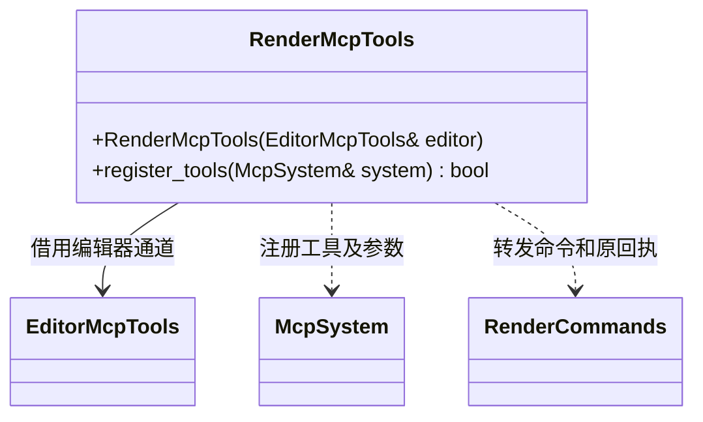

# 渲染 MCP 适配

[类图索引](../../../class-diagrams/index.md)

工具为 get_render_settings、set_render_settings、set_render_stats、capture_frame、get_frame_capture。路径策略与撤销归编辑器，图形和截图处理归渲染器；MCP 不生成图片，也不把已接受请求报告为完成。

屏幕空间 AO 通过 `aoEnabled`、`aoRadius`、`aoStrength`、`aoPower`、`aoFadeStart`、`aoFadeEnd` 暴露，同曝光归相机后处理域。MCP Schema 使用协议支持的 minimum/maximum，半径严格大于零、淡出起止先后关系由编辑器及原生组件整体校验；协议声明不使用不支持的 exclusiveMinimum。

HDR/Bloom 使用 `hdrEnabled`、`bloomEnabled`（布尔值）、`bloomThreshold`（0..100）、`bloomIntensity`（0..10）、`bloomRadius`（0.25..4）。协议层描述独立字段类型与范围，编辑器和组件校验 `bloomEnabled` 必须依赖 `hdrEnabled`，两开关可同批原子更新。MCP 不自动为开启 Bloom 开启 HDR，不自动为关闭 HDR 关闭 Bloom。

`set_render_stats {"enabled": true|false}` 只转发统计面板开关并返回保存的 `enabled` 状态。默认关闭，开关不区分待机、场景预览或玩法，也不修改场景和撤销历史；显示由 bgfx 自带的 `BGFX_DEBUG_STATS` 完成。

渲染设置工具同时暴露三色环境光（ambientTricolor、ambientSkyColor、ambientEquatorColor、ambientGroundColor）与雾设置（fogMode、fogColor、fogStart、fogEnd、fogDensity），只转发编辑器命令；数值校验、原子提交和撤销继续走相同入口。颜色为线性 0..1，雾距离满足 0 <= start < end，density 为非负有限值。fogMode 支持 none、linear、exponential、exponential_squared；保留 linearFog 兼容入口，仅用于切换 linear/none，与显式 fogMode 同时提供时必须一致。查询中的 linearFog 是当前模式是否为 linear 的派生值，内部只保存一个模式。

有活动场景时 set_render_settings 直接编辑并保存场景组件参数，修改标记场景未保存，支持撤销/重做；无场景时只改变待机默认值。MCP 不创建自己的场景参数状态，也不将参数写入脚本。

方向光级联字段为 `shadowCascades`（整数 1、2、4）、`shadowDistance`（大于 0 且不超过 100000）、`shadowSplitLambda`（0..1）与 `shadowCascadeBlend`（0..0.3）。`shadowResolution` 表示整个 atlas 的边长；四级共享 2×2 atlas。MCP 只转发和描述参数，组件校验、撤销以及保存仍由已有编辑器命令完成。
