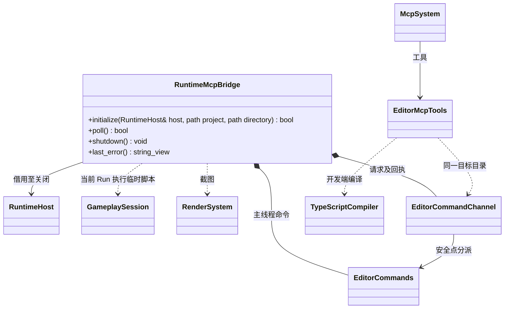

# 独立运行程序的 MCP 测试接入

独立运行程序可通过显式测试构建接入本图所示的通道；编辑器内运行继续使用现有通道。协议和 TypeScript 编译仍属于编辑器插件及开发工具，运行时核心不依赖它们。

- `RuntimeMcpBridge` 由独立测试宿主独占，仅在显式启用测试构建时编译和装配；常规运行产物不包含该桥接或 MCP 服务。测试宿主通过明确参数指定项目和独立通道目录，不能复用活动编辑器目录。
- 开发端继续运行既有 `mcp_app`，通过原有请求、独立会话身份、请求身份和持久回执与目标通信；TS 编译在开发端完成，游戏进程不携带 Node 或 TypeScript 编译器。
- 主线程安全点重新校验会话和当前 `runId`，经现有 `GameplaySession::execute_project_script` 在活动玩法的同一个 VM 和模块实例内同步执行，停止或热重载后旧身份失效。脚本不写入项目资源；副作用不自动回滚。
- 游戏入口及启动影片完成后才处理测试请求。最小测试能力包括运行状态、临时脚本和原始帧截图，其他编辑器专有命令明确拒绝；截图路径限制在项目缓存内。采集工具分别记录无法截图、截图全黑和场景加载失败，不将文件写入成功误报为画面正常。
- 桥接先于宿主关闭，不持久化 VM、场景或节点借用；跨进程超时保留原请求身份供查询，不重复执行。未启用脚本、玩法尚未就绪或目标会话不匹配时明确报告失败。
- 本图中的 `TypeScriptCompiler` 是现有开发工具的职责标注，并非新增类；其他类的完整方法及所有权以各自的所属类图为准。
