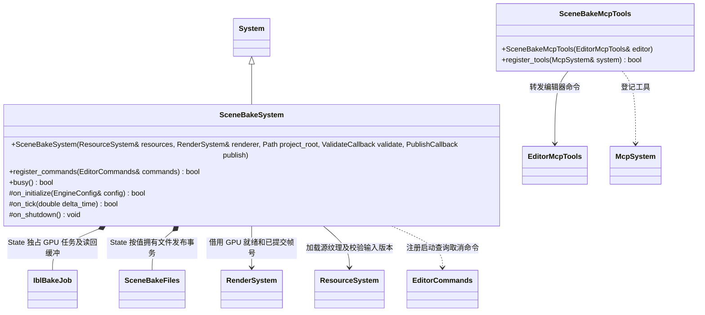
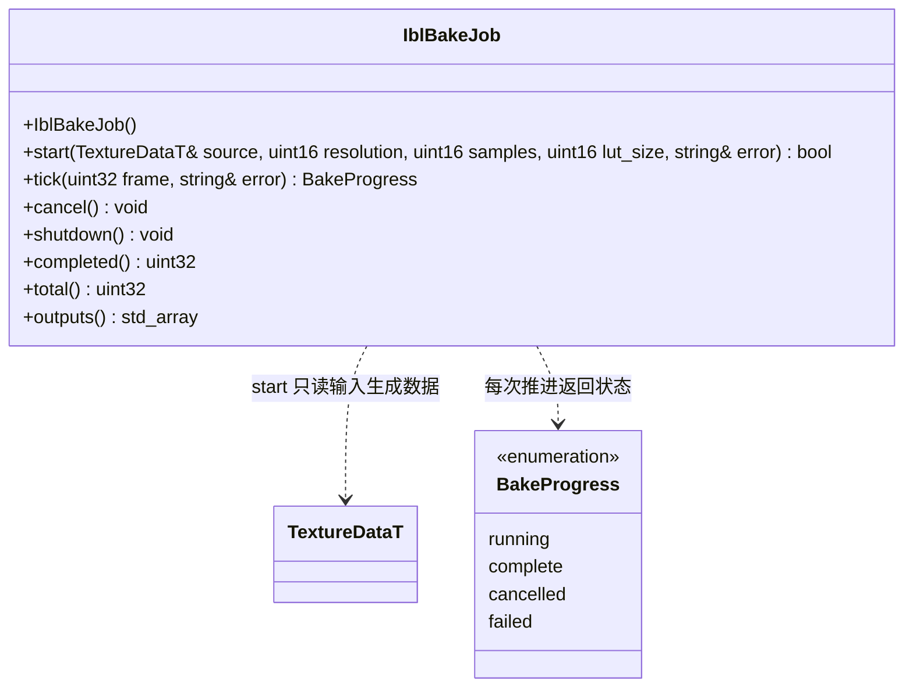
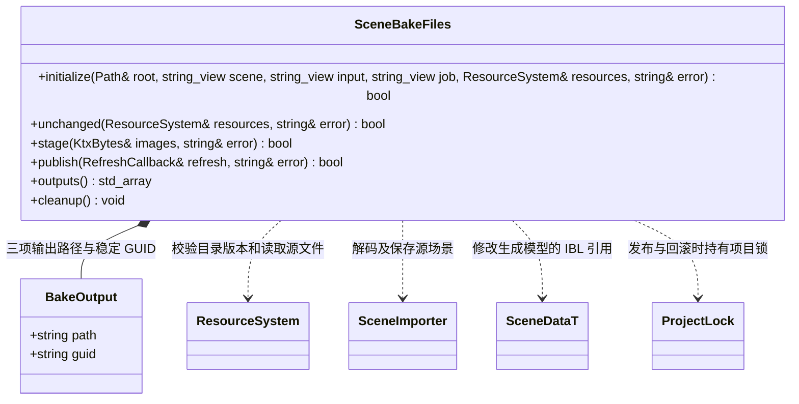

# 场景 GPU 烘焙

`SceneBakeSystem` 通过私有 `State` 持有 GPU 任务、文件事务、输入 ResourcePtr、任务身份和状态；ValidateCallback / PublishCallback 由宿主提供且依赖对象覆盖系统生命周期。ValidateCallback 输出当前场景身份并检查已保存预览，PublishCallback 只执行通用导入刷新。注册命令与 MCP 回调均为借用，必须先关闭命令服务再销毁模块。

`outputs()` 返回 `const std::array<std::vector<std::uint8_t>, 3>&`，按 irradiance、prefilter、LUT 顺序借用完成的 KTX 字节；只在 complete 后消费，借用有效期截至任务销毁。`completed()` / `total()` 是已完成和全部 GPU 面/mip 工作项数量，均 const、noexcept。取消和关闭为 noexcept；本类不持有源场景，不创建资源 GUID、不执行资源导入。

图中 `KtxBytes` 表示 `const std::array<std::vector<std::uint8_t>, 3>`，`RefreshCallback` 表示 `const std::function<bool(std::string&)>`，仅缩短类图展示，不新增代码类型。`outputs()` 返回 `const std::array<BakeOutput, 3>&`；`unchanged()` 为 const，`outputs()` 为 const、noexcept，`cleanup()` 为 noexcept。SceneBakeFiles 不拥有资源系统，临时文件、旧文件备份及回滚状态由它管理；导入刷新前先释放项目锁，刷新失败时恢复旧源文件并再次刷新旧目录。失败回滚尚未收回的备份保留以供恢复。

插件属于 `plugins/editor/scene_bake`，运行时核心不包含或链接它。第一类烘焙是 IBL；计算沿用 Ant 的余弦重要性采样、GGX 预过滤和 split-sum BRDF LUT，并保留来源与许可。GPU 调度仅在主线程进行，每帧推进有限计算和读取，不创建后台 bgfx 线程，不自行调用 bgfx::frame。

`bake_scene` 返回已接受任务，`get_scene_bake` 查询状态，只有 complete 表示三个 KTX、meta、场景引用和导入刷新全部完成；`cancel_scene_bake` 请求取消，在途 readTexture 完成前保持缓冲存活。启动和发布前通过宿主检查精确场景路径、场景身份、未修改状态，并比对磁盘场景及输入纹理版本。发布采用 `cache/bake/<job>/` 暂存、旧 GUID 复用、失败回滚，目标为源场景旁同名目录中的 IBL 纹理。烘焙只填写资源引用，保留组件 enabled、场景 ibl_enabled 与强度。优先写入唯一启用的 EnvironmentComponent；没有启用项时，复用唯一停用项并保持停用，多个停用项返回目标歧义错误。只有完全没有环境组件时才创建普通环境节点，IBL 仍默认关闭。

输出：RGBA16F irradiance cubemap、RGBA16F prefilter cubemap 完整 mip 链、RG16F BRDF LUT，KTX1，linear。每面每 mip 先 blit 至独立 2D READ_BACK 纹理，再等待 readTexture 返回帧号，兼容 Metal 的立方纹理读取限制。GPU 计算与读回统一使用 RGBA16F；LUT 读回后仅按字节保留 RG 通道，保存为 RG16F，不在 CPU 重做积分。

关闭顺序：先停止本系统的新提交并释放 GPU 句柄，保留 State 的 CPU 读回缓冲；宿主关闭渲染器并完成 bgfx 队列处理，最后销毁本系统。普通取消同样等在途读回结束再释放内存。

## 后续优化：全局共享 BRDF LUT

当前保留按场景输出三份 IBL 纹理的实现，先保证场景效果。后续将 BRDF LUT 改为引擎内置的全局共享资源，所有场景复用同一份，避免重复烘焙、保存和打包。

BRDF LUT 取决于所选 BRDF 模型与积分约定，与具体场景及天空图无关；漫反射环境图和预滤波反射图仍由各场景烘焙。迁移时同步调整场景资源引用、依赖清单与 Shader 绑定；上述优化尚未实施。
