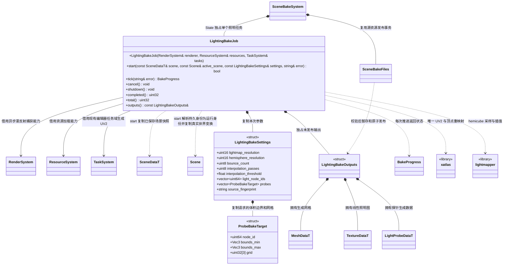
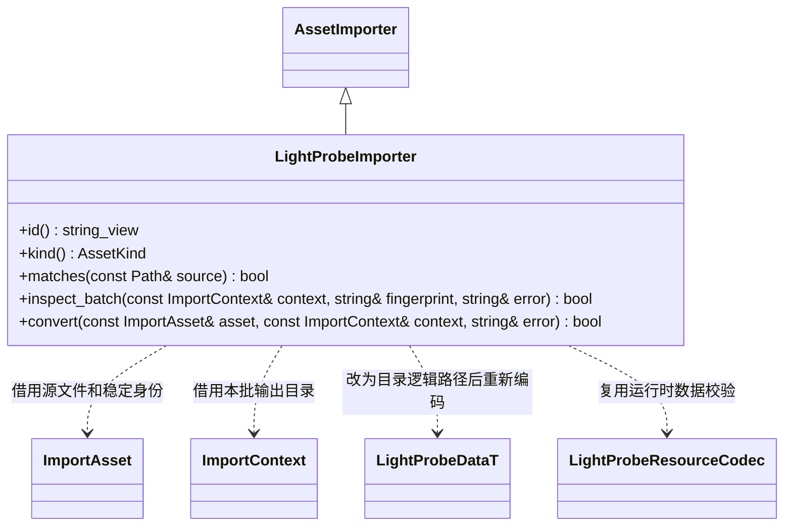

# 场景静态照明烘焙

状态：当前实现契约；实际验证范围见[测试文档](../../../testing.md)。
提供静态多次漫反射 Lightmap 和动态对象采样的光照探针；运行时消费预计算数据。
继承既有 [场景烘焙](scene-bake.md) 的任务、取消、版本检查及原子发布流程，不另建烘焙系统。
运行时组件及捕获接口见 [渲染扩展类图](../../../runtime/class-diagrams/forward-lighting-reflections.md)。

## 职责与所有权



以上未列方法的类均为外部引用；RenderSystem 的捕获方法只在所属运行时类图维护。
LightingBakeJob 是 scene_bake 插件私有实现类，不成为核心或脚本接口。
start 的 scene/settings 均为 const 引用，本次调用复制所需数据，不跨帧借用原始场景对象。
renderer/resources 是非空借用，必须覆盖任务生命周期；宿主先关闭烘焙，再关闭渲染器。
tick 返回现有 BakeProgress，错误写入 error；不能用异常或日志代替失败状态。
completed/total 为 const、noexcept；outputs 返回 const 引用，仅 complete 后可读，借用至任务重置。
cancel/shutdown 为 noexcept 且支持重复调用；shutdown 停止提交，但不提前销毁在途 GPU 读回内存。
LightingBakeOutputs 是普通聚合结构，保存节点到输出的对应关系及生成数据，不另造持久数据模型。

## 数据与资源契约

| 所属数据 | 增量 | 约定 |
|---|---|---|
| MeshData | lightmap_texcoords:[Vec2] | 独立 UV2；GPU 使用 TexCoord1，保留原 UV0 |
| MeshRendererData | bake_static:bool、lightmap_guid:string | 默认不参与静态烘焙；照明绑定属于实例，不写入共享 Material |
| LightProbeData | 局部边界、规则网格、SH9 RGB、有效标记、烘焙定位及输入指纹 | 独立 FlatBuffers 资源；核心消费不依赖烘焙插件 |
| LightProbeVolumeData | probes_guid:string | 普通组件仅引用资源，由 Transform 放置体积；公开接口归运行时类图 |
| 烘焙输入 | 固定几何、固定光源、环境及材质版本 | 显式选择固定光源；动态光只提供运行时直射 |

烘焙请求使用 light_node_ids 白名单选择固定光源；空列表不包含任何解析光源，不新增 Light 字段。
探针目标条目包含体积节点 ID、局部 box 和 grid 尺寸；烘焙结果保存边界、网格及当时的世界变换。
SceneCaptureRequest 显式传递 light_node_ids，核心只捕获所请求的光源，不隐式包含所有灯。
LightProbeData 是新增 schema 的唯一模型来源，生成的 LightProbeDataT 不再配套手写持久模型。
输出保存到源场景同名资源子目录，拥有独立且稳定的 meta/GUID，缓存继续使用 cache/gen/GUID。
新增照明源描述和导入器按类型登记；源格式及 runtime FlatBuffers 编解码分别归编辑器与核心。
Lightmap 使用线性 HDR 纹理；源纹理、模型、材质、固定光源和变换参与烘焙输入指纹。
SceneBakeFiles 的 `initialize_lighting()` / `stage_lighting()` 复用既有发布事务，统一修改场景绑定及导入刷新。
失败、取消或输入版本变化不发布半成品；旧源文件和场景引用在发布失败时一起恢复。

发布接口以[SceneBakeFiles 类图](scene-bake.md)及当前头文件为准：IBL 保留单输入的 `initialize()` 与三份 KTX 的 `stage()`；照明使用 `initialize_lighting()` 与 `stage_lighting()`，没有额外的 `span<const string>` 初始化重载。`outputs()` 返回 `const std::vector<BakeOutput>&`，两类任务共享 `publish()`、`unchanged()` 和 `cleanup()` 的事务语义。

## UV2 与几何

复用现有 xatlas::xatlas，调用 Create/AddMesh/Generate/Destroy，检查 AddMeshError。
xatlas 输出顶点可能增加；按 Vertex::xref 重映射位置、法线、UV0、切线、颜色及其他顶点数据。
所有下标、子网格范围和材质槽保持对应，不只添加 UV 数组而忽略接缝导致的顶点重排。
光照图 UV 必须无重叠且留足采样边距；缩放、分辨率和插值质量属于本次烘焙参数。
首版为每个固定 MeshRenderer 实例生成独立照明纹理；源几何共享不等于实例照明共享。
需要 UV2 的派生网格通过正式 .mesh/meta 管线发布，保留原始美术源文件，重复烘焙复用生成资源身份。
不要求模型业务脚本生成 UV、处理顶点或读写缓存。

## 漫反射多次反弹

捕获在线性 HDR 空间进行；保存的是接收面无关的入射 irradiance E，不能提前乘接收面颜色。
初始 E[0] = 0；第 k 轮场景表面的出射 radiance 为：

```text
emissive + direct_diffuse + diffuse_albedo / pi * E[k-1]
diffuse_albedo = base_color * (1 - metallic)
E[k] = integral(captured_radiance * cosine * solid_angle)
```

每轮全部网格写入独立输出，整轮完成后交换，不能同一轮混读新旧结果或累计重复直接光。
移植 lightmapper 时明确其权重的归一化；若原权重输出 E/pi，在唯一边界恢复 E，不能重复除 pi。
alpha 裁切和固定几何遮挡沿用现有材质规则；透明物体首版不参与烘焙遮挡与反弹。
捕获关闭高光、SSAO、雾、曝光、色调映射和 Bloom，保留所选环境 radiance、发光及固定直接光。
固定直接光需要真实阴影；复用同套阴影实现，但使用捕获所需范围，不能误用主镜头裁剪后的 CSM。
最终运行时组合为实时直射 + diffuse_albedo/pi * E + 间接高光；烘焙漫反射替换 diffuse IBL。
多次反弹须验证遮挡后仍存在颜色反弹，单次环境光或 AO 不能作为完整 GI 交付。

## 捕获、分帧与取消

RenderSystem 提供一次一个活动的漫反射离屏捕获请求；公开参数和结果不包含 bgfx 句柄。
request 接受只读 view/projection、尺寸、节点集合及上一轮照明数据；只读纹理以 shared_ptr 共享。
描述和引用在接受时复制，资源及变换在已有安全点保存快照，禁止持有原始 Node 指针跨帧。
图形提交、readTexture 和进度均由现有主线程 render 推进；烘焙插件不调用 bgfx::frame，不忙等。
SceneCaptureImage 持有线性 RGBA float 数据；只有 complete 可 take，成功移动结果并恢复 idle。
取消后停止新提交，等待在途读回完成才进入 cancelled；期间保留 CPU buffer 和必要 GPU 资源。
切场景、GPU 关闭及任务退出同样取消；销毁顺序保证读回内存存活到 bgfx 队列处理结束。
SceneBakeSystem 同时仅运行一个 IBL 或照明任务；新任务不能覆盖上一任务尚未 drain 的捕获。
view 常量集中登记：捕获阴影/cluster 预留 144..191，UI 保留 200，IBL 保留 240/241，捕获 draw/copy 使用 242/243。
每次只捕获一个面；hemicube 和六面探针分帧推进，不因一组采样而无限占用 view 或主线程。
UV2 工作使用现有编辑器任务域，GPU 捕获留在主线程；进度体现真实完成工作，不伪造百分比。

## 探针与可破坏场景

最终反弹结果完成后，以相同 diffuse capture 捕获探针六面，按立体角投影 SH9。
保存世界轴 radiance SH；基底顺序为 [1,y,z,x,xy,yz,3z²−1,xz,x²−y²]，采用标准正系数。
运行时评价前分别对 l=0/1/2 乘 π、2π/3、π/4，再按 Lambert diffuse 除 π，仅卷积一次。
CPU 将 Renderer 世界包围盒中心转到体积局部网格，在有效点之间插值，提交 SH9 uniform，Shader 依世界法线求值。
体积重叠时按较小覆盖体积及节点 ID 稳定选择；体积定位与烘焙位置不符则失效，不能旋转网格而沿用原 SH。
无有效采样或体积外回退 IBL；存在有效探针时替换 diffuse IBL，不叠加两份环境漫反射。
房间和楼层使用明确体积避免跨墙插值；首版不提供逐像素可见性探针或自动解决任意薄墙漏光。
单个大动态 Renderer 跨越多个房间时仍是单点照明近似；大型固定表面使用 Lightmap。
蒙皮、运行时变形、可破坏结构和可编辑地形默认不作为固定烘焙贡献者；不能仅凭初始静止判定。
角色、碎片和可变地形接收实时光和探针；破坏不会烘入原墙体的固定遮挡，但也不会实时重算反弹光。
编辑器改变固定贡献者或固定灯光后标记结果过期并重烘；运行时改变固定输入不属于静态 GI 保证范围。

## 上游与移植边界

| 来源 | 固定版本 | 许可与复用内容 |
|---|---|---|
| 已有 third_party/xatlas | f700c7790aaa030e794b52ba7791a05c085faf0c | MIT；UV 图表划分、打包和重映射 |
| ands/lightmapper | 4fd3bf4e2c07263f85d5d875ebdef061bc512dd4 | Public domain/永久复制修改许可；采样、权重、插值和膨胀 |
| ejoy/ant 的 pkg/ant.sh/sh.lua | 670f3d45919841581d705289f5cb3c1238cd8c05 | MIT；SH 投影和立体角约定 |

xatlas 目标统一在 cmake/dependencies/xatlas.cmake 登记，建模与烘焙按启用条件共用同一依赖，不能引入第二份版本。
lightmapper 原版要求 OpenGL；本实现需移植图形调用到 bgfx/Metal，不能宣称原库直接支持 Metal。
固定原版作为 third_party 下独立上游源；适配补丁另存 third_party/patches，构建时复制到 build 再应用补丁。
原始检出目录保持不变；补丁保留原版权说明，说明新增回调、异步读回及 bgfx 坐标/深度约定。
Ant 的旧烘焙模块包含禁用构建和占位代码，只参考回调边界；GPU SH 草稿也不直接引入。
第三方仅链接编辑器烘焙目标；运行包只保留数据读取、Lightmap 和探针采样。

## 探针源文件导入



`.lightprobe` 是编辑器生成的 FlatBuffers 二进制源，与唯一 meta 一起进入常规资源管线；
Importer 只负责本类型验证和重编码，不拥有加载器或运行时探针体积。
`id/kind` 为 const noexcept，`matches/convert` 为 const；运行时解码接口见
[ResourceCodec](../../../runtime/class-diagrams/resource-codecs.md)。
