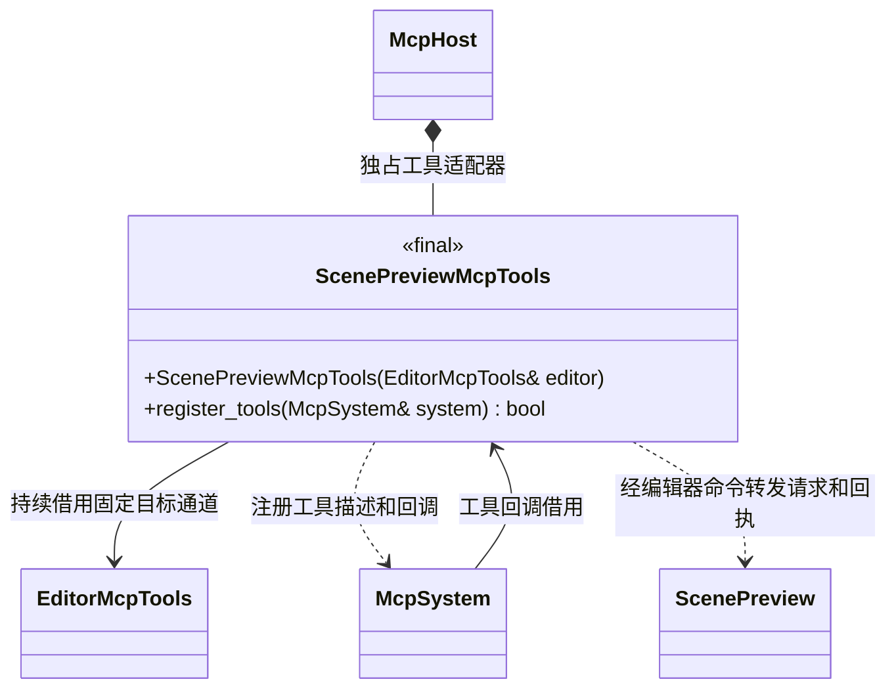

# 场景预览 MCP 适配

[类图索引](../../../class-diagrams/index.md) · [编辑器命令](../../../editor/class-diagrams/editor-commands.md)

- `ScenePreviewMcpTools` 属于 `engine::plugins::mcp`；构造为 `explicit`、`noexcept`，登记返回值标注 `[[nodiscard]]`。宿主保证它和借用的 `EditorMcpTools` 存活到 MCP 关闭。
- MCP 只描述参数并调用 `EditorMcpTools::call_command()`，不 include 编辑器预览类、不创建场景和相机、不扫描资源或驱动渲染。预览状态、导入刷新及退出释放由编辑器完成。工具仅在桌面编辑器目标登记。
- `open_scene_preview` 接收逻辑资源 `path`，可选 `camera` 对象包含 `position`、`rotation`、`speed`。位置和旋转分别为三个数字，旋转以度表示；相机移动速度为 0.01..1000 米/秒，默认 5。
- `set_preview_camera` 直接接收上述相机字段，至少一项；`close_scene_preview`、`get_scene_preview` 无参数。镜头不进入项目场景节点、场景查询或保存结果，修改镜头不将场景标为已编辑。
- `refresh_scene_preview` 接收可选 `discardChanges`，默认 false。未保存的编辑不被隐式丢弃，明确传 true 才允许替换。导入完成后，无未保存编辑的预览自动更新；有编辑时返回 `modified=true`、`reloadPending=true`，由调用方决定保存或明确刷新。
- 编辑器返回 `active`、`path`、`sceneId`、`camera`、`modified`、`reloadPending`、`lastError`；camera 含 position/rotation/speed，关闭时为 null、sceneId 为 "0"。MCP 保留原始执行回执，不把跨进程等待超时报告成操作完成。
- 预览不启动 Gameplay、物理模拟或音频播放。既有场景编辑命令直接修改同一预览场景，下一帧显示结果；关闭预览释放场景和 GPU 引用并恢复空白窗口。玩法运行与预览的切换由编辑器协调。
